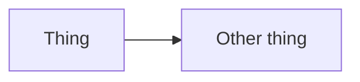

# Lab NN · Title

> **Outcome:** What exists at the end of this lab.

## Scenario

Problem, who has it, why the obvious approach fails.

## How it works

| Concept | Detail |
| --- | --- |

## Step 1 — …

## Verify

- [ ] …

## Clean up

## Learn more

- [Official docs](https://…)
- Next: [Lab NN+1 — …](../NN-next/README.md)
