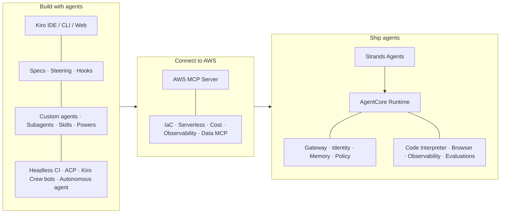

# Kiro Reinvent Labs

**Learn to build with Kiro by building real things with it**: 50 hands-on labs that take you from your first spec to governed, production agents on AWS.

[**🌐 Open the labs site**](https://akashtalole.github.io/Kiro-Reinvent/) · [Landscape report](docs/landscape.md) · [Advanced scenarios](docs/advanced-scenarios.md) · [AI-first SaaS playbook](docs/ai-first-saas-playbook.md) · [Kiro in the field](docs/kiro-in-the-field.md) · [Architecture patterns](docs/architecture-patterns.md) · [AWS MCP catalog](docs/aws-mcp-catalog.md) · [Setup](docs/setup.md)



## What's inside

| | |
| --- | --- |
| **Kiro** | Kiro IDE, Kiro CLI (V3 harness, headless, ACP), Kiro Web, the Kiro autonomous agent, **Kiro Crew** and Crew **bots**, plus specs, steering, hooks, custom agents, subagents, skills, powers and MCP |
| **AWS MCP servers** | The managed AWS MCP Server, AWS Knowledge, IaC, Serverless, Lambda Tool, Pricing, Billing, CloudWatch, Application Signals, CloudTrail, DynamoDB, Aurora, S3 Tables, Bedrock KB |
| **Strands Agents** | Tools, MCP, structured output, agents-as-tools, graph, swarm, A2A, hooks, evals |
| **Bedrock AgentCore** | Runtime, Gateway, Identity, Memory, Policy (Cedar), Code Interpreter, Browser, Observability, Evaluations, plus the `agentcore` CLI |
| **End-to-end builds** | Multi-tenant serverless SaaS, governed customer-support agent, AI SRE crew, legacy modernization, permissions-aware RAG assistant, org-wide agent platform |

Every lab is a folder with a README (scenario, diagram, steps, verify, clean up) and **runnable assets**: `.kiro/` configs, Python/TypeScript agents and CDK. The code was checked against the current SDKs (`strands-agents` 1.66, `bedrock-agentcore` 1.27, `@aws/agentcore` 1.2). The reference CDK app synthesizes cleanly under cdk-nag, and the A2A server, Runtime contract and AWS Knowledge MCP connection were exercised live.

## Labs

### Kiro foundations

| # | Lab | Level | Time |
| --- | --- | --- | --- |
| [01](labs/01-kiro-cli-quickstart/README.md) | [Kiro CLI quick start](labs/01-kiro-cli-quickstart/README.md) | Beginner | 15 min |
| [02](labs/02-steering-and-agents-md/README.md) | [Steering and AGENTS.md](labs/02-steering-and-agents-md/README.md) | Beginner | 20 min |
| [03](labs/03-spec-driven-development/README.md) | [Spec-driven development](labs/03-spec-driven-development/README.md) | Beginner | 45 min |
| [04](labs/04-agent-hooks/README.md) | [Agent hooks and guardrails](labs/04-agent-hooks/README.md) | Intermediate | 35 min |

### Customize Kiro

| # | Lab | Level | Time |
| --- | --- | --- | --- |
| [05](labs/05-custom-agents/README.md) | [Custom agents with scoped permissions](labs/05-custom-agents/README.md) | Intermediate | 40 min |
| [06](labs/06-subagents-and-parallel-work/README.md) | [Subagents and parallel work](labs/06-subagents-and-parallel-work/README.md) | Intermediate | 35 min |
| [07](labs/07-agent-skills/README.md) | [Agent skills](labs/07-agent-skills/README.md) | Intermediate | 30 min |
| [08](labs/08-build-a-kiro-power/README.md) | [Build a Kiro power](labs/08-build-a-kiro-power/README.md) | Intermediate | 40 min |
| [09](labs/09-mcp-servers-in-kiro/README.md) | [MCP servers in Kiro](labs/09-mcp-servers-in-kiro/README.md) | Beginner | 30 min |
| [40](labs/40-kiro-cli-persistent-memory/README.md) | [Field pattern: long-term memory for Kiro CLI with AgentCore Memory](labs/40-kiro-cli-persistent-memory/README.md) | Intermediate | 45 min |
| [41](labs/41-domain-skills-at-scale/README.md) | [Field pattern: domain skills at scale — coordinator, specialists, A/B evals](labs/41-domain-skills-at-scale/README.md) | Advanced | 60 min |

### Automate & scale

| # | Lab | Level | Time |
| --- | --- | --- | --- |
| [10](labs/10-headless-kiro-in-ci/README.md) | [Headless Kiro in CI/CD](labs/10-headless-kiro-in-ci/README.md) | Intermediate | 40 min |
| [11](labs/11-acp-editor-integration/README.md) | [ACP — Kiro inside any editor or app](labs/11-acp-editor-integration/README.md) | Advanced | 35 min |
| [12](labs/12-kiro-crew-workspace/README.md) | [Kiro Crew — your persistent agent workspace](labs/12-kiro-crew-workspace/README.md) | Intermediate | 45 min |
| [13](labs/13-kiro-crew-bots/README.md) | [Kiro Crew bots — always-on teammates](labs/13-kiro-crew-bots/README.md) | Intermediate | 50 min |
| [14](labs/14-kiro-autonomous-agent/README.md) | [The Kiro autonomous agent — issue to PR](labs/14-kiro-autonomous-agent/README.md) | Intermediate | 40 min |

### AWS MCP servers

| # | Lab | Level | Time |
| --- | --- | --- | --- |
| [15](labs/15-aws-mcp-server/README.md) | [The managed AWS MCP Server](labs/15-aws-mcp-server/README.md) | Beginner | 30 min |
| [16](labs/16-iac-with-mcp/README.md) | [Infrastructure as code with MCP](labs/16-iac-with-mcp/README.md) | Intermediate | 50 min |
| [17](labs/17-serverless-with-mcp/README.md) | [Serverless build-deploy-debug loop with MCP](labs/17-serverless-with-mcp/README.md) | Intermediate | 45 min |
| [18](labs/18-finops-with-mcp/README.md) | [FinOps with MCP — estimate, explain, optimize](labs/18-finops-with-mcp/README.md) | Beginner | 35 min |
| [19](labs/19-observability-with-mcp/README.md) | [Incident investigation with CloudWatch & CloudTrail MCP](labs/19-observability-with-mcp/README.md) | Intermediate | 45 min |
| [20](labs/20-data-with-mcp/README.md) | [Data modeling and querying with MCP](labs/20-data-with-mcp/README.md) | Intermediate | 45 min |
| [42](labs/42-work-management-mcp-in-the-dev-loop/README.md) | [Field pattern: project plans in the dev loop with a work-management MCP](labs/42-work-management-mcp-in-the-dev-loop/README.md) | Beginner | 30 min |

### Strands Agents

| # | Lab | Level | Time |
| --- | --- | --- | --- |
| [21](labs/21-strands-first-agent/README.md) | [Your first Strands agent](labs/21-strands-first-agent/README.md) | Beginner | 30 min |
| [22](labs/22-strands-mcp-tools/README.md) | [Strands agents with MCP tools](labs/22-strands-mcp-tools/README.md) | Intermediate | 30 min |
| [23](labs/23-strands-multi-agent/README.md) | [Multi-agent patterns — agents-as-tools, graph, swarm](labs/23-strands-multi-agent/README.md) | Advanced | 60 min |
| [24](labs/24-strands-a2a/README.md) | [A2A — agents across teams and frameworks](labs/24-strands-a2a/README.md) | Advanced | 40 min |
| [25](labs/25-strands-evals-and-guardrails/README.md) | [Evals, hooks and guardrails for Strands agents](labs/25-strands-evals-and-guardrails/README.md) | Advanced | 50 min |

### AgentCore

| # | Lab | Level | Time |
| --- | --- | --- | --- |
| [26](labs/26-agentcore-runtime/README.md) | [Deploy agents to AgentCore Runtime](labs/26-agentcore-runtime/README.md) | Intermediate | 45 min |
| [27](labs/27-agentcore-gateway/README.md) | [AgentCore Gateway — any API becomes an MCP tool](labs/27-agentcore-gateway/README.md) | Advanced | 60 min |
| [28](labs/28-agentcore-memory/README.md) | [AgentCore Memory — agents that remember](labs/28-agentcore-memory/README.md) | Intermediate | 40 min |
| [29](labs/29-agentcore-identity/README.md) | [AgentCore Identity — inbound and outbound auth for agents](labs/29-agentcore-identity/README.md) | Advanced | 50 min |
| [30](labs/30-agentcore-policy/README.md) | [AgentCore Policy — deterministic tool control with Cedar](labs/30-agentcore-policy/README.md) | Advanced | 50 min |
| [31](labs/31-agentcore-code-interpreter-browser/README.md) | [AgentCore Code Interpreter and Browser](labs/31-agentcore-code-interpreter-browser/README.md) | Intermediate | 40 min |
| [32](labs/32-agentcore-observability-evaluations/README.md) | [AgentCore Observability and Evaluations](labs/32-agentcore-observability-evaluations/README.md) | Advanced | 45 min |
| [43](labs/43-fullstack-agentcore-starter/README.md) | [Field pattern: full-stack agent app from the FAST starter, customized with Kiro](labs/43-fullstack-agentcore-starter/README.md) | Intermediate | 90 min |

### End-to-end solutions

| # | Lab | Level | Time |
| --- | --- | --- | --- |
| [33](labs/33-e2e-serverless-saas/README.md) | [E2E: Multi-tenant serverless SaaS, spec to production](labs/33-e2e-serverless-saas/README.md) | Advanced | 4 h |
| [34](labs/34-e2e-agentic-customer-support/README.md) | [E2E: Production agentic customer support on AgentCore](labs/34-e2e-agentic-customer-support/README.md) | Advanced | 5 h |
| [35](labs/35-e2e-sre-crew/README.md) | [E2E: An AI SRE crew — detect, investigate, fix, learn](labs/35-e2e-sre-crew/README.md) | Advanced | 4 h |
| [36](labs/36-e2e-legacy-modernization/README.md) | [E2E: Legacy monolith to serverless, spec by spec](labs/36-e2e-legacy-modernization/README.md) | Advanced | 6 h |
| [37](labs/37-e2e-enterprise-knowledge-assistant/README.md) | [E2E: Enterprise knowledge assistant with permissions-aware RAG](labs/37-e2e-enterprise-knowledge-assistant/README.md) | Advanced | 5 h |
| [38](labs/38-e2e-governed-agent-platform/README.md) | [E2E: A governed agent platform for your organization](labs/38-e2e-governed-agent-platform/README.md) | Advanced | 1 day |
| [39](labs/39-skill-driven-migration-engine/README.md) | [Field pattern: a skill-driven, parity-verified migration engine](labs/39-skill-driven-migration-engine/README.md) | Advanced | 3 h |
| [44](labs/44-kiro-in-sagemaker-model-customization/README.md) | [Field pattern: agent-guided model fine-tuning with Kiro in SageMaker AI](labs/44-kiro-in-sagemaker-model-customization/README.md) | Advanced | 3 h |

### AI-first SaaS

| # | Lab | Level | Time |
| --- | --- | --- | --- |
| [45](labs/45-ai-first-persona-kit/README.md) | [The AI-first team kit — a Kiro agent and skills for every persona](labs/45-ai-first-persona-kit/README.md) | Intermediate | 60 min |
| [46](labs/46-tenant-lifecycle-automation/README.md) | [Automate the tenant lifecycle with Kiro, skills and the AWS CLI](labs/46-tenant-lifecycle-automation/README.md) | Intermediate | 60 min |
| [47](labs/47-tenant-observability-cloudwatch-omni/README.md) | [Tenant-aware observability with CloudWatch Omni](labs/47-tenant-observability-cloudwatch-omni/README.md) | Advanced | 75 min |
| [48](labs/48-multi-tenant-ai-on-bedrock/README.md) | [Multi-tenant AI features on Bedrock — isolation, cost and budgets per tenant](labs/48-multi-tenant-ai-on-bedrock/README.md) | Advanced | 75 min |
| [49](labs/49-ai-sdlc-pipeline/README.md) | [The AI-first SDLC pipeline — every persona automated, humans at the gates](labs/49-ai-sdlc-pipeline/README.md) | Advanced | 90 min |
| [50](labs/50-ai-engineering-platform/README.md) | [An AI engineering platform for SaaS — routing, prompt versions, canaries, release gates](labs/50-ai-engineering-platform/README.md) | Advanced | 75 min |

## Advanced use cases and scenarios

The [**Scenarios**](https://akashtalole.github.io/Kiro-Reinvent/scenarios.html) page ([markdown version](docs/advanced-scenarios.md)) tells 16 end-to-end stories of an AI-first, multi-tenant SaaS team when things get hard. Each story shows the trigger, every step by agent, human or system, a flow diagram, guardrails, metrics to track, and the labs that teach each piece. You can filter them by domain, complexity and persona.

| Domain | Scenarios |
| --- | --- |
| Tenant lifecycle | Zero-touch enterprise onboarding with SSO and data residency |
| Reliability & operations | 2 a.m. noisy neighbour · multi-region failover game day · AWS + Azure incident in one Omni space |
| Security & compliance | Fleet-wide CVE remediation · right to erasure across data, search and AI memory · continuous audit evidence |
| AI engineering | Cross-tenant RAG leak caught in CI · model deprecation without a quality dip |
| Cost & FinOps | Runaway agent spend capped by budgets · repackaging tiers from unit economics |
| Delivery & SDLC | Customer ticket to deployed fix the same day · new AI feature from idea to GA in a sprint |
| Modernization | On-prem single-tenant installs into pooled SaaS · runtime end-of-life upgrade wave |
| Integration & ecosystem | B2B agent-to-agent integration with a partner |

Like the tracks on a lab page, every scenario has a **✓ happy path** with a checkpoint on each step and collapsible *Troubleshoot N known errors* panels (symptom → cause → fix), plus **alternate paths**: ✗ failures, ◇ edge cases and ↪ variations. Each alternate path shows where it branches from the happy path and how it ends. Readers can tick steps as done and track their progress. That adds up to 45 paths and 36 known-error fixes.

The scenarios live in `site/data/scenarios.json`. The build validates every lab reference, and CI checks that the markdown version is in sync.

## AI-first SaaS on AWS

The **AI-first SaaS** track (labs 45–50) and the [AI-first SaaS playbook](docs/ai-first-saas-playbook.md) show how a multi-tenant SaaS company automates the work of **every persona**: product, architecture, engineering, AI engineering, QA, SRE, security, FinOps, support and tenant operations. It uses Kiro (skills, custom agents, hooks, Crew bots, autonomous agent, headless CI), MCP, Agent Toolkit for AWS and the AWS CLI. The full AI stack on AWS covers Bedrock, Strands, AgentCore, SageMaker AI and Amazon Quick, with **Amazon CloudWatch Omni**, AgentCore Evaluations and AWS DevOps Agent for observability.

| Lab | What gets automated |
| --- | --- |
| 45 Persona kit | A scoped Kiro agent and tenant-aware skill per persona (PRD→spec, tenancy review, isolation tests, runbooks, tenant cost, ticket→repro, AI eval gate) |
| 46 Tenant lifecycle | Onboard, suspend and offboard via an idempotent AWS CLI script driven by a skill, a guard hook and a Crew bot |
| 47 Observability | Per-tenant EMF metrics, `tenant.id` traces, CloudWatch Omni spaces, the Omni extension in Kiro, per-tier anomaly alarms, DevOps Agent root cause |
| 48 Multi-tenant AI | Per-tenant Bedrock inference profiles, tenant-filtered RAG, scoped memory, atomic token budgets, Cedar tenant rules |
| 49 AI SDLC pipeline | Spec gate, isolation tests, AI tenancy review, AI cost diff, Security Agent, dev deploy, AI release notes |
| 50 AI platform | Tier-aware model routing, versioned prompts, per-tenant canaries, eval-based release gate |

The home page opens with a **clickable architecture diagram**: personas, the Kiro agent platform, AWS for agents, AI on AWS, enterprise controls and observability. Hovering over any part previews the lab that teaches it.

## From the field: how AWS teams use Kiro

Every post in the [AWS ML Blog's Kiro category](https://aws.amazon.com/blogs/machine-learning/category/artificial-intelligence/kiro/) is analyzed in [docs/kiro-in-the-field.md](docs/kiro-in-the-field.md) and mapped to a lab:

| Post | How Kiro is used | Lab |
| --- | --- | --- |
| [Repeatable PHP-to-Java migration engine](https://aws.amazon.com/blogs/machine-learning/build-a-repeatable-php-to-java-migration-engine-with-kiro/) (Oct 2026) | Skills + steering encode an 8-phase, parity-verified methodology; AWS Transform runs the same skills at portfolio scale. | [39](labs/39-skill-driven-migration-engine/README.md) |
| [Workflow context with Smartsheet MCP](https://aws.amazon.com/blogs/machine-learning/workflow-context-for-ai-agents-with-smartsheet-mcp-on-aws/) (Oct 2026) | Remote MCP in mcp.json; specs from roadmap rows; a hook marks tasks Complete on commit. | [42](labs/42-work-management-mcp-in-the-dev-loop/README.md) |
| [HCLS reasoning with open-source agent skills](https://aws.amazon.com/blogs/machine-learning/improving-hcls-ai-reasoning-with-open-source-agent-skills/) (Sep 2026) | 38 skills; Kiro CLI coordinator + 8 specialists; skills won 70–86% of head-to-head comparisons. | [41](labs/41-domain-skills-at-scale/README.md) |
| [AI as accessibility](https://aws.amazon.com/blogs/machine-learning/when-your-brain-works-differently-ai-isnt-a-luxury-its-accessibility/) (Jul 2026) | A neurodivergent architect built a custom MCP server with Kiro; triage rules live in Markdown. | [40](labs/40-kiro-cli-persistent-memory/README.md) |
| [ProServe became a frontier team](https://aws.amazon.com/blogs/machine-learning/built-from-the-inside-out-how-aws-professional-services-became-a-frontier-team-first/) (Jun 2026) | AI-DLC: specs as source of truth, steering as first-order artifacts, parallel agents, shift-left testing. | [38](labs/38-e2e-governed-agent-platform/README.md) |
| [Research assistants with Strands](https://aws.amazon.com/blogs/machine-learning/from-idea-to-ai-app-creating-intelligent-research-assistants-with-strands/) (May 2026) | The Strands power grounds Kiro's code generation; a Streamlit + Strands app from one prompt. | [21](labs/21-strands-first-agent/README.md) |
| [Kiro CLI memory with AgentCore Memory](https://aws.amazon.com/blogs/machine-learning/extending-conversational-memory-in-kiro-cli-using-amazon-bedrock-agentcore-memory/) (May 2026) | Custom MCP server + default custom agent + hooks give Kiro CLI memory across sessions. | [40](labs/40-kiro-cli-persistent-memory/README.md) |
| [Agent-guided model customization in SageMaker AI](https://aws.amazon.com/blogs/machine-learning/agent-guided-workflows-to-accelerate-model-customization-in-amazon-sagemaker-ai/) (May 2026) | Kiro pre-configured over ACP in JupyterLab; 9 skills drive SFT/DPO/RLVR, eval and deploy. | [44](labs/44-kiro-in-sagemaker-model-customization/README.md) |
| [Full-stack starter template for AgentCore (FAST)](https://aws.amazon.com/blogs/machine-learning/accelerate-agentic-application-development-with-a-full-stack-starter-template-for-amazon-bedrock-agentcore/) (Feb 2026) | A CDK template shipped with steering docs so Kiro extends it along documented patterns. | [43](labs/43-fullstack-agentcore-starter/README.md) |

## Learning paths

Eight role-based paths (essentials in an afternoon, field patterns from AWS, AI-first SaaS organization, Kiro power user, platform engineer, agent developer, security & governance, FinOps & operations) are listed on the [site](https://akashtalole.github.io/Kiro-Reinvent/#paths) and defined in [`site/data/catalog.json`](site/data/catalog.json).

## Run the site locally

```bash
python scripts/build_site.py --serve     # → http://localhost:8000
```

The site is plain HTML, CSS and JS in [`site/`](site/), generated from lab front matter by [`scripts/build_site.py`](scripts/build_site.py). It uses no framework and has no dependencies beyond Python 3.9+.

## Publish to GitHub Pages

1. Go to **Settings → Pages → Build and deployment → Source** and choose **GitHub Actions**.
2. Push to `main`. [`.github/workflows/pages.yml`](.github/workflows/pages.yml) validates every lab, builds `_site/` and deploys it. Pull requests run the same validation without deploying.

## Contributing

Read the [authoring guide](docs/authoring.md), or let Kiro do it with the bundled skill:

```text
> /lab-creator AgentCore Payments: give an agent a wallet with spending limits
```

This repo is itself configured for Kiro: see [`.kiro/steering/`](.kiro/steering/), [`.kiro/skills/lab-creator/`](.kiro/skills/lab-creator/SKILL.md) and a hook that rebuilds the site whenever a lab is saved.

## Disclaimer

This is a community project. It is not affiliated with, endorsed by, or an official resource of Amazon Web Services. Product names are trademarks of their respective owners. Several features covered here were in preview in November 2026, so verify details against the linked official documentation before you use them in production. MIT licensed.
