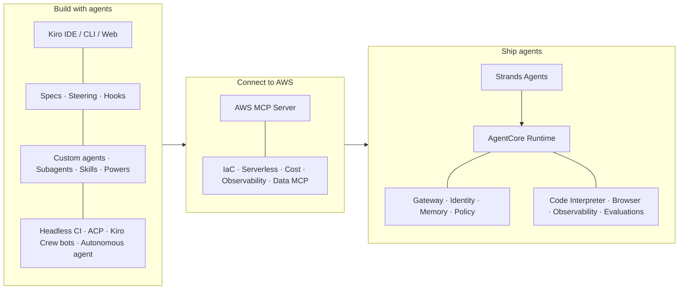

# Kiro Reinvent Labs

**Learn to build with Kiro by building real things with it**: 38 hands-on labs that take you from your first spec to governed, production agents on AWS.

[**🌐 Open the labs site**](https://akashtalole.github.io/Kiro-Reinvent/) · [Landscape report](docs/landscape.md) · [Architecture patterns](docs/architecture-patterns.md) · [AWS MCP catalog](docs/aws-mcp-catalog.md) · [Setup](docs/setup.md)



## What's inside

| | |
| --- | --- |
| **Kiro** | Kiro IDE, Kiro CLI (V3 harness, headless, ACP), Kiro Web, the Kiro autonomous agent, **Kiro Crew** and Crew **bots**, plus specs, steering, hooks, custom agents, subagents, skills, powers and MCP |
| **AWS MCP servers** | The managed AWS MCP Server, AWS Knowledge, IaC, Serverless, Lambda Tool, Pricing, Billing, CloudWatch, Application Signals, CloudTrail, DynamoDB, Aurora, S3 Tables, Bedrock KB |
| **Strands Agents** | Tools, MCP, structured output, agents-as-tools, graph, swarm, A2A, hooks, evals |
| **Bedrock AgentCore** | Runtime, Gateway, Identity, Memory, Policy (Cedar), Code Interpreter, Browser, Observability, Evaluations, plus the `agentcore` CLI |
| **End-to-end builds** | Multi-tenant serverless SaaS, governed customer-support agent, AI SRE crew, legacy modernization, permissions-aware RAG assistant, org-wide agent platform |

Every lab is a folder with a README (scenario, diagram, steps, verify, clean up) and **runnable assets**: `.kiro/` configs, Python/TypeScript agents and CDK. The code was checked against the current SDKs (`strands-agents` 1.66, `bedrock-agentcore` 1.27, `@aws/agentcore` 1.2). The reference CDK app synthesizes cleanly under cdk-nag, and the A2A server, Runtime contract and AWS Knowledge MCP connection were exercised live.

## Labs

### Kiro foundations

| # | Lab | Level | Time |
| --- | --- | --- | --- |
| [01](labs/01-kiro-cli-quickstart/README.md) | [Kiro CLI quick start](labs/01-kiro-cli-quickstart/README.md) | Beginner | 15 min |
| [02](labs/02-steering-and-agents-md/README.md) | [Steering and AGENTS.md](labs/02-steering-and-agents-md/README.md) | Beginner | 20 min |
| [03](labs/03-spec-driven-development/README.md) | [Spec-driven development](labs/03-spec-driven-development/README.md) | Beginner | 45 min |
| [04](labs/04-agent-hooks/README.md) | [Agent hooks and guardrails](labs/04-agent-hooks/README.md) | Intermediate | 35 min |

### Customize Kiro

| # | Lab | Level | Time |
| --- | --- | --- | --- |
| [05](labs/05-custom-agents/README.md) | [Custom agents with scoped permissions](labs/05-custom-agents/README.md) | Intermediate | 40 min |
| [06](labs/06-subagents-and-parallel-work/README.md) | [Subagents and parallel work](labs/06-subagents-and-parallel-work/README.md) | Intermediate | 35 min |
| [07](labs/07-agent-skills/README.md) | [Agent skills](labs/07-agent-skills/README.md) | Intermediate | 30 min |
| [08](labs/08-build-a-kiro-power/README.md) | [Build a Kiro power](labs/08-build-a-kiro-power/README.md) | Intermediate | 40 min |
| [09](labs/09-mcp-servers-in-kiro/README.md) | [MCP servers in Kiro](labs/09-mcp-servers-in-kiro/README.md) | Beginner | 30 min |

### Automate & scale

| # | Lab | Level | Time |
| --- | --- | --- | --- |
| [10](labs/10-headless-kiro-in-ci/README.md) | [Headless Kiro in CI/CD](labs/10-headless-kiro-in-ci/README.md) | Intermediate | 40 min |
| [11](labs/11-acp-editor-integration/README.md) | [ACP — Kiro inside any editor or app](labs/11-acp-editor-integration/README.md) | Advanced | 35 min |
| [12](labs/12-kiro-crew-workspace/README.md) | [Kiro Crew — your persistent agent workspace](labs/12-kiro-crew-workspace/README.md) | Intermediate | 45 min |
| [13](labs/13-kiro-crew-bots/README.md) | [Kiro Crew bots — always-on teammates](labs/13-kiro-crew-bots/README.md) | Intermediate | 50 min |
| [14](labs/14-kiro-autonomous-agent/README.md) | [The Kiro autonomous agent — issue to PR](labs/14-kiro-autonomous-agent/README.md) | Intermediate | 40 min |

### AWS MCP servers

| # | Lab | Level | Time |
| --- | --- | --- | --- |
| [15](labs/15-aws-mcp-server/README.md) | [The managed AWS MCP Server](labs/15-aws-mcp-server/README.md) | Beginner | 30 min |
| [16](labs/16-iac-with-mcp/README.md) | [Infrastructure as code with MCP](labs/16-iac-with-mcp/README.md) | Intermediate | 50 min |
| [17](labs/17-serverless-with-mcp/README.md) | [Serverless build-deploy-debug loop with MCP](labs/17-serverless-with-mcp/README.md) | Intermediate | 45 min |
| [18](labs/18-finops-with-mcp/README.md) | [FinOps with MCP — estimate, explain, optimize](labs/18-finops-with-mcp/README.md) | Beginner | 35 min |
| [19](labs/19-observability-with-mcp/README.md) | [Incident investigation with CloudWatch & CloudTrail MCP](labs/19-observability-with-mcp/README.md) | Intermediate | 45 min |
| [20](labs/20-data-with-mcp/README.md) | [Data modeling and querying with MCP](labs/20-data-with-mcp/README.md) | Intermediate | 45 min |

### Strands Agents

| # | Lab | Level | Time |
| --- | --- | --- | --- |
| [21](labs/21-strands-first-agent/README.md) | [Your first Strands agent](labs/21-strands-first-agent/README.md) | Beginner | 30 min |
| [22](labs/22-strands-mcp-tools/README.md) | [Strands agents with MCP tools](labs/22-strands-mcp-tools/README.md) | Intermediate | 30 min |
| [23](labs/23-strands-multi-agent/README.md) | [Multi-agent patterns — agents-as-tools, graph, swarm](labs/23-strands-multi-agent/README.md) | Advanced | 60 min |
| [24](labs/24-strands-a2a/README.md) | [A2A — agents across teams and frameworks](labs/24-strands-a2a/README.md) | Advanced | 40 min |
| [25](labs/25-strands-evals-and-guardrails/README.md) | [Evals, hooks and guardrails for Strands agents](labs/25-strands-evals-and-guardrails/README.md) | Advanced | 50 min |

### AgentCore

| # | Lab | Level | Time |
| --- | --- | --- | --- |
| [26](labs/26-agentcore-runtime/README.md) | [Deploy agents to AgentCore Runtime](labs/26-agentcore-runtime/README.md) | Intermediate | 45 min |
| [27](labs/27-agentcore-gateway/README.md) | [AgentCore Gateway — any API becomes an MCP tool](labs/27-agentcore-gateway/README.md) | Advanced | 60 min |
| [28](labs/28-agentcore-memory/README.md) | [AgentCore Memory — agents that remember](labs/28-agentcore-memory/README.md) | Intermediate | 40 min |
| [29](labs/29-agentcore-identity/README.md) | [AgentCore Identity — inbound and outbound auth for agents](labs/29-agentcore-identity/README.md) | Advanced | 50 min |
| [30](labs/30-agentcore-policy/README.md) | [AgentCore Policy — deterministic tool control with Cedar](labs/30-agentcore-policy/README.md) | Advanced | 50 min |
| [31](labs/31-agentcore-code-interpreter-browser/README.md) | [AgentCore Code Interpreter and Browser](labs/31-agentcore-code-interpreter-browser/README.md) | Intermediate | 40 min |
| [32](labs/32-agentcore-observability-evaluations/README.md) | [AgentCore Observability and Evaluations](labs/32-agentcore-observability-evaluations/README.md) | Advanced | 45 min |

### End-to-end solutions

| # | Lab | Level | Time |
| --- | --- | --- | --- |
| [33](labs/33-e2e-serverless-saas/README.md) | [E2E: Multi-tenant serverless SaaS, spec to production](labs/33-e2e-serverless-saas/README.md) | Advanced | 4 h |
| [34](labs/34-e2e-agentic-customer-support/README.md) | [E2E: Production agentic customer support on AgentCore](labs/34-e2e-agentic-customer-support/README.md) | Advanced | 5 h |
| [35](labs/35-e2e-sre-crew/README.md) | [E2E: An AI SRE crew — detect, investigate, fix, learn](labs/35-e2e-sre-crew/README.md) | Advanced | 4 h |
| [36](labs/36-e2e-legacy-modernization/README.md) | [E2E: Legacy monolith to serverless, spec by spec](labs/36-e2e-legacy-modernization/README.md) | Advanced | 6 h |
| [37](labs/37-e2e-enterprise-knowledge-assistant/README.md) | [E2E: Enterprise knowledge assistant with permissions-aware RAG](labs/37-e2e-enterprise-knowledge-assistant/README.md) | Advanced | 5 h |
| [38](labs/38-e2e-governed-agent-platform/README.md) | [E2E: A governed agent platform for your organization](labs/38-e2e-governed-agent-platform/README.md) | Advanced | 1 day |

## Learning paths

Six role-based paths (essentials in an afternoon, Kiro power user, platform engineer, agent developer, security & governance, FinOps & operations) are listed on the [site](https://akashtalole.github.io/Kiro-Reinvent/#paths) and defined in [`site/data/catalog.json`](site/data/catalog.json).

## Run the site locally

```bash
python scripts/build_site.py --serve     # → http://localhost:8000
```

The site is plain HTML, CSS and JS in [`site/`](site/), generated from lab front matter by [`scripts/build_site.py`](scripts/build_site.py). It uses no framework and has no dependencies beyond Python 3.9+.

## Publish to GitHub Pages

1. Go to **Settings → Pages → Build and deployment → Source** and choose **GitHub Actions**.
2. Push to `main`. [`.github/workflows/pages.yml`](.github/workflows/pages.yml) validates every lab, builds `_site/` and deploys it. Pull requests run the same validation without deploying.

## Contributing

Read the [authoring guide](docs/authoring.md), or let Kiro do it with the bundled skill:

```text
> /lab-creator AgentCore Payments: give an agent a wallet with spending limits
```

This repo is itself configured for Kiro: see [`.kiro/steering/`](.kiro/steering/), [`.kiro/skills/lab-creator/`](.kiro/skills/lab-creator/SKILL.md) and a hook that rebuilds the site whenever a lab is saved.

## Disclaimer

This is a community project. It is not affiliated with, endorsed by, or an official resource of Amazon Web Services. Product names are trademarks of their respective owners. Several features covered here were in preview in November 2026, so verify details against the linked official documentation before you use them in production. MIT licensed.
