# Advanced use cases and scenarios

> Generated from `site/data/scenarios.json` by `scripts/gen_scenarios_md.py`. Edit the JSON, not this file.

End-to-end stories showing how an AI-first, multi-tenant SaaS team uses Kiro, skills, MCP, the AWS CLI, Bedrock, AgentCore and CloudWatch Omni when things get hard. Each scenario lists the trigger, who does what (🤖 agent · 🧑 human · ⚙️ system), the guardrails, the outcome, the metrics to track, and the labs that teach every piece. Like a lab with tracks, every scenario has a **happy path** with a checkpoint on each step and troubleshooting for known errors, plus **alternate paths**: failures, edge cases and variations, showing where they branch and how they end. The metrics are what to measure, not promised results.

| Scenario | Domain | Complexity | Personas |
| --- | --- | --- | --- |
| [Zero-touch enterprise onboarding with SSO and data residency](#enterprise-onboarding-residency) | Tenant lifecycle | Expert | Tenant operations, Architect, Security, Sales ops |
| [2 a.m. noisy neighbour, mitigated in minutes](#noisy-neighbour-2am) | Reliability & operations | Advanced | SRE, Support, Account manager |
| [A cross-tenant RAG leak caught before release](#rag-leak-caught) | AI engineering | Advanced | AI engineer, QA, Security |
| [Model deprecation: migrate every tenant without a quality dip](#model-deprecation-wave) | AI engineering | Expert | AI engineer, FinOps, Product manager |
| [Runaway agent spend stopped at the budget, not the invoice](#runaway-agent-cost) | Cost & FinOps | Advanced | FinOps, SRE, Account manager |
| [Critical CVE across 40 services, patched by an agent fleet](#cve-fleet-remediation) | Security & compliance | Expert | Security, Developer, Release manager |
| [Customer ticket to deployed fix the same day](#ticket-to-fix-same-day) | Delivery & SDLC | Advanced | Support, Developer, QA, Release manager |
| [Right to erasure across data, search, memory and model logs](#gdpr-erasure) | Security & compliance | Expert | Security / DPO, Tenant operations, AI engineer |
| [New AI feature from idea to GA in one sprint](#idea-to-ga-ai-feature) | Delivery & SDLC | Advanced | Product manager, AI engineer, Architect, QA, FinOps |
| [Migrating on-prem single-tenant customers into the pooled SaaS](#single-tenant-to-pooled) | Modernization | Expert | Architect, Tenant operations, QA, Customer success |
| [Multi-region failover game day run by agents](#multi-region-gameday) | Reliability & operations | Expert | SRE, Architect, Leadership |
| [Repackaging tiers from real unit economics](#pricing-from-unit-economics) | Cost & FinOps | Advanced | FinOps, Product manager, Leadership |
| [Incident spanning AWS and Azure-hosted tenants](#hybrid-cloud-incident) | Reliability & operations | Expert | SRE, Support |
| [B2B agent-to-agent integration with a partner](#partner-agent-integration) | Integration & ecosystem | Expert | Architect, Security, Partner manager |
| [Platform upgrade wave: runtime end of life across every stack](#runtime-eol-upgrade-wave) | Modernization | Advanced | Platform engineer, SRE, Release manager |
| [Continuous audit evidence for SOC 2 and enterprise security reviews](#audit-evidence-pack) | Security & compliance | Advanced | Security / compliance, Sales engineering |

## Zero-touch enterprise onboarding with SSO and data residency

*Tenant lifecycle · Expert · Tenant operations, Architect, Security, Sales ops*

A signed enterprise contract becomes a dedicated, region-pinned, SSO-enabled tenant by the next morning, with no tickets.

**Trigger:** A deal closes in the CRM: Enterprise tier, EU data residency, customer IdP (Entra ID) for SSO.

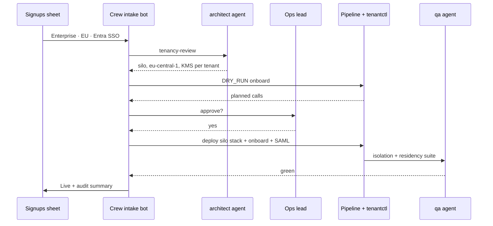

### ✓ Happy path

| # | Who | Does | With | Checkpoint |
| --- | --- | --- | --- | --- |
| 1 | 🤖 Crew intake bot | Reads the new row in the Signups sheet, then validates the contract fields: tier, region and IdP metadata URL. | Smartsheet MCP, tenant-ops skill | The row has a valid tier, region and IdP metadata URL; the bot comments 'Validated'. |
| 2 | 🤖 architect agent | Runs tenancy-review on the request. Enterprise means the silo model: a dedicated stack pinned to eu-central-1 and a KMS key per tenant. | tenancy-review skill, AWS Knowledge MCP | Review output: model = silo, region = eu-central-1, KMS key per tenant; no blocking findings. |
| 3 | ⚙️ tenantctl | Dry run: tenant record, admin user with custom:tenantId, usage plan, Bedrock application inference profile in the EU region. | AWS CLI, tenantctl.sh | Dry-run output lists the tenant record, admin user, usage plan key and inference profile, all in eu-central-1. |
| 4 | 🧑 Tenant ops lead | Approves the plan in the Slack thread. | Kiro Crew channel | Approval recorded in the thread with the approver's name and a timestamp. |
| 5 | ⚙️ Pipeline | Deploys the silo stack with CDK in the EU account, then runs onboarding and registers the customer IdP as a Cognito SAML provider. | AWS CDK, Cognito, tenantctl.sh | `cdk deploy` succeeds; `tenantctl.sh status t-…` shows ACTIVE; a SAML provider exists in the tenant's user pool. |
| 6 | 🤖 qa agent | Runs the isolation and residency smoke suite: no data outside the EU, and cross-tenant probes return 403/404. | tenant-isolation-tests skill | Isolation suite green; the residency check finds no resources or objects outside eu-central-1. |
| 7 | 🤖 Crew intake bot | Posts a welcome pack and an audit summary on the row, then sets Status = Live. | Smartsheet MCP | Row status = Live with an audit summary comment. |

Troubleshoot 4 known errors

| Step | Symptom | Cause | Fix |
| --- | --- | --- | --- |
| 3 | The dry run shows us-east-1 resources | AWS_REGION was not set from the tenant record | Export the region from the tenant record before calling tenantctl; add a region check to the skill. |
| 3 | `create-inference-profile` fails with ValidationException | The base model ARN isn't available in the target region | Use the region's model or inference-profile ARN; list them with `aws bedrock list-inference-profiles`. |
| 5 | Users get a SAML error on first login | IdP metadata URL or attribute mapping is wrong | Re-import the metadata; map the IdP group claim to `custom:tenantId` only through a trusted pre-token Lambda, never user-editable. |
| 6 | Residency check flags a CloudWatch log group in us-east-1 | A global service (or default) wrote logs outside the region | Pin logging destinations in the silo stack; add an SCP denying other regions for the tenant account. |

### ✗ Approval denied: contract mismatch (failure)

**When:** The ops lead spots that the contract says premium, not enterprise · **branches at step 4**

| # | Who | Does | Checkpoint |
| --- | --- | --- | --- |
| 4.1 | 🧑 Tenant ops lead | Rejects with a reason in the thread. | Rejection reason recorded; no AWS calls were made after the dry run. |
| 4.2 | 🤖 Crew intake bot | Sets the row to 'Needs sales review', tags the account owner and stops. | Row status updated; the bot doesn't retry automatically. |
| 4.3 | 🧑 Sales ops | Fixes the tier in the CRM, which re-queues the row. | The next bot run starts again at step 1. |

**Path outcome:** Nothing is provisioned on bad input; the record of why is on the row.

### ✗ Residency test fails after provisioning (failure)

**When:** The qa agent finds tenant data replicated to another region · **branches at step 6**

| # | Who | Does | Checkpoint |
| --- | --- | --- | --- |
| 6.1 | 🤖 qa agent | Reports the failing object or resource and blocks the Live status. | Row stays 'Provisioning'; the finding is linked. |
| 6.2 | 🤖 architect agent | Finds the cause (e.g. a cross-region backup rule) and proposes an IaC fix. | A PR with the region-pinned config and a test. |
| 6.3 | ⚙️ Pipeline | Redeploys the stack and deletes the out-of-region copy, then re-runs the suite. | Suite green; row moves to Live. |
| 6.4 | 🧑 Security | Confirms the deletion evidence for the customer's DPA file. | Evidence attached to the tenant record. |

**Path outcome:** The violation is caught before go-live and documented.

### ◇ Edge case: tenant id already exists (edge)

**When:** The customer already had a basic-tier trial under the same id · **branches at step 3**

| # | Who | Does | Checkpoint |
| --- | --- | --- | --- |
| 3.1 | ⚙️ tenantctl | Conditional put fails, so it logs `onboard.exists` and continues idempotently. | No overwrite of the existing record. |
| 3.2 | 🤖 Crew intake bot | Treats it as an upgrade: plans a tier change and silo migration instead of a new tenant. | Plan shows upgrade + data migration steps. |
| 3.3 | 🧑 Tenant ops lead | Approves the upgrade plan. | Approval recorded. |

**Path outcome:** The trial becomes the enterprise tenant without duplicate identities.

**Guardrails:** Silo deploys need a human approval · Region allow-list per tenant record; SCPs deny other regions in the tenant account · Onboarding is idempotent (conditional writes) · Every step logged with the approver

**Outcome:** Enterprise tenants go live in hours, not weeks, and every one is provisioned the same way.

**Metrics to track:** Contract-to-live time · Onboarding steps done by a human · Residency violations found by tests (target 0)

**Labs:** [46 Automate the tenant lifecycle with Kiro, skills and the AWS CLI](../labs/46-tenant-lifecycle-automation/README.md) · [45 The AI-first team kit — a Kiro agent and skills for every persona](../labs/45-ai-first-persona-kit/README.md) · [33 E2E: Multi-tenant serverless SaaS, spec to production](../labs/33-e2e-serverless-saas/README.md) · [42 Field pattern: project plans in the dev loop with a work-management MCP](../labs/42-work-management-mcp-in-the-dev-loop/README.md) · [13 Kiro Crew bots — always-on teammates](../labs/13-kiro-crew-bots/README.md) · [29 AgentCore Identity — inbound and outbound auth for agents](../labs/29-agentcore-identity/README.md)

**AWS & Kiro services:** Kiro Crew, Smartsheet MCP, AWS CLI, AWS CDK, Amazon Cognito, Amazon Bedrock, AWS KMS, AWS Organizations SCPs

## 2 a.m. noisy neighbour, mitigated in minutes

*Reliability & operations · Advanced · SRE, Support, Account manager*

One tenant's batch job degrades every premium tenant. Agents find it, propose a scoped throttle, and the on-call engineer approves from their phone.

**Trigger:** A CloudWatch anomaly alarm fires: premium-tier p95 latency is above its band.

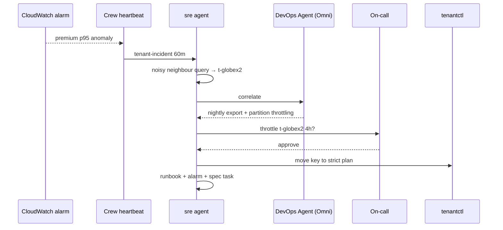

### ✓ Happy path

| # | Who | Does | With | Checkpoint |
| --- | --- | --- | --- | --- |
| 1 | 🤖 Crew heartbeat | Sees the alarm and starts the sre agent with the tenant-incident skill for the last 60 minutes. | Kiro Crew, CloudWatch alarms | An incident thread exists; the agent posts 'Investigating premium p95, window 01:10–02:10 UTC'. |
| 2 | 🤖 sre agent | Scopes the problem to the premium tier. The noisy-neighbour query shows t-globex2 at 61% of requests and 9x its usual AI tokens. | tenant-incident skill, CloudWatch Logs Insights, CloudWatch Omni | Query output shows one tenant with a disproportionate share of Requests/AITokens in the window. |
| 3 | 🤖 AWS DevOps Agent | Correlates the spike with t-globex2's new nightly export job and shared DynamoDB partition throttling. | CloudWatch Omni root cause | Root cause hypothesis names a specific change (new job) and resource (partition), with trace links. |
| 4 | 🤖 sre agent | Proposes a mitigation: move t-globex2's API key to a stricter usage plan for 4 hours. No global change. | tenantctl.sh (dry run) | Dry-run shows a single API key moving to the strict plan with an expiry time. |
| 5 | 🧑 On-call SRE | Approves on mobile. The throttle is applied, and premium p95 recovers within 6 minutes. | Kiro mobile / Slack | Premium p95 back inside the anomaly band within 10 minutes. |
| 6 | 🤖 support agent | Drafts a customer-safe note to t-globex2's account manager explaining the throttle and suggesting off-peak scheduling. | ticket-to-repro skill | Draft message is in the account manager's queue, not sent. |
| 7 | 🤖 sre agent | Runs runbook-from-incident, which produces a per-tenant write-capacity alarm and a spec task for adaptive throttling. | runbook-from-incident skill | PR with the new alarm + a spec task exists and links the incident. |

Troubleshoot 3 known errors

| Step | Symptom | Cause | Fix |
| --- | --- | --- | --- |
| 2 | Query returns no TenantId values | Service isn't emitting EMF with the TenantId dimension | Add `emit_usage()` from lab 47; meanwhile filter by the tenant claim in access logs. |
| 2 | Every tenant looks equally busy | Cause is shared infrastructure, not a tenant | Take the 'Not a tenant' path: investigate dependencies and deployments instead. |
| 5 | p95 doesn't recover after the throttle | The tenant's traffic wasn't the real cause, or a backlog is still draining | Check queue depth and DynamoDB throttles; revert the throttle if it didn't help. |

### ↪ Not a tenant: a bad deploy (alternate)

**When:** No tenant stands out; all premium tenants are slow equally · **branches at step 2**

| # | Who | Does | Checkpoint |
| --- | --- | --- | --- |
| 2.1 | 🤖 sre agent | Checks deployments and config changes in the window via CloudTrail and the pipeline history. | Finds a deploy 12 minutes before the alarm. |
| 2.2 | 🤖 AWS DevOps Agent | Correlates the latency with a new N+1 query in that release. | Root cause with trace evidence. |
| 2.3 | 🧑 On-call SRE | Rolls back the release. | p95 recovers; the rollback is recorded. |
| 2.4 | 🤖 sre agent | Runbook + regression test task; adds a latency gate to the pipeline. | PR adds a performance check. |

**Path outcome:** The fix is a rollback, not a throttle. The skill's scope check prevents punishing an innocent tenant.

### ◇ Edge case: the noisy tenant is enterprise (edge)

**When:** The tenant causing the load has an enterprise SLA · **branches at step 4**

| # | Who | Does | Checkpoint |
| --- | --- | --- | --- |
| 4.1 | 🤖 sre agent | Proposes isolating the workload instead of throttling (e.g. dedicated queue or capacity), because throttling would breach the SLA. | Two options with SLA impact noted. |
| 4.2 | 🧑 Incident commander | Chooses temporary dedicated capacity and pages the account manager. | Decision logged. |
| 4.3 | ⚙️ Pipeline | Deploys the dedicated consumer for that tenant. | Other tenants recover; the enterprise tenant keeps its SLA. |

**Path outcome:** Tier-aware mitigation that respects contracts.

### ✗ Nobody approves within 15 minutes (failure)

**When:** The on-call engineer doesn't respond · **branches at step 5**

| # | Who | Does | Checkpoint |
| --- | --- | --- | --- |
| 5.1 | 🤖 Crew heartbeat | Escalates to the secondary on-call through the paging tool; does not apply the throttle itself. | Escalation sent; no automatic mutation. |
| 5.2 | 🧑 Secondary on-call | Approves the throttle. | Approval recorded; mitigation proceeds from step 5. |

**Path outcome:** Agents never self-approve mutations; escalation is automatic.

**Guardrails:** Investigation is read-only · Mitigation is scoped to one tenant and time-boxed · A human approves every throttle change · The customer message is reviewed before it is sent

**Outcome:** One tenant is temporarily limited instead of every tenant degrading, and the class of incident is prevented next time.

**Metrics to track:** Time to tenant attribution · MTTR per tier · Tenants affected per incident

**Labs:** [47 Tenant-aware observability with CloudWatch Omni](../labs/47-tenant-observability-cloudwatch-omni/README.md) · [45 The AI-first team kit — a Kiro agent and skills for every persona](../labs/45-ai-first-persona-kit/README.md) · [46 Automate the tenant lifecycle with Kiro, skills and the AWS CLI](../labs/46-tenant-lifecycle-automation/README.md) · [12 Kiro Crew — your persistent agent workspace](../labs/12-kiro-crew-workspace/README.md) · [35 E2E: An AI SRE crew — detect, investigate, fix, learn](../labs/35-e2e-sre-crew/README.md) · [19 Incident investigation with CloudWatch & CloudTrail MCP](../labs/19-observability-with-mcp/README.md)

**AWS & Kiro services:** Amazon CloudWatch Omni, AWS DevOps Agent, CloudWatch Logs Insights, Amazon API Gateway usage plans, Kiro Crew

## A cross-tenant RAG leak caught before release

*AI engineering · Advanced · AI engineer, QA, Security*

A retrieval refactor drops the tenant filter. The eval gate's isolation probes catch it in CI, and no customer ever sees it.

**Trigger:** A PR refactors the search tool to support hybrid search and accidentally drops kb_filter(ctx).

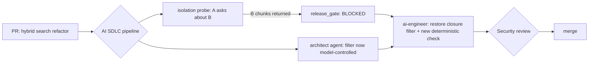

### ✓ Happy path

| # | Who | Does | With | Checkpoint |
| --- | --- | --- | --- | --- |
| 1 | ⚙️ AI SDLC pipeline | Runs the spec gate, unit tests and the isolation suite. The RAG isolation probe for tenant A asking about tenant B's documents returns B's chunks. | spec_gate.py, tenant-isolation-tests | The CI job `test` fails on `@isolation rag: tenant A cannot retrieve tenant B` with B's document ids in the output. |
| 2 | 🤖 architect agent | Its tenancy review flags that the filter is now a parameter the model can control, not a closure, and cites the tenancy-review rule. | tenancy-review skill, headless Kiro | PR comment from the architect agent cites the tenancy-review rule and the file and line. |
| 3 | ⚙️ release_gate | isolation_probes_passed < isolation_probes, so the release is blocked. | router.release_gate | Gate output: 'failed tenant-isolation probes'; status check red. |
| 4 | 🤖 ai-engineer agent | Restores kb_filter as a closure and adds a deterministic 'no foreign tenant id in output' check to the golden set. | ai-feature-eval skill, Kiro | New commit restores the closure filter; the golden set gains a 'no foreign tenant id in output' check. |
| 5 | 🧑 Security engineer | Reviews the fix and the new probe, then approves. | GitHub review | Approval from security; all checks green. |

Troubleshoot 2 known errors

| Step | Symptom | Cause | Fix |
| --- | --- | --- | --- |
| 1 | The isolation test passes even though the filter was removed | Seed data has only one tenant, or both tenants share documents | Seed two tenants with distinct documents and assert on tenantId of every retrieved chunk. |
| 1 | Test is flaky | Retrieval is semantic, so B's chunk sometimes ranks low | Query with B-unique phrases and check all top-k results, not just the first. |

### ✗ What if it had reached production? (failure)

**When:** The isolation probe was missing and the change shipped · **branches at step 1**

| # | Who | Does | Checkpoint |
| --- | --- | --- | --- |
| 1.1 | ⚙️ CloudWatch Omni | An online evaluator with a deterministic 'foreign tenant id in output' check fires. | Alert with session ids. |
| 1.2 | 🧑 Incident commander | Disables the feature flag for all tenants immediately. | Feature off within minutes. |
| 1.3 | 🤖 sre agent | Lists affected sessions and tenants from traces (tenant.id, prompt version). | Impact list for legal and support. |
| 1.4 | 🧑 Security / DPO | Runs the breach-notification process for affected tenants. | Notifications per contract and regulation. |
| 1.5 | 🤖 ai-engineer agent | Adds the missing probe to the golden set and the gate, so it's never missing again. | Gate updated; postmortem filed. |

**Path outcome:** Why the CI probe matters: the production path is expensive and painful.

### ↪ Backstop: Policy blocks a tool-level leak (alternate)

**When:** The leak was through an agent tool call, not retrieval · **branches at step 2**

| # | Who | Does | Checkpoint |
| --- | --- | --- | --- |
| 2.1 | ⚙️ AgentCore Policy | Cedar rule denies a tool call whose tenant_id differs from the caller's claim. | Decision log shows DENY with the mismatched tenant ids. |
| 2.2 | 🤖 ai-engineer agent | Fixes the tool to take tenant_id from context, not from the model. | Denials drop to zero for legitimate traffic. |

**Path outcome:** Defense in depth: even if code regresses, the gateway refuses cross-tenant tool calls.

**Guardrails:** Isolation probes are a hard gate · The tenant filter is never a model-controlled argument · Gateway policy requires tool tenant_id = caller claim

**Outcome:** The leak never reaches production, and the eval set permanently covers this class of bug.

**Metrics to track:** Isolation probe coverage per AI feature · Escaped isolation defects (target 0)

**Labs:** [48 Multi-tenant AI features on Bedrock — isolation, cost and budgets per tenant](../labs/48-multi-tenant-ai-on-bedrock/README.md) · [49 The AI-first SDLC pipeline — every persona automated, humans at the gates](../labs/49-ai-sdlc-pipeline/README.md) · [50 An AI engineering platform for SaaS — routing, prompt versions, canaries, release gates](../labs/50-ai-engineering-platform/README.md) · [45 The AI-first team kit — a Kiro agent and skills for every persona](../labs/45-ai-first-persona-kit/README.md) · [30 AgentCore Policy — deterministic tool control with Cedar](../labs/30-agentcore-policy/README.md) · [25 Evals, hooks and guardrails for Strands agents](../labs/25-strands-evals-and-guardrails/README.md)

**AWS & Kiro services:** Amazon Bedrock Knowledge Bases, Strands Agents, AgentCore Policy, GitHub Actions, Kiro CLI headless

## Model deprecation: migrate every tenant without a quality dip

*AI engineering · Expert · AI engineer, FinOps, Product manager*

A Bedrock model reaches end of life. The AI platform evaluates candidates per tier, canaries by tenant and promotes, with no outage and no surprise bill.

**Trigger:** An announcement that the model behind the premium route will be retired in 90 days.

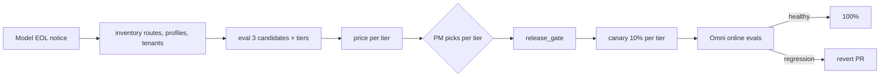

### ✓ Happy path

| # | Who | Does | With | Checkpoint |
| --- | --- | --- | --- | --- |
| 1 | 🤖 ai-engineer agent | Lists every route, profile and tenant that uses the model, from model_policy.json and the application inference profiles. | router.py, AWS MCP Server | Inventory table: routes × tiers × tenants × monthly tokens on the deprecated model. |
| 2 | 🤖 ai-engineer agent | Runs ai-feature-eval for 3 candidate models on each golden set and writes eval records. | ai-feature-eval skill, Strands Evals | Eval records exist for each candidate × tier, with pass rate, faithfulness, isolation, p95, cost. |
| 3 | 🤖 finops agent | Prices each candidate at current per-tier volume and flags a margin impact for basic. | tenant-cost-report, AWS Pricing MCP | Cost delta per tier; basic tier margin impact flagged. |
| 4 | 🧑 Product manager | Picks the candidate per tier, trading quality against margin. | Kiro spec | Spec records the choice per tier and the rationale. |
| 5 | ⚙️ Pipeline | The release gate passes. Canary is 10% of tenants per tier, and inference profiles are updated via tenantctl. | release_gate, tenantctl.sh | release_gate passes; canary percent = 10 in model_policy.json; profiles updated. |
| 6 | ⚙️ CloudWatch Omni | Compares online evaluation scores and latency by prompt and model version. The canary is healthy, so it is promoted to 100%. | Omni evaluators | Omni comparison: candidate ≥ baseline on online evals; promoted to 100%. |

Troubleshoot 3 known errors

| Step | Symptom | Cause | Fix |
| --- | --- | --- | --- |
| 5 | Gate fails on latency budget | Candidate is slower at your output lengths | Lower max_tokens per tier, enable streaming, or choose the next candidate. |
| 5 | Profile update fails | Application inference profiles copy a fixed model; they can't be edited in place | Create a new profile per tenant pointing at the new model and switch the resolver, then delete the old ones. |
| 6 | Online scores look worse only for one language | Golden set under-represented that language | Add cases for it, re-run the gate, and keep that tier's canary at 10% meanwhile. |

### ✗ Canary regresses (failure)

**When:** Online evaluation scores for the canary drop below baseline · **branches at step 6**

| # | Who | Does | Checkpoint |
| --- | --- | --- | --- |
| 6.1 | ⚙️ CloudWatch Omni | Alarm on helpfulness for model version = candidate. | Alarm names the tier and route. |
| 6.2 | 🤖 ai-engineer agent | Opens a revert PR for the canary config. | PR sets canary to 0%. |
| 6.3 | 🧑 AI lead | Merges the revert. | All tenants back on the baseline model. |
| 6.4 | 🤖 ai-engineer agent | Clusters the failing sessions into new golden cases, then tries the next candidate. | New eval record for candidate #2. |

**Path outcome:** Rollback is a config revert; the failures improve the eval set.

### ◇ No candidate meets the bar for basic tier (edge)

**When:** Every candidate is either worse or too expensive for basic · **branches at step 4**

| # | Who | Does | Checkpoint |
| --- | --- | --- | --- |
| 4.1 | 🧑 Product manager | Decides to change the basic-tier feature (shorter answers, summary only) instead of the model. | Spec updated for basic. |
| 4.2 | 🤖 ai-engineer agent | New prompt version for basic, then evaluates and gates it. | Gate passes at the lower cost. |

**Path outcome:** Sometimes the right fix is product scope, not a model.

**Guardrails:** No model change without an eval record · Cost increase over 15% needs a budget owner · Deterministic per-tenant canary; rollback = revert the PR

**Outcome:** Migration finishes weeks before end of life, with quality equal or better and a known cost impact per tier.

**Metrics to track:** Eval pass rate vs baseline per tier · Cost per 1k requests per tier · Days before end of life completed

**Labs:** [50 An AI engineering platform for SaaS — routing, prompt versions, canaries, release gates](../labs/50-ai-engineering-platform/README.md) · [48 Multi-tenant AI features on Bedrock — isolation, cost and budgets per tenant](../labs/48-multi-tenant-ai-on-bedrock/README.md) · [45 The AI-first team kit — a Kiro agent and skills for every persona](../labs/45-ai-first-persona-kit/README.md) · [47 Tenant-aware observability with CloudWatch Omni](../labs/47-tenant-observability-cloudwatch-omni/README.md) · [18 FinOps with MCP — estimate, explain, optimize](../labs/18-finops-with-mcp/README.md) · [32 AgentCore Observability and Evaluations](../labs/32-agentcore-observability-evaluations/README.md)

**AWS & Kiro services:** Amazon Bedrock, Bedrock application inference profiles, Strands Evals, Amazon CloudWatch Omni, AWS Pricing MCP

## Runaway agent spend stopped at the budget, not the invoice

*Cost & FinOps · Advanced · FinOps, SRE, Account manager*

A tenant's automation loops on an agent endpoint. The token budget caps it, alarms fire and FinOps turns it into a pricing conversation.

**Trigger:** Tenant t-initech's integration retries an agent call in a tight loop over a weekend.

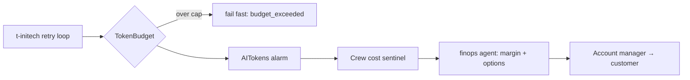

### ✓ Happy path

| # | Who | Does | With | Checkpoint |
| --- | --- | --- | --- | --- |
| 1 | ⚙️ TokenBudget | Atomic conditional updates reject calls once the monthly tier budget is reached, so requests fail fast with a clear error code. | tenant_ai.TokenBudget, DynamoDB | Calls beyond the cap return `budget_exceeded`; the budget item `used` stops increasing. |
| 2 | ⚙️ CloudWatch alarm | The per-tenant AITokens alarm fires for t-initech. | ops/alarms.sh | Alarm `ai-tokens-spike-t-initech` in ALARM state. |
| 3 | 🤖 Crew cost sentinel | Confirms the spend in Cost Explorer under the tenantId tag and finds the looping caller in the traces. | Billing MCP, CloudWatch Omni | Cost Explorer filtered by tag tenantId = t-initech confirms the spike; the looping caller id is in the traces. |
| 4 | 🤖 finops agent | Writes a margin impact summary and recommends an overage add-on or the enterprise tier. | tenant-cost-report skill | Report shows margin impact and two commercial options. |
| 5 | 🧑 Account manager | Contacts the customer with the fix (backoff) and the commercial options. | — | Customer contact logged with the backoff guidance. |

Troubleshoot 3 known errors

| Step | Symptom | Cause | Fix |
| --- | --- | --- | --- |
| 1 | Tenant exceeded the cap anyway | Concurrent requests read-then-write instead of the atomic conditional update | Use TokenBudget.charge (UpdateItem with ConditionExpression) exactly as in lab 48. |
| 1 | Legitimate calls blocked at month start | Budget key uses the wrong period or time zone | Key by UTC month (`BUDGET#tenant#YYYY-MM`) and test the rollover. |
| 3 | Cost Explorer shows no tenantId breakdown | Cost-allocation tag not activated or calls don't use the tenant's profile | Activate the tag in Billing; route calls through the application inference profile. |

### ✗ It's abuse, not a bug (failure)

**When:** Traces show prompt-injection attempts and a leaked API key · **branches at step 3**

| # | Who | Does | Checkpoint |
| --- | --- | --- | --- |
| 3.1 | 🧑 Security | Rotates the tenant's API key via tenantctl suspend/resume, then tells the tenant admin. | Old key disabled; new key issued. |
| 3.2 | 🤖 AWS Security Agent | Reviews the endpoint for further abuse paths. | Findings report. |
| 3.3 | 🤖 sre agent | Adds a per-key rate alarm and a WAF rate rule. | PR with the new controls. |

**Path outcome:** The budget limits the damage; the response is security, not billing.

### ◇ Enterprise tenant with contracted overage (edge)

**When:** The contract allows paid overage instead of a hard stop · **branches at step 1**

| # | Who | Does | Checkpoint |
| --- | --- | --- | --- |
| 1.1 | ⚙️ TokenBudget | Tier config for this tenant uses a soft cap: alert at 100%, hard stop at 150%. | Calls continue past 100% with overage metered. |
| 1.2 | 🤖 finops agent | Generates the overage line items for billing. | Invoice draft. |
| 1.3 | 🧑 Account manager | Confirms with the customer before invoicing. | Customer acknowledged. |

**Path outcome:** Budgets follow the contract, not one global rule.

**Guardrails:** Hard budget per tenant and tier · Per-tenant cost attribution via inference profiles · Agents never change budgets or prices

**Outcome:** The bill stays bounded, the customer gets a fix, and pricing learns from real usage.

**Metrics to track:** Max overspend per tenant · Time from anomaly to customer contact · Negative-margin tenants

**Labs:** [48 Multi-tenant AI features on Bedrock — isolation, cost and budgets per tenant](../labs/48-multi-tenant-ai-on-bedrock/README.md) · [47 Tenant-aware observability with CloudWatch Omni](../labs/47-tenant-observability-cloudwatch-omni/README.md) · [45 The AI-first team kit — a Kiro agent and skills for every persona](../labs/45-ai-first-persona-kit/README.md) · [13 Kiro Crew bots — always-on teammates](../labs/13-kiro-crew-bots/README.md) · [18 FinOps with MCP — estimate, explain, optimize](../labs/18-finops-with-mcp/README.md)

**AWS & Kiro services:** Amazon DynamoDB, Bedrock application inference profiles, Cost Explorer, Amazon CloudWatch Omni, Kiro Crew

## Critical CVE across 40 services, patched by an agent fleet

*Security & compliance · Expert · Security, Developer, Release manager*

A critical library CVE lands on Friday. The autonomous agent opens tested PRs across every repo, and Security Agent verifies them.

**Trigger:** A critical CVE is published for a JSON parsing library used in 40 microservices.

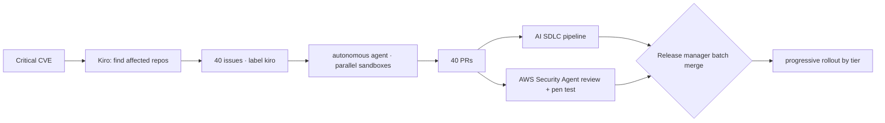

### ✓ Happy path

| # | Who | Does | With | Checkpoint |
| --- | --- | --- | --- | --- |
| 1 | 🧑 security engineer + Kiro | Runs a code search for affected repos and versions, then opens one issue per repo from the delegate template with label kiro. | Kiro CLI, GitHub | A list of affected repos and versions; one `kiro`-labelled issue per repo using the delegate template. |
| 2 | 🤖 Kiro autonomous agent | Works the issues in parallel sandboxes: bumps the version, fixes breaking changes and runs tests and isolation suites. | Kiro autonomous agent, steering | A PR per repo with the bump, fixes and passing tests. |
| 3 | ⚙️ AI SDLC pipeline | Runs on each PR: spec-exempt (security), tests, isolation suite and AI review. | ai-sdlc.yml | Pipeline green per PR (spec-exempt: security reason recorded). |
| 4 | 🤖 AWS Security Agent | PR security review confirms the vulnerable path is gone. An on-demand pen test runs against the dev endpoint. | AWS Security Agent | Security Agent: vulnerable path not reachable; the pen test reports no exploit. |
| 5 | 🧑 Release manager | Batch-merges green PRs and rolls out progressively by tier. | release-manager agent | All PRs merged; rollout complete across tiers; the dependency scanner shows 0 affected. |

Troubleshoot 3 known errors

| Step | Symptom | Cause | Fix |
| --- | --- | --- | --- |
| 2 | Agent PR changes far more than the bump | Issue scope too loose | Constrain the template: 'only dependency and directly required code changes; no refactors'. |
| 2 | Tests fail on the new major version | Breaking API change in the library | Let the agent apply the upgrade guide; if > N files, route to a human owner. |
| 5 | Error rate rises in the first wave | Behaviour change in the library (e.g. stricter parsing) | Rollback alarms revert that wave; add a compatibility shim and re-run. |

### ◇ No patched version exists yet (edge)

**When:** The library hasn't released a fix · **branches at step 1**

| # | Who | Does | Checkpoint |
| --- | --- | --- | --- |
| 1.1 | 🧑 security engineer + Kiro | Designs a mitigation: input-size limits and WAF rule blocking the exploit pattern. | Mitigation spec. |
| 1.2 | ⚙️ Pipeline | Deploys the WAF rule and limits fleet-wide. | Exploit pattern blocked at the edge. |
| 1.3 | 🤖 Crew bot | Watches the upstream repo and reopens the fleet issues when a fix ships. | Issues reopened automatically. |

**Path outcome:** Exposure is reduced right away, and the patch wave starts automatically later.

### ✗ A repo has no tests (failure)

**When:** The agent can't prove the bump is safe · **branches at step 2**

| # | Who | Does | Checkpoint |
| --- | --- | --- | --- |
| 2.1 | 🤖 Kiro autonomous agent | Marks the PR draft and states it can't verify behaviour. | Draft PR with the risk noted. |
| 2.2 | 🧑 Service owner | Adds a smoke test or approves a manual check. | Verification recorded before merge. |

**Path outcome:** Agents surface missing safety nets instead of guessing.

**Guardrails:** Agents open PRs, humans merge · Sandbox network allow-list · Progressive rollout with automatic rollback alarms

**Outcome:** Fleet-wide remediation in hours with evidence for every repo.

**Metrics to track:** Time from CVE to 100% patched · PRs merged without human edits · Post-patch incidents

**Labs:** [14 The Kiro autonomous agent — issue to PR](../labs/14-kiro-autonomous-agent/README.md) · [49 The AI-first SDLC pipeline — every persona automated, humans at the gates](../labs/49-ai-sdlc-pipeline/README.md) · [10 Headless Kiro in CI/CD](../labs/10-headless-kiro-in-ci/README.md) · [38 E2E: A governed agent platform for your organization](../labs/38-e2e-governed-agent-platform/README.md) · [05 Custom agents with scoped permissions](../labs/05-custom-agents/README.md)

**AWS & Kiro services:** Kiro autonomous agent, AWS Security Agent, GitHub Actions, Kiro CLI

## Customer ticket to deployed fix the same day

*Delivery & SDLC · Advanced · Support, Developer, QA, Release manager*

A premium customer reports empty exports. Support, engineering and release agents hand off through a bugfix spec, and the customer gets a specific answer before end of day.

**Trigger:** Ticket: 'Our CSV exports are empty since Tuesday', tenant t-acme01 (premium).

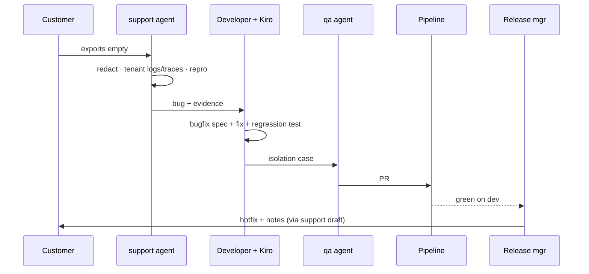

### ✓ Happy path

| # | Who | Does | With | Checkpoint |
| --- | --- | --- | --- | --- |
| 1 | 🤖 support agent | Redacts PII, pulls t-acme01's logs and traces for the window, and finds a serialization error after Tuesday's release. Writes a reproducible bug report. | ticket-to-repro skill, CloudWatch Omni | Bug report with redacted ticket, trace ids for t-acme01, the first failing request time and a reproduction on a test tenant. |
| 2 | 🧑 Developer + Kiro | Creates a bugfix spec where unchanged behaviour = other export formats. Kiro implements it with a regression test. | Kiro bugfix spec | Bugfix spec with 'unchanged behaviour' = other formats; regression test fails before the fix and passes after. |
| 3 | 🤖 qa agent | Adds an isolation case: an export as tenant A never contains B's rows. | tenant-isolation-tests | New isolation test is in the suite and green. |
| 4 | ⚙️ AI SDLC pipeline | Runs the gates, deploys to dev and runs the smoke tests. | ai-sdlc.yml | Pipeline green; dev smoke passes. |
| 5 | 🧑 Release manager | Promotes the hotfix. Release notes are generated per tier. | release-manager agent | Hotfix promoted; release notes list the fix under premium. |
| 6 | 🤖 support agent | Drafts a specific customer reply with the root cause in plain terms and the fixed version. A human sends it. | ticket-to-repro skill | Customer reply draft ready for a human to send. |

Troubleshoot 2 known errors

| Step | Symptom | Cause | Fix |
| --- | --- | --- | --- |
| 1 | Can't reproduce on the test tenant | Data-dependent bug (specific characters or sizes) | Ask for an anonymized sample via support; replay the exact request shape with synthetic data. |
| 4 | Isolation smoke fails on dev after the fix | The fix changed the export query's tenant predicate | Block the release; restore the predicate and add a unit test on the query builder. |

### ↪ Not a bug: customer configuration (alternate)

**When:** Logs show the export filters exclude everything · **branches at step 1**

| # | Who | Does | Checkpoint |
| --- | --- | --- | --- |
| 1.1 | 🤖 support agent | Explains the filter setting with a screenshot-ready answer; no engineering hand-off. | Reply draft with steps. |
| 1.2 | 🤖 pm agent | Logs a UX issue: warn when filters return zero rows. | Backlog item linked to the ticket. |

**Path outcome:** The ticket is resolved in minutes, and the confusing UX goes into the backlog.

### ✗ Many tenants affected (failure)

**When:** Logs show the same error for 30% of premium tenants · **branches at step 1**

| # | Who | Does | Checkpoint |
| --- | --- | --- | --- |
| 1.1 | 🤖 support agent | Escalates to an incident instead of a single ticket. | Incident opened with tenant list. |
| 1.2 | 🧑 Incident commander | Rolls back Tuesday's release while the fix is built. | Exports work again for everyone. |
| 1.3 | 🤖 support agent | Drafts a status-page update and proactive notices for affected tenants. | Comms reviewed and sent by humans. |

**Path outcome:** Single-ticket flow upgrades to incident flow automatically.

**Guardrails:** PII redaction before engineering sees the ticket · Reproduction uses a test tenant, never customer data · Humans send customer communications

**Outcome:** A same-day fix with a regression test, and a customer reply that builds trust.

**Metrics to track:** Ticket-to-deploy time · Reopened tickets · Customer satisfaction on escalations

**Labs:** [45 The AI-first team kit — a Kiro agent and skills for every persona](../labs/45-ai-first-persona-kit/README.md) · [03 Spec-driven development](../labs/03-spec-driven-development/README.md) · [49 The AI-first SDLC pipeline — every persona automated, humans at the gates](../labs/49-ai-sdlc-pipeline/README.md) · [47 Tenant-aware observability with CloudWatch Omni](../labs/47-tenant-observability-cloudwatch-omni/README.md) · [05 Custom agents with scoped permissions](../labs/05-custom-agents/README.md)

**AWS & Kiro services:** Kiro specs, Amazon CloudWatch Omni, GitHub Actions, Kiro CLI

## Right to erasure across data, search, memory and model logs

*Security & compliance · Expert · Security / DPO, Tenant operations, AI engineer*

A tenant asks for one user's data to be deleted. Agents find every copy, including AI memory and knowledge base chunks, and produce an erasure certificate.

**Trigger:** A data subject erasure request from tenant t-acme01 for user u-881.

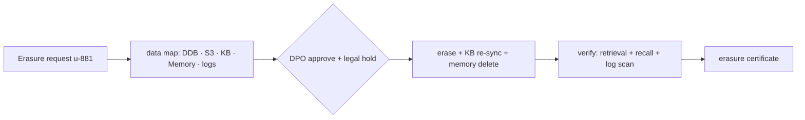

### ✓ Happy path

| # | Who | Does | With | Checkpoint |
| --- | --- | --- | --- | --- |
| 1 | 🤖 tenant-ops agent | Builds a data map for u-881: DynamoDB items, S3 exports, Knowledge Base documents (metadata tenantId+userId), AgentCore Memory namespace /tenant/t-acme01/user/u-881, and logs. | tenant-ops skill, AWS MCP Server | Data map lists every store with item counts for u-881 (DynamoDB, S3, KB docs, memory records, logs). |
| 2 | 🧑 DPO | Reviews the data map and the legal holds, then approves. | — | DPO approval recorded; no legal hold. |
| 3 | ⚙️ Erasure job | Deletes items and objects, removes KB documents and re-syncs the data source, and deletes memory records for the actor. | AWS CLI, Bedrock Knowledge Bases, AgentCore Memory | Deletion job log shows per-store counts deleted; KB ingestion job completed. |
| 4 | 🤖 qa agent | Verifies retrieval and memory recall for u-881 return nothing, and searches logs for residual identifiers. | tenant-isolation-tests | Retrieval and memory recall for u-881 return nothing; log scan finds no identifiers beyond retention exceptions. |
| 5 | 🤖 tenant-ops agent | Generates an erasure certificate listing systems, timestamps and verification queries. | — | Certificate lists systems, timestamps and the verification queries. |

Troubleshoot 3 known errors

| Step | Symptom | Cause | Fix |
| --- | --- | --- | --- |
| 3 | KB still returns the user's content | Documents deleted from S3 but the data source wasn't re-synced | Start an ingestion job for the data source and wait for COMPLETE before verifying. |
| 3 | Memory records reappear | Events still exist and extraction re-ran | Delete events for the actor/session as well as long-term records. |
| 4 | Identifier found in old CloudWatch logs | Logs have longer retention than the erasure policy allows | Document the retention exception or mask via subscription filter; shorten retention. |

### ◇ A legal hold blocks deletion (edge)

**When:** The user's data is under litigation hold · **branches at step 2**

| # | Who | Does | Checkpoint |
| --- | --- | --- | --- |
| 2.1 | 🧑 DPO | Rejects deletion and records the legal basis; restricts processing instead. | Hold documented. |
| 2.2 | 🤖 tenant-ops agent | Marks the user as 'processing restricted', which excludes them from AI memory and retrieval. | Restriction flag set; recall returns nothing for the user. |
| 2.3 | 🤖 Crew bot | Reminds the DPO when the hold expires. | Scheduled follow-up. |

**Path outcome:** Lawful handling: restriction now, erasure later.

### ↪ Whole-tenant erasure at offboarding (alternate)

**When:** The request covers every user of the tenant · **branches at step 1**

| # | Who | Does | Checkpoint |
| --- | --- | --- | --- |
| 1.1 | ⚙️ tenantctl | Offboard flow: export → suspend → mark offboarded (ticket + CONFIRM). | Tenant OFFBOARDED. |
| 1.2 | ⚙️ Erasure job | After the retention window, deletes all tenant data, inference profiles, memory namespaces and KB docs. | Per-store deletion counts. |
| 1.3 | 🤖 qa agent | Verifies nothing of the tenant remains by retrieval, recall and Cost Explorer (no spend). | Verification report. |

**Path outcome:** Offboarding and erasure share one audited flow.

**Guardrails:** Identity-scoped memory namespaces make deletion precise · Human approval and legal-hold check · Verification by retrieval, not by assumption

**Outcome:** Complete, provable erasure, including AI-derived data.

**Metrics to track:** Time to complete erasure · Residual data found in verification (target 0)

**Labs:** [48 Multi-tenant AI features on Bedrock — isolation, cost and budgets per tenant](../labs/48-multi-tenant-ai-on-bedrock/README.md) · [28 AgentCore Memory — agents that remember](../labs/28-agentcore-memory/README.md) · [46 Automate the tenant lifecycle with Kiro, skills and the AWS CLI](../labs/46-tenant-lifecycle-automation/README.md) · [37 E2E: Enterprise knowledge assistant with permissions-aware RAG](../labs/37-e2e-enterprise-knowledge-assistant/README.md) · [45 The AI-first team kit — a Kiro agent and skills for every persona](../labs/45-ai-first-persona-kit/README.md)

**AWS & Kiro services:** Amazon DynamoDB, Amazon S3, Bedrock Knowledge Bases, AgentCore Memory, AWS CLI

## New AI feature from idea to GA in one sprint

*Delivery & SDLC · Advanced · Product manager, AI engineer, Architect, QA, FinOps*

'Summarize this account's activity' goes from a customer ask to a tiered, evaluated, observed GA feature, with every persona's agent pulling its weight.

**Trigger:** Top requested feature on the roadmap: account activity summaries.

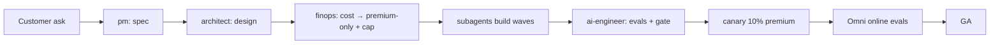

### ✓ Happy path

| # | Who | Does | With | Checkpoint |
| --- | --- | --- | --- | --- |
| 1 | 🤖 pm agent | prd-to-spec: EARS requirements with tier gating (premium+), isolation, metering, success metrics and rollout. | prd-to-spec skill | requirements.md has tier gating, isolation, metering and success metrics. |
| 2 | 🤖 architect agent | Design: a Strands agent on AgentCore Runtime, tools via Gateway, a per-tenant inference profile and Policy rules. | tenancy-review, AWS Knowledge MCP | design.md has the agent, tools, profile and policy rules, plus a diagram. |
| 3 | 🤖 finops agent | Estimates cost per tenant per month at forecast usage, so the PM sets premium-only and a monthly cap. | estimate-before-build | Cost estimate in design.md; PM decision recorded (premium-only + cap). |
| 4 | 🤖 Developers + subagents | Implement spec task waves in parallel. | Kiro specs, subagents | All tasks ticked; spec gate passes on every PR. |
| 5 | 🤖 ai-engineer agent | Builds a golden set with isolation probes; the release gate passes; 10% canary of premium tenants. | ai-feature-eval, release_gate | Eval record passes the gate; canary config at 10% premium. |
| 6 | ⚙️ CloudWatch Omni | Online evaluations and latency look healthy, so GA follows. | Omni evaluators | Omni shows healthy online scores and latency; the flag is set to GA. |

Troubleshoot 2 known errors

| Step | Symptom | Cause | Fix |
| --- | --- | --- | --- |
| 5 | Golden set too small to trust | Only happy-path cases | Add adversarial, out-of-scope and cross-tenant probes; ≥ 30 cases per tier. |
| 6 | Adoption is low in canary | Feature hard to discover | PM adds in-product prompts; this is a product signal, not a model problem. |

### ✗ Cost estimate kills the plan (failure)

**When:** Estimated cost per tenant exceeds the premium price uplift · **branches at step 3**

| # | Who | Does | Checkpoint |
| --- | --- | --- | --- |
| 3.1 | 🧑 Product manager | Narrows scope to weekly summaries (batch) instead of on-demand. | Spec updated. |
| 3.2 | 🤖 architect agent | Redesigns as a scheduled batch job using Bedrock batch inference. | New design with lower unit cost. |
| 3.3 | 🤖 finops agent | Re-estimates. | Within margin target, so the build proceeds. |

**Path outcome:** The cost gate changed the design before any code was written.

### ✗ Eval gate fails (failure)

**When:** Faithfulness below baseline on long accounts · **branches at step 5**

| # | Who | Does | Checkpoint |
| --- | --- | --- | --- |
| 5.1 | 🤖 ai-engineer agent | Adds retrieval chunking and a citation requirement to the prompt; re-runs the eval. | New eval record. |
| 5.2 | ⚙️ release_gate | Passes on second attempt. | Canary proceeds. |

**Path outcome:** The gate did its job, and the fix is measurable.

**Guardrails:** Spec gate on every PR · Eval and cost gates · Tier-gated feature flag

**Outcome:** A measurable, profitable AI feature shipped safely in one sprint.

**Metrics to track:** Lead time idea to GA · Adoption per tier · Cost per active tenant

**Labs:** [45 The AI-first team kit — a Kiro agent and skills for every persona](../labs/45-ai-first-persona-kit/README.md) · [03 Spec-driven development](../labs/03-spec-driven-development/README.md) · [06 Subagents and parallel work](../labs/06-subagents-and-parallel-work/README.md) · [48 Multi-tenant AI features on Bedrock — isolation, cost and budgets per tenant](../labs/48-multi-tenant-ai-on-bedrock/README.md) · [50 An AI engineering platform for SaaS — routing, prompt versions, canaries, release gates](../labs/50-ai-engineering-platform/README.md) · [26 Deploy agents to AgentCore Runtime](../labs/26-agentcore-runtime/README.md) · [27 AgentCore Gateway — any API becomes an MCP tool](../labs/27-agentcore-gateway/README.md) · [30 AgentCore Policy — deterministic tool control with Cedar](../labs/30-agentcore-policy/README.md) · [47 Tenant-aware observability with CloudWatch Omni](../labs/47-tenant-observability-cloudwatch-omni/README.md)

**AWS & Kiro services:** Kiro specs, Strands Agents, AgentCore Runtime, AgentCore Gateway, AgentCore Policy, Amazon Bedrock, Amazon CloudWatch Omni

## Migrating on-prem single-tenant customers into the pooled SaaS

*Modernization · Expert · Architect, Tenant operations, QA, Customer success*

Hundreds of legacy single-tenant installs move onto the multi-tenant platform. Each tenant is proven at parity before cutover.

**Trigger:** Executive decision to retire the on-prem product line within 12 months.

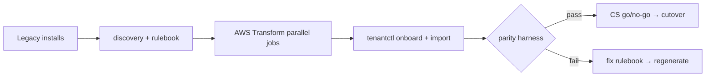

### ✓ Happy path

| # | Who | Does | With | Checkpoint |
| --- | --- | --- | --- | --- |
| 1 | 🤖 migration-engine skill | Discovery on the legacy schema, then a rulebook mapping legacy entities to pooled keys with tenantId. | migration-engine skill, Kiro | Manifest + RULEBOOK.md approved; flags resolved. |
| 2 | ⚙️ Parity harness | Replays recorded API cases per customer against legacy and the pooled tenant. | parity_harness.py | Harness passes on legacy and fails on injected breakage (`--self-test`). |
| 3 | 🤖 AWS Transform | Runs the same skill files across the customer portfolio as parallel jobs. | AWS Transform | Jobs complete per customer with generated mappings. |
| 4 | 🤖 Crew bot | Per wave: onboard tenants via tenantctl, import data, run parity and post the report. | tenant-ops skill, Kiro Crew | Per-wave report: tenants onboarded, data imported, parity %. |
| 5 | 🧑 Customer success | Go/no-go per customer from the parity report, then cutover scheduling. | — | Signed go/no-go per customer; cutover scheduled. |

Troubleshoot 2 known errors

| Step | Symptom | Cause | Fix |
| --- | --- | --- | --- |
| 2 | Parity fails on timestamps for every case | Legacy stored local time; pooled stores UTC | Add a rulebook rule for time-zone conversion and an ignore rule only for volatile fields. |
| 4 | Import collides with existing tenant ids | Legacy customer ids overlap the t- namespace | Prefix legacy ids deterministically (t-l-<id>) in the rulebook; re-run the wave. |

### ◇ Heavily customised install (edge)

**When:** A customer has custom tables and code the pooled product doesn't support · **branches at step 2**

| # | Who | Does | Checkpoint |
| --- | --- | --- | --- |
| 2.1 | 🤖 architect agent | Classifies customisations: drop, replace with config, or build as an extension. | Customisation inventory. |
| 2.2 | 🧑 Customer success | Negotiates a plan with the customer. | Agreed scope. |
| 2.3 | 🧑 Tenant operations | Moves the customer to a later wave or a silo tier. | Plan updated. |

**Path outcome:** Not every install fits the pool, and the factory handles exceptions explicitly.

### ✗ Cutover rollback (failure)

**When:** Post-cutover error rate spikes for a migrated customer · **branches at step 5**

| # | Who | Does | Checkpoint |
| --- | --- | --- | --- |
| 5.1 | 🧑 Incident commander | Switches the customer back to legacy within the rollback window. | Customer back on legacy. |
| 5.2 | 🤖 migration-engine skill | Adds the failing requests as parity cases and fixes the rulebook. | Parity 100% including new cases. |
| 5.3 | 🧑 Customer success | Reschedules cutover. | New date agreed. |

**Path outcome:** The rollback window turns a bad cutover into a delay, not an outage.

**Guardrails:** No cutover without a parity report · Rulebook changes are reviewed and regenerate output · Rollback window per tenant

**Outcome:** A predictable, evidence-backed migration factory instead of bespoke projects.

**Metrics to track:** Tenants migrated per week · Parity pass rate at first attempt · Post-cutover tickets

**Labs:** [39 Field pattern: a skill-driven, parity-verified migration engine](../labs/39-skill-driven-migration-engine/README.md) · [36 E2E: Legacy monolith to serverless, spec by spec](../labs/36-e2e-legacy-modernization/README.md) · [46 Automate the tenant lifecycle with Kiro, skills and the AWS CLI](../labs/46-tenant-lifecycle-automation/README.md) · [13 Kiro Crew bots — always-on teammates](../labs/13-kiro-crew-bots/README.md) · [45 The AI-first team kit — a Kiro agent and skills for every persona](../labs/45-ai-first-persona-kit/README.md)

**AWS & Kiro services:** Kiro skills, AWS Transform, Kiro Crew, AWS CLI, AWS Database Migration Service

## Multi-region failover game day run by agents

*Reliability & operations · Expert · SRE, Architect, Leadership*

A quarterly DR game day where agents prepare, execute and score a region switch, and humans hold the big red button.

**Trigger:** Quarterly resilience game day for enterprise SLA commitments.

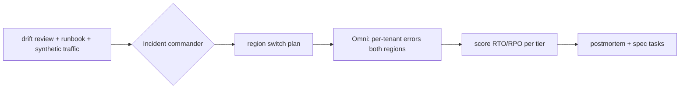

### ✓ Happy path

| # | Who | Does | With | Checkpoint |
| --- | --- | --- | --- | --- |
| 1 | 🤖 architect agent | Reviews region-switch plans and IaC for drift between primary and secondary, and opens fixes. | iac-author, AWS IaC MCP | Drift report: none, or fix PRs merged. |
| 2 | 🤖 sre agent | Generates the game day runbook, success criteria per tier and synthetic tenant traffic. | runbook-from-incident | Runbook with RTO/RPO targets per tier; synthetic traffic running. |
| 3 | 🧑 Incident commander | Starts the switch using declarative region-switch plans. | Amazon Application Recovery Controller | Region-switch plan executed; steps green. |
| 4 | ⚙️ CloudWatch Omni | Tracks golden metrics and per-tenant error rates across both regions in one space. | Omni spaces | Omni shows traffic and error rates per tenant in the secondary region. |
| 5 | 🤖 sre agent | Scores the run against RTO and RPO per tier, and turns gaps into a postmortem and spec tasks. | runbook-from-incident | Scorecard vs targets; postmortem and tasks filed. |

Troubleshoot 2 known errors

| Step | Symptom | Cause | Fix |
| --- | --- | --- | --- |
| 3 | Switch stalls on database promotion | Replication lag above the threshold | Wait or accept data loss within RPO; document; tune replication. |
| 4 | Some tenants still route to the primary | Client-side DNS caching or hard-coded regional endpoints | Lower TTLs; remove regional endpoints from SDK config. |

### ✗ RTO missed (failure)

**When:** Failover took longer than the enterprise SLA · **branches at step 5**

| # | Who | Does | Checkpoint |
| --- | --- | --- | --- |
| 5.1 | 🤖 sre agent | Breaks down the timeline by step to find the slowest dependency. | Timeline with durations. |
| 5.2 | 🤖 architect agent | Proposes warm standby for that dependency, with cost. | Design + cost. |
| 5.3 | 🧑 Leadership | Approves the spend or adjusts the SLA. | Decision recorded. |
| 5.4 | ⚙️ Pipeline | Re-runs the game day next sprint. | RTO met. |

**Path outcome:** A missed target becomes a funded fix, not just a finding.

**Guardrails:** Humans initiate failover · Synthetic tenants only during drills · Every finding becomes a tracked task

**Outcome:** Proven, repeatable failover with evidence for enterprise customers.

**Metrics to track:** Measured RTO/RPO vs SLA per tier · Drift findings per drill

**Labs:** [16 Infrastructure as code with MCP](../labs/16-iac-with-mcp/README.md) · [45 The AI-first team kit — a Kiro agent and skills for every persona](../labs/45-ai-first-persona-kit/README.md) · [47 Tenant-aware observability with CloudWatch Omni](../labs/47-tenant-observability-cloudwatch-omni/README.md) · [35 E2E: An AI SRE crew — detect, investigate, fix, learn](../labs/35-e2e-sre-crew/README.md) · [38 E2E: A governed agent platform for your organization](../labs/38-e2e-governed-agent-platform/README.md)

**AWS & Kiro services:** Amazon Application Recovery Controller, Amazon CloudWatch Omni, AWS CDK, Kiro

## Repackaging tiers from real unit economics

*Cost & FinOps · Advanced · FinOps, Product manager, Leadership*

FinOps and product agents turn per-tenant cost data into a pricing proposal, and the change ships behind feature flags with metering already in place.

**Trigger:** Quarterly review shows basic-tier AI usage eroding margin.

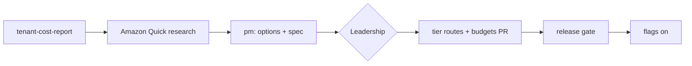

### ✓ Happy path

| # | Who | Does | With | Checkpoint |
| --- | --- | --- | --- | --- |
| 1 | 🤖 finops agent | tenant-cost-report for the quarter: margin by tier, top negative-margin tenants and drivers (AI tokens on summaries). | tenant-cost-report, Cost Explorer | Margin by tier with method and assumptions stated. |
| 2 | 🤖 Amazon Quick | Research flow combining usage data, competitor pricing pages and win/loss notes into a briefing. | Quick Research, Quick Flows | Briefing with cited sources. |
| 3 | 🤖 pm agent | Drafts packaging options and a spec for an AI add-on with metering and a monthly cap. | prd-to-spec | Options document + spec draft for the add-on. |
| 4 | 🧑 Leadership | Chooses the option. | — | Decision recorded. |
| 5 | ⚙️ AI platform | Tier routes and budgets updated in model_policy and TIER_DEFAULTS via PR and the release gate. | router.py, tenant_ai.py | Config PR merged through the gate; flags on for new tenants; existing contracts grandfathered. |

Troubleshoot 1 known errors

| Step | Symptom | Cause | Fix |
| --- | --- | --- | --- |
| 1 | Shared infra cost allocation looks wrong | Usage metrics missing for some features | Instrument those features with TenantUsage first; mark the allocation as provisional. |

### ↪ Existing customers push back (alternate)

**When:** Key accounts object to the change · **branches at step 4**

| # | Who | Does | Checkpoint |
| --- | --- | --- | --- |
| 4.1 | 🧑 Account managers | Offer grandfathering until renewal. | Exceptions list. |
| 4.2 | 🤖 tenant-ops agent | Sets per-tenant overrides in the tenant record. | Overrides visible in status. |
| 4.3 | 🤖 finops agent | Tracks margin for grandfathered tenants separately. | Monthly report includes the cohort. |

**Path outcome:** Pricing changes roll out gradually by contract.

**Guardrails:** Agents propose, humans price · Changes ship via reviewed config · Existing contracts are respected (grandfathering flags)

**Outcome:** Pricing grounded in measured cost-to-serve, shipped without code rewrites.

**Metrics to track:** Gross margin per tier · Add-on adoption · Churn after repackaging

**Labs:** [45 The AI-first team kit — a Kiro agent and skills for every persona](../labs/45-ai-first-persona-kit/README.md) · [48 Multi-tenant AI features on Bedrock — isolation, cost and budgets per tenant](../labs/48-multi-tenant-ai-on-bedrock/README.md) · [50 An AI engineering platform for SaaS — routing, prompt versions, canaries, release gates](../labs/50-ai-engineering-platform/README.md) · [18 FinOps with MCP — estimate, explain, optimize](../labs/18-finops-with-mcp/README.md)

**AWS & Kiro services:** Cost Explorer, Amazon Quick, Amazon Bedrock, Kiro specs

## Incident spanning AWS and Azure-hosted tenants

*Reliability & operations · Expert · SRE, Support*

Some enterprise tenants run in a customer-mandated Azure region. One Omni space sees both clouds, so the investigation doesn't split in two.

**Trigger:** Elevated errors for two enterprise tenants, one on AWS and one on Azure.

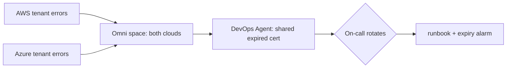

### ✓ Happy path

| # | Who | Does | With | Checkpoint |
| --- | --- | --- | --- | --- |
| 1 | 🤖 sre agent | Queries the Omni space that includes Azure Monitor metrics, resource logs and Application Insights traces. | CloudWatch Omni, tenant-incident skill | The Omni space shows both clouds' telemetry for the window. |
| 2 | 🤖 AWS DevOps Agent | Correlates both errors to the same expired certificate on a shared identity integration. | Omni root cause | Single root cause with evidence from both clouds. |
| 3 | 🧑 On-call SRE | Rotates the certificate and confirms recovery in both clouds. | — | Certificate rotated; errors stop in both clouds. |
| 4 | 🤖 sre agent | Runbook plus a certificate-expiry alarm for all clouds. | runbook-from-incident | Runbook + alarm PR merged. |

Troubleshoot 1 known errors

| Step | Symptom | Cause | Fix |
| --- | --- | --- | --- |
| 1 | Azure data missing in Omni | Entra ID tenant not connected or diagnostic settings not exporting | Connect the Entra tenant in Omni and enable diagnostic settings for the resources. |

### ↪ Two independent causes (alternate)

**When:** Correlation shows unrelated failures in each cloud · **branches at step 2**

| # | Who | Does | Checkpoint |
| --- | --- | --- | --- |
| 2.1 | 🤖 sre agent | Splits into two incident tracks with separate owners. | Two threads. |
| 2.2 | 🧑 Incident commander | Assigns owners and keeps one status page. | Coordinated comms. |

**Path outcome:** One view of both clouds stops two coincidences being treated as one cause.

**Guardrails:** Read-only investigation · Customer communications reviewed

**Outcome:** One investigation, one root cause, across clouds.

**Metrics to track:** MTTR for multicloud incidents · Certificate-expiry incidents (target 0)

**Labs:** [47 Tenant-aware observability with CloudWatch Omni](../labs/47-tenant-observability-cloudwatch-omni/README.md) · [45 The AI-first team kit — a Kiro agent and skills for every persona](../labs/45-ai-first-persona-kit/README.md) · [19 Incident investigation with CloudWatch & CloudTrail MCP](../labs/19-observability-with-mcp/README.md)

**AWS & Kiro services:** Amazon CloudWatch Omni, AWS DevOps Agent, Azure Monitor (via Omni)

## B2B agent-to-agent integration with a partner

*Integration & ecosystem · Expert · Architect, Security, Partner manager*

A logistics partner's agent needs shipment status for your shared customers. A2A plus Gateway policy lets it in with tenant consent and nothing more.

**Trigger:** Partnership agreement: partner agent may query order status for tenants who opt in.

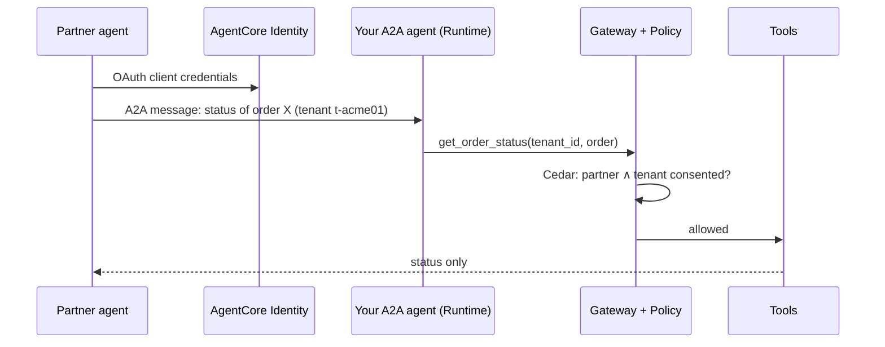

### ✓ Happy path

| # | Who | Does | With | Checkpoint |
| --- | --- | --- | --- | --- |
| 1 | 🤖 architect agent | Designs an A2A endpoint on AgentCore Runtime with an agent card exposing only get_order_status. | Strands A2A, AgentCore Runtime | Agent card exposes only get_order_status. |
| 2 | 🧑 Security | Configures partner OAuth client credentials in AgentCore Identity, and Cedar rules: partner can call get_order_status only for consenting tenants. | AgentCore Identity, AgentCore Policy | Partner client exists in Identity; Cedar rules created in LOG_ONLY. |
| 3 | 🧑 Tenant admin | Opts in from the tenant settings page, which writes the consent flag to the tenant record. | — | Consent flag on the tenant record. |
| 4 | ⚙️ Policy engine | LOG_ONLY for a week, review the decisions, then ENFORCE. | AgentCore Policy | A week of decision logs reviewed; no unexpected allows; ENFORCE set. |
| 5 | ⚙️ CloudWatch Omni | Partner calls traced with partner id and tenant id; abuse alarms. | Omni | Traces carry partner id + tenant id; abuse alarm configured. |

Troubleshoot 2 known errors

| Step | Symptom | Cause | Fix |
| --- | --- | --- | --- |
| 2 | Policy creation fails validation | Hand-written Cedar names don't match the gateway schema | Generate from natural language first (lab 30), then edit. |
| 4 | Legitimate partner calls denied | Consent claim not propagated to the policy context | Pass consent as a tool input or tag from the tenant record; re-test in LOG_ONLY. |

### ✗ Partner queries a non-consenting tenant (failure)

**When:** Partner requests status for a tenant that didn't opt in · **branches at step 4**

| # | Who | Does | Checkpoint |
| --- | --- | --- | --- |
| 4.1 | ⚙️ AgentCore Policy | Denies the tool call. | DENY in the decision log with tenant id. |
| 4.2 | 🤖 Your A2A agent | Returns a structured 'not authorized for this customer' response, without revealing whether the order exists. | No data leakage in the response. |
| 4.3 | 🤖 Crew bot | Weekly report of denied attempts to the partner manager. | Report sent. |

**Path outcome:** Consent is enforced at the gateway, outside both agents' code.

### ↪ Partnership ends (alternate)

**When:** Contract terminated · **branches at step 5**

| # | Who | Does | Checkpoint |
| --- | --- | --- | --- |
| 5.1 | 🧑 Security | Deletes the partner's OAuth client and policies. | Partner calls fail auth. |
| 5.2 | 🤖 qa agent | Verifies the partner can no longer obtain tokens. | Verification log. |

**Path outcome:** Clean revocation with evidence.

**Guardrails:** Consent per tenant · Least-privilege tool surface · Policy enforced outside the agent code

**Outcome:** A new partner channel without exposing tenant data beyond what was agreed.

**Metrics to track:** Denied policy decisions · Partner call volume per tenant

**Labs:** [24 A2A — agents across teams and frameworks](../labs/24-strands-a2a/README.md) · [26 Deploy agents to AgentCore Runtime](../labs/26-agentcore-runtime/README.md) · [29 AgentCore Identity — inbound and outbound auth for agents](../labs/29-agentcore-identity/README.md) · [30 AgentCore Policy — deterministic tool control with Cedar](../labs/30-agentcore-policy/README.md) · [27 AgentCore Gateway — any API becomes an MCP tool](../labs/27-agentcore-gateway/README.md) · [47 Tenant-aware observability with CloudWatch Omni](../labs/47-tenant-observability-cloudwatch-omni/README.md)

**AWS & Kiro services:** Strands A2A, AgentCore Runtime, AgentCore Identity, AgentCore Policy, AgentCore Gateway, Amazon CloudWatch Omni

## Platform upgrade wave: runtime end of life across every stack

*Modernization · Advanced · Platform engineer, SRE, Release manager*

A Lambda runtime and a CDK major version reach end of life. Bots plan the wave, the autonomous agent does the edits, and tenants never notice.

**Trigger:** Runtime deprecation notice and a new CDK major version.

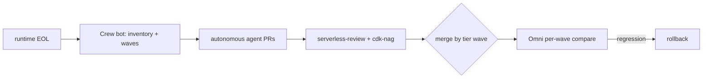

### ✓ Happy path

| # | Who | Does | With | Checkpoint |
| --- | --- | --- | --- | --- |
| 1 | 🤖 Crew release-readiness bot | Inventories functions per account and stack with the AWS MCP Server, groups them by owner and risk, and plans waves. | AWS MCP Server, Kiro Crew | Inventory by account, stack and owner; waves defined. |
| 2 | 🤖 Kiro autonomous agent | One issue per stack: runtime bump, CDK migration and tests, then a PR. | Kiro autonomous agent | A PR per stack with the runtime and CDK upgrades and tests passing. |
| 3 | 🤖 serverless-review skill | Checks timeouts, memory and arm64 opportunities while it's there. | serverless-review, cdk-nag | No new cdk-nag findings; suggestions noted. |
| 4 | 🧑 Release manager | Merges by wave: internal, then basic, then premium, then enterprise. | — | Waves merged in order internal → basic → premium → enterprise. |
| 5 | ⚙️ CloudWatch Omni | Per-wave error and latency comparison; automatic rollback alarm. | Omni | Per-wave comparison is healthy; no rollbacks needed. |

Troubleshoot 2 known errors

| Step | Symptom | Cause | Fix |
| --- | --- | --- | --- |
| 2 | CDK major upgrade breaks synth | Removed or renamed constructs | Have the agent follow the CDK migration guide; pin the version per stack until green. |
| 5 | Cold starts regress on the new runtime | Bundle size or init code | Enable SnapStart or tune memory; Lambda Power Tuning. |

### ✗ A wave regresses (failure)

**When:** Premium wave error rate rises after the merge · **branches at step 5**

| # | Who | Does | Checkpoint |
| --- | --- | --- | --- |
| 5.1 | ⚙️ CloudWatch Omni | Rollback alarm fires for the premium wave. | Alarm with stack list. |
| 5.2 | ⚙️ Pipeline | Automatic rollback of that wave's stacks. | Previous versions restored. |
| 5.3 | 🤖 Kiro autonomous agent | Investigates the diff and opens a fix PR. | Fix PR; wave re-queued. |

**Path outcome:** Wave order and rollback alarms limit the blast radius.

**Guardrails:** Wave order by tier · Rollback alarms · cdk-nag clean

**Outcome:** Upgrades become routine background work instead of quarter-long projects.

**Metrics to track:** Stacks on supported runtimes · Upgrade-related incidents

**Labs:** [13 Kiro Crew bots — always-on teammates](../labs/13-kiro-crew-bots/README.md) · [14 The Kiro autonomous agent — issue to PR](../labs/14-kiro-autonomous-agent/README.md) · [15 The managed AWS MCP Server](../labs/15-aws-mcp-server/README.md) · [16 Infrastructure as code with MCP](../labs/16-iac-with-mcp/README.md) · [07 Agent skills](../labs/07-agent-skills/README.md) · [47 Tenant-aware observability with CloudWatch Omni](../labs/47-tenant-observability-cloudwatch-omni/README.md)

**AWS & Kiro services:** AWS MCP Server, Kiro Crew, Kiro autonomous agent, AWS Lambda, AWS CDK, Amazon CloudWatch Omni

## Continuous audit evidence for SOC 2 and enterprise security reviews

*Security & compliance · Advanced · Security / compliance, Sales engineering*

Security questionnaires and audit requests are answered from live evidence that agents collect continuously, not from a scramble.

**Trigger:** An enterprise prospect sends a 300-question security questionnaire. A SOC 2 period also closes.

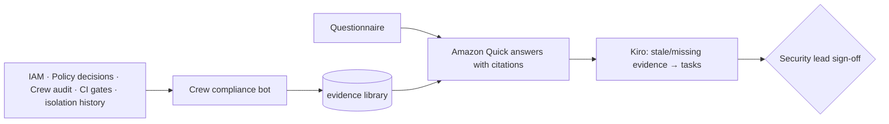

### ✓ Happy path

| # | Who | Does | With | Checkpoint |
| --- | --- | --- | --- | --- |
| 1 | 🤖 Crew compliance bot | Weekly evidence collection: IAM Identity Center assignments, policy engine decisions, Kiro Crew audit logs, pipeline gate results and isolation test history. | AWS MCP Server, Kiro Crew | Evidence library updated this week, with timestamps per control. |
| 2 | 🤖 Amazon Quick | Answers the questionnaire from the evidence library and policies, with citations. | Quick Research | Every answer has a citation to evidence or policy. |
| 3 | 🤖 security agent (Kiro) | Flags answers whose evidence is stale or missing, and opens tasks. | threat-model skill | List of stale or missing evidence with owners. |
| 4 | 🧑 Security lead | Reviews and signs off. | — | Sign-off recorded; questionnaire sent. |

Troubleshoot 1 known errors

| Step | Symptom | Cause | Fix |
| --- | --- | --- | --- |
| 2 | Answers without citations | Evidence library missing that control | Mark as 'needs evidence' instead of answering; never let the model answer from memory. |

### ✗ A control gap is found (failure)

**When:** No evidence exists that isolation tests run on every release · **branches at step 3**

| # | Who | Does | Checkpoint |
| --- | --- | --- | --- |
| 3.1 | 🧑 Security lead | Opens a remediation task with a due date. | Task tracked. |
| 3.2 | ⚙️ Pipeline | Lab 49's isolation gate is added to every repo. | Gate active. |
| 3.3 | 🤖 Crew compliance bot | Starts collecting the gate results as evidence. | New evidence stream. |

**Path outcome:** Gaps found in questionnaires turn into controls, not promises.

**Guardrails:** Answers must cite evidence · Human sign-off · Evidence store is read-only to agents

**Outcome:** Faster enterprise deals and stress-free audits.

**Metrics to track:** Questionnaire turnaround · Evidence freshness · Audit findings

**Labs:** [38 E2E: A governed agent platform for your organization](../labs/38-e2e-governed-agent-platform/README.md) · [30 AgentCore Policy — deterministic tool control with Cedar](../labs/30-agentcore-policy/README.md) · [49 The AI-first SDLC pipeline — every persona automated, humans at the gates](../labs/49-ai-sdlc-pipeline/README.md) · [12 Kiro Crew — your persistent agent workspace](../labs/12-kiro-crew-workspace/README.md) · [41 Field pattern: domain skills at scale — coordinator, specialists, A/B evals](../labs/41-domain-skills-at-scale/README.md)

**AWS & Kiro services:** AWS IAM Identity Center, AgentCore Policy, Kiro Crew, Amazon Quick, AWS MCP Server
