# Advanced use cases and scenarios

> Generated from `site/data/scenarios.json` by `scripts/gen_scenarios_md.py`. Edit the JSON, not this file.

End-to-end stories showing how an AI-first, multi-tenant SaaS team uses Kiro, skills, MCP, the AWS CLI, Bedrock, AgentCore and CloudWatch Omni when things get hard. Each scenario lists the trigger, who does what (🤖 agent · 🧑 human · ⚙️ system), the guardrails, the outcome, the metrics to track, and the labs that teach every piece. The metrics are what to measure, not promised results.

| Scenario | Domain | Complexity | Personas |
| --- | --- | --- | --- |
| [Zero-touch enterprise onboarding with SSO and data residency](#enterprise-onboarding-residency) | Tenant lifecycle | Expert | Tenant operations, Architect, Security, Sales ops |
| [2 a.m. noisy neighbour, mitigated in minutes](#noisy-neighbour-2am) | Reliability & operations | Advanced | SRE, Support, Account manager |
| [A cross-tenant RAG leak caught before release](#rag-leak-caught) | AI engineering | Advanced | AI engineer, QA, Security |
| [Model deprecation: migrate every tenant without a quality dip](#model-deprecation-wave) | AI engineering | Expert | AI engineer, FinOps, Product manager |
| [Runaway agent spend stopped at the budget, not the invoice](#runaway-agent-cost) | Cost & FinOps | Advanced | FinOps, SRE, Account manager |
| [Critical CVE across 40 services, patched by an agent fleet](#cve-fleet-remediation) | Security & compliance | Expert | Security, Developer, Release manager |
| [Customer ticket to deployed fix the same day](#ticket-to-fix-same-day) | Delivery & SDLC | Advanced | Support, Developer, QA, Release manager |
| [Right to erasure across data, search, memory and model logs](#gdpr-erasure) | Security & compliance | Expert | Security / DPO, Tenant operations, AI engineer |
| [New AI feature from idea to GA in one sprint](#idea-to-ga-ai-feature) | Delivery & SDLC | Advanced | Product manager, AI engineer, Architect, QA, FinOps |
| [Migrating on-prem single-tenant customers into the pooled SaaS](#single-tenant-to-pooled) | Modernization | Expert | Architect, Tenant operations, QA, Customer success |
| [Multi-region failover game day run by agents](#multi-region-gameday) | Reliability & operations | Expert | SRE, Architect, Leadership |
| [Repackaging tiers from real unit economics](#pricing-from-unit-economics) | Cost & FinOps | Advanced | FinOps, Product manager, Leadership |
| [Incident spanning AWS and Azure-hosted tenants](#hybrid-cloud-incident) | Reliability & operations | Expert | SRE, Support |
| [B2B agent-to-agent integration with a partner](#partner-agent-integration) | Integration & ecosystem | Expert | Architect, Security, Partner manager |
| [Platform upgrade wave: runtime end of life across every stack](#runtime-eol-upgrade-wave) | Modernization | Advanced | Platform engineer, SRE, Release manager |
| [Continuous audit evidence for SOC 2 and enterprise security reviews](#audit-evidence-pack) | Security & compliance | Advanced | Security / compliance, Sales engineering |

## Zero-touch enterprise onboarding with SSO and data residency

*Tenant lifecycle · Expert · Tenant operations, Architect, Security, Sales ops*

A signed enterprise contract becomes a dedicated, region-pinned, SSO-enabled tenant by the next morning, with no tickets.

**Trigger:** A deal closes in the CRM: Enterprise tier, EU data residency, customer IdP (Entra ID) for SSO.

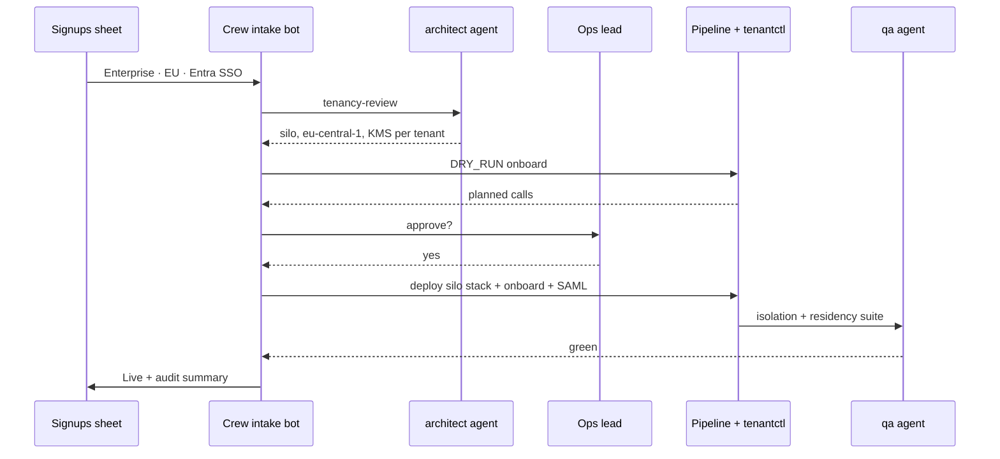

| # | Who | Does | With |
| --- | --- | --- | --- |
| 1 | 🤖 Crew intake bot | Reads the new row in the Signups sheet, then validates the contract fields: tier, region and IdP metadata URL. | Smartsheet MCP, tenant-ops skill |
| 2 | 🤖 architect agent | Runs tenancy-review on the request. Enterprise means the silo model: a dedicated stack pinned to eu-central-1 and a KMS key per tenant. | tenancy-review skill, AWS Knowledge MCP |
| 3 | ⚙️ tenantctl | Dry run: tenant record, admin user with custom:tenantId, usage plan, Bedrock application inference profile in the EU region. | AWS CLI, tenantctl.sh |
| 4 | 🧑 Tenant ops lead | Approves the plan in the Slack thread. | Kiro Crew channel |
| 5 | ⚙️ Pipeline | Deploys the silo stack with CDK in the EU account, then runs onboarding and registers the customer IdP as a Cognito SAML provider. | AWS CDK, Cognito, tenantctl.sh |
| 6 | 🤖 qa agent | Runs the isolation and residency smoke suite: no data outside the EU, and cross-tenant probes return 403/404. | tenant-isolation-tests skill |
| 7 | 🤖 Crew intake bot | Posts a welcome pack and an audit summary on the row, then sets Status = Live. | Smartsheet MCP |

**Guardrails:** Silo deploys need a human approval · Region allow-list per tenant record; SCPs deny other regions in the tenant account · Onboarding is idempotent (conditional writes) · Every step logged with the approver

**Outcome:** Enterprise tenants go live in hours, not weeks, and every one is provisioned the same way.

**Metrics to track:** Contract-to-live time · Onboarding steps done by a human · Residency violations found by tests (target 0)

**Labs:** [46 Automate the tenant lifecycle with Kiro, skills and the AWS CLI](../labs/46-tenant-lifecycle-automation/README.md) · [45 The AI-first team kit — a Kiro agent and skills for every persona](../labs/45-ai-first-persona-kit/README.md) · [33 E2E: Multi-tenant serverless SaaS, spec to production](../labs/33-e2e-serverless-saas/README.md) · [42 Field pattern: project plans in the dev loop with a work-management MCP](../labs/42-work-management-mcp-in-the-dev-loop/README.md) · [13 Kiro Crew bots — always-on teammates](../labs/13-kiro-crew-bots/README.md) · [29 AgentCore Identity — inbound and outbound auth for agents](../labs/29-agentcore-identity/README.md)

**AWS & Kiro services:** Kiro Crew, Smartsheet MCP, AWS CLI, AWS CDK, Amazon Cognito, Amazon Bedrock, AWS KMS, AWS Organizations SCPs

## 2 a.m. noisy neighbour, mitigated in minutes

*Reliability & operations · Advanced · SRE, Support, Account manager*

One tenant's batch job degrades every premium tenant. Agents find it, propose a scoped throttle, and the on-call engineer approves from their phone.

**Trigger:** A CloudWatch anomaly alarm fires: premium-tier p95 latency is above its band.

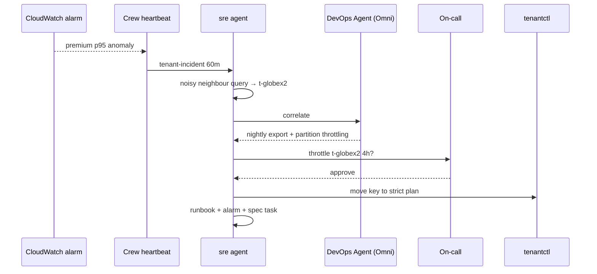

| # | Who | Does | With |
| --- | --- | --- | --- |
| 1 | 🤖 Crew heartbeat | Sees the alarm and starts the sre agent with the tenant-incident skill for the last 60 minutes. | Kiro Crew, CloudWatch alarms |
| 2 | 🤖 sre agent | Scopes the problem to the premium tier. The noisy-neighbour query shows t-globex2 at 61% of requests and 9x its usual AI tokens. | tenant-incident skill, CloudWatch Logs Insights, CloudWatch Omni |
| 3 | 🤖 AWS DevOps Agent | Correlates the spike with t-globex2's new nightly export job and shared DynamoDB partition throttling. | CloudWatch Omni root cause |
| 4 | 🤖 sre agent | Proposes a mitigation: move t-globex2's API key to a stricter usage plan for 4 hours. No global change. | tenantctl.sh (dry run) |
| 5 | 🧑 On-call SRE | Approves on mobile. The throttle is applied, and premium p95 recovers within 6 minutes. | Kiro mobile / Slack |
| 6 | 🤖 support agent | Drafts a customer-safe note to t-globex2's account manager explaining the throttle and suggesting off-peak scheduling. | ticket-to-repro skill |
| 7 | 🤖 sre agent | Runs runbook-from-incident, which produces a per-tenant write-capacity alarm and a spec task for adaptive throttling. | runbook-from-incident skill |

**Guardrails:** Investigation is read-only · Mitigation is scoped to one tenant and time-boxed · A human approves every throttle change · The customer message is reviewed before it is sent

**Outcome:** One tenant is temporarily limited instead of every tenant degrading, and the class of incident is prevented next time.

**Metrics to track:** Time to tenant attribution · MTTR per tier · Tenants affected per incident

**Labs:** [47 Tenant-aware observability with CloudWatch Omni](../labs/47-tenant-observability-cloudwatch-omni/README.md) · [45 The AI-first team kit — a Kiro agent and skills for every persona](../labs/45-ai-first-persona-kit/README.md) · [46 Automate the tenant lifecycle with Kiro, skills and the AWS CLI](../labs/46-tenant-lifecycle-automation/README.md) · [12 Kiro Crew — your persistent agent workspace](../labs/12-kiro-crew-workspace/README.md) · [35 E2E: An AI SRE crew — detect, investigate, fix, learn](../labs/35-e2e-sre-crew/README.md) · [19 Incident investigation with CloudWatch & CloudTrail MCP](../labs/19-observability-with-mcp/README.md)

**AWS & Kiro services:** Amazon CloudWatch Omni, AWS DevOps Agent, CloudWatch Logs Insights, Amazon API Gateway usage plans, Kiro Crew

## A cross-tenant RAG leak caught before release

*AI engineering · Advanced · AI engineer, QA, Security*

A retrieval refactor drops the tenant filter. The eval gate's isolation probes catch it in CI, and no customer ever sees it.

**Trigger:** A PR refactors the search tool to support hybrid search and accidentally drops kb_filter(ctx).

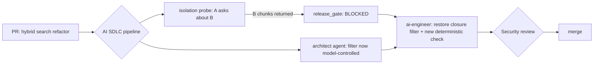

| # | Who | Does | With |
| --- | --- | --- | --- |
| 1 | ⚙️ AI SDLC pipeline | Runs the spec gate, unit tests and the isolation suite. The RAG isolation probe for tenant A asking about tenant B's documents returns B's chunks. | spec_gate.py, tenant-isolation-tests |
| 2 | 🤖 architect agent | Its tenancy review flags that the filter is now a parameter the model can control, not a closure, and cites the tenancy-review rule. | tenancy-review skill, headless Kiro |
| 3 | ⚙️ release_gate | isolation_probes_passed < isolation_probes, so the release is blocked. | router.release_gate |
| 4 | 🤖 ai-engineer agent | Restores kb_filter as a closure and adds a deterministic 'no foreign tenant id in output' check to the golden set. | ai-feature-eval skill, Kiro |
| 5 | 🧑 Security engineer | Reviews the fix and the new probe, then approves. | GitHub review |

**Guardrails:** Isolation probes are a hard gate · The tenant filter is never a model-controlled argument · Gateway policy requires tool tenant_id = caller claim

**Outcome:** The leak never reaches production, and the eval set permanently covers this class of bug.

**Metrics to track:** Isolation probe coverage per AI feature · Escaped isolation defects (target 0)

**Labs:** [48 Multi-tenant AI features on Bedrock — isolation, cost and budgets per tenant](../labs/48-multi-tenant-ai-on-bedrock/README.md) · [49 The AI-first SDLC pipeline — every persona automated, humans at the gates](../labs/49-ai-sdlc-pipeline/README.md) · [50 An AI engineering platform for SaaS — routing, prompt versions, canaries, release gates](../labs/50-ai-engineering-platform/README.md) · [45 The AI-first team kit — a Kiro agent and skills for every persona](../labs/45-ai-first-persona-kit/README.md) · [30 AgentCore Policy — deterministic tool control with Cedar](../labs/30-agentcore-policy/README.md) · [25 Evals, hooks and guardrails for Strands agents](../labs/25-strands-evals-and-guardrails/README.md)

**AWS & Kiro services:** Amazon Bedrock Knowledge Bases, Strands Agents, AgentCore Policy, GitHub Actions, Kiro CLI headless

## Model deprecation: migrate every tenant without a quality dip

*AI engineering · Expert · AI engineer, FinOps, Product manager*

A Bedrock model reaches end of life. The AI platform evaluates candidates per tier, canaries by tenant and promotes, with no outage and no surprise bill.

**Trigger:** An announcement that the model behind the premium route will be retired in 90 days.

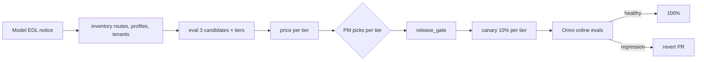

| # | Who | Does | With |
| --- | --- | --- | --- |
| 1 | 🤖 ai-engineer agent | Lists every route, profile and tenant that uses the model, from model_policy.json and the application inference profiles. | router.py, AWS MCP Server |
| 2 | 🤖 ai-engineer agent | Runs ai-feature-eval for 3 candidate models on each golden set and writes eval records. | ai-feature-eval skill, Strands Evals |
| 3 | 🤖 finops agent | Prices each candidate at current per-tier volume and flags a margin impact for basic. | tenant-cost-report, AWS Pricing MCP |
| 4 | 🧑 Product manager | Picks the candidate per tier, trading quality against margin. | Kiro spec |
| 5 | ⚙️ Pipeline | The release gate passes. Canary is 10% of tenants per tier, and inference profiles are updated via tenantctl. | release_gate, tenantctl.sh |
| 6 | ⚙️ CloudWatch Omni | Compares online evaluation scores and latency by prompt and model version. The canary is healthy, so it is promoted to 100%. | Omni evaluators |

**Guardrails:** No model change without an eval record · Cost increase over 15% needs a budget owner · Deterministic per-tenant canary; rollback = revert the PR

**Outcome:** Migration finishes weeks before end of life, with quality equal or better and a known cost impact per tier.

**Metrics to track:** Eval pass rate vs baseline per tier · Cost per 1k requests per tier · Days before end of life completed

**Labs:** [50 An AI engineering platform for SaaS — routing, prompt versions, canaries, release gates](../labs/50-ai-engineering-platform/README.md) · [48 Multi-tenant AI features on Bedrock — isolation, cost and budgets per tenant](../labs/48-multi-tenant-ai-on-bedrock/README.md) · [45 The AI-first team kit — a Kiro agent and skills for every persona](../labs/45-ai-first-persona-kit/README.md) · [47 Tenant-aware observability with CloudWatch Omni](../labs/47-tenant-observability-cloudwatch-omni/README.md) · [18 FinOps with MCP — estimate, explain, optimize](../labs/18-finops-with-mcp/README.md) · [32 AgentCore Observability and Evaluations](../labs/32-agentcore-observability-evaluations/README.md)

**AWS & Kiro services:** Amazon Bedrock, Bedrock application inference profiles, Strands Evals, Amazon CloudWatch Omni, AWS Pricing MCP

## Runaway agent spend stopped at the budget, not the invoice

*Cost & FinOps · Advanced · FinOps, SRE, Account manager*

A tenant's automation loops on an agent endpoint. The token budget caps it, alarms fire and FinOps turns it into a pricing conversation.

**Trigger:** Tenant t-initech's integration retries an agent call in a tight loop over a weekend.

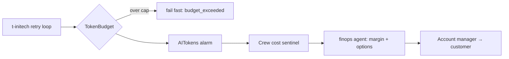

| # | Who | Does | With |
| --- | --- | --- | --- |
| 1 | ⚙️ TokenBudget | Atomic conditional updates reject calls once the monthly tier budget is reached, so requests fail fast with a clear error code. | tenant_ai.TokenBudget, DynamoDB |
| 2 | ⚙️ CloudWatch alarm | The per-tenant AITokens alarm fires for t-initech. | ops/alarms.sh |
| 3 | 🤖 Crew cost sentinel | Confirms the spend in Cost Explorer under the tenantId tag and finds the looping caller in the traces. | Billing MCP, CloudWatch Omni |
| 4 | 🤖 finops agent | Writes a margin impact summary and recommends an overage add-on or the enterprise tier. | tenant-cost-report skill |
| 5 | 🧑 Account manager | Contacts the customer with the fix (backoff) and the commercial options. | — |

**Guardrails:** Hard budget per tenant and tier · Per-tenant cost attribution via inference profiles · Agents never change budgets or prices

**Outcome:** The bill stays bounded, the customer gets a fix, and pricing learns from real usage.

**Metrics to track:** Max overspend per tenant · Time from anomaly to customer contact · Negative-margin tenants

**Labs:** [48 Multi-tenant AI features on Bedrock — isolation, cost and budgets per tenant](../labs/48-multi-tenant-ai-on-bedrock/README.md) · [47 Tenant-aware observability with CloudWatch Omni](../labs/47-tenant-observability-cloudwatch-omni/README.md) · [45 The AI-first team kit — a Kiro agent and skills for every persona](../labs/45-ai-first-persona-kit/README.md) · [13 Kiro Crew bots — always-on teammates](../labs/13-kiro-crew-bots/README.md) · [18 FinOps with MCP — estimate, explain, optimize](../labs/18-finops-with-mcp/README.md)

**AWS & Kiro services:** Amazon DynamoDB, Bedrock application inference profiles, Cost Explorer, Amazon CloudWatch Omni, Kiro Crew

## Critical CVE across 40 services, patched by an agent fleet

*Security & compliance · Expert · Security, Developer, Release manager*

A critical library CVE lands on Friday. The autonomous agent opens tested PRs across every repo, and Security Agent verifies them.

**Trigger:** A critical CVE is published for a JSON parsing library used in 40 microservices.

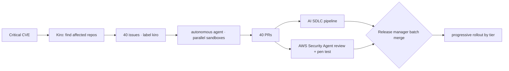

| # | Who | Does | With |
| --- | --- | --- | --- |
| 1 | 🧑 security engineer + Kiro | Runs a code search for affected repos and versions, then opens one issue per repo from the delegate template with label kiro. | Kiro CLI, GitHub |
| 2 | 🤖 Kiro autonomous agent | Works the issues in parallel sandboxes: bumps the version, fixes breaking changes and runs tests and isolation suites. | Kiro autonomous agent, steering |
| 3 | ⚙️ AI SDLC pipeline | Runs on each PR: spec-exempt (security), tests, isolation suite and AI review. | ai-sdlc.yml |
| 4 | 🤖 AWS Security Agent | PR security review confirms the vulnerable path is gone. An on-demand pen test runs against the dev endpoint. | AWS Security Agent |
| 5 | 🧑 Release manager | Batch-merges green PRs and rolls out progressively by tier. | release-manager agent |

**Guardrails:** Agents open PRs, humans merge · Sandbox network allow-list · Progressive rollout with automatic rollback alarms

**Outcome:** Fleet-wide remediation in hours with evidence for every repo.

**Metrics to track:** Time from CVE to 100% patched · PRs merged without human edits · Post-patch incidents

**Labs:** [14 The Kiro autonomous agent — issue to PR](../labs/14-kiro-autonomous-agent/README.md) · [49 The AI-first SDLC pipeline — every persona automated, humans at the gates](../labs/49-ai-sdlc-pipeline/README.md) · [10 Headless Kiro in CI/CD](../labs/10-headless-kiro-in-ci/README.md) · [38 E2E: A governed agent platform for your organization](../labs/38-e2e-governed-agent-platform/README.md) · [05 Custom agents with scoped permissions](../labs/05-custom-agents/README.md)

**AWS & Kiro services:** Kiro autonomous agent, AWS Security Agent, GitHub Actions, Kiro CLI

## Customer ticket to deployed fix the same day

*Delivery & SDLC · Advanced · Support, Developer, QA, Release manager*

A premium customer reports empty exports. Support, engineering and release agents hand off through a bugfix spec, and the customer gets a specific answer before end of day.

**Trigger:** Ticket: 'Our CSV exports are empty since Tuesday', tenant t-acme01 (premium).

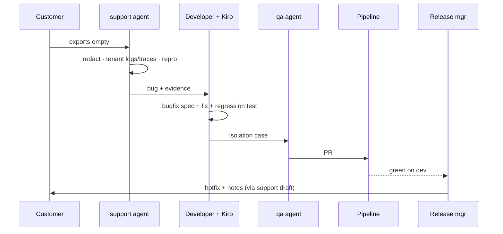

| # | Who | Does | With |
| --- | --- | --- | --- |
| 1 | 🤖 support agent | Redacts PII, pulls t-acme01's logs and traces for the window, and finds a serialization error after Tuesday's release. Writes a reproducible bug report. | ticket-to-repro skill, CloudWatch Omni |
| 2 | 🧑 Developer + Kiro | Creates a bugfix spec where unchanged behaviour = other export formats. Kiro implements it with a regression test. | Kiro bugfix spec |
| 3 | 🤖 qa agent | Adds an isolation case: an export as tenant A never contains B's rows. | tenant-isolation-tests |
| 4 | ⚙️ AI SDLC pipeline | Runs the gates, deploys to dev and runs the smoke tests. | ai-sdlc.yml |
| 5 | 🧑 Release manager | Promotes the hotfix. Release notes are generated per tier. | release-manager agent |
| 6 | 🤖 support agent | Drafts a specific customer reply with the root cause in plain terms and the fixed version. A human sends it. | ticket-to-repro skill |

**Guardrails:** PII redaction before engineering sees the ticket · Reproduction uses a test tenant, never customer data · Humans send customer communications

**Outcome:** A same-day fix with a regression test, and a customer reply that builds trust.

**Metrics to track:** Ticket-to-deploy time · Reopened tickets · Customer satisfaction on escalations

**Labs:** [45 The AI-first team kit — a Kiro agent and skills for every persona](../labs/45-ai-first-persona-kit/README.md) · [03 Spec-driven development](../labs/03-spec-driven-development/README.md) · [49 The AI-first SDLC pipeline — every persona automated, humans at the gates](../labs/49-ai-sdlc-pipeline/README.md) · [47 Tenant-aware observability with CloudWatch Omni](../labs/47-tenant-observability-cloudwatch-omni/README.md) · [05 Custom agents with scoped permissions](../labs/05-custom-agents/README.md)

**AWS & Kiro services:** Kiro specs, Amazon CloudWatch Omni, GitHub Actions, Kiro CLI

## Right to erasure across data, search, memory and model logs

*Security & compliance · Expert · Security / DPO, Tenant operations, AI engineer*

A tenant asks for one user's data to be deleted. Agents find every copy, including AI memory and knowledge base chunks, and produce an erasure certificate.

**Trigger:** A data subject erasure request from tenant t-acme01 for user u-881.

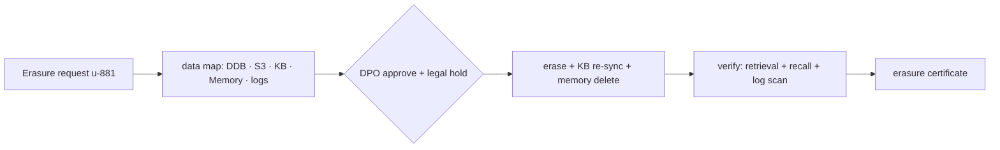

| # | Who | Does | With |
| --- | --- | --- | --- |
| 1 | 🤖 tenant-ops agent | Builds a data map for u-881: DynamoDB items, S3 exports, Knowledge Base documents (metadata tenantId+userId), AgentCore Memory namespace /tenant/t-acme01/user/u-881, and logs. | tenant-ops skill, AWS MCP Server |
| 2 | 🧑 DPO | Reviews the data map and the legal holds, then approves. | — |
| 3 | ⚙️ Erasure job | Deletes items and objects, removes KB documents and re-syncs the data source, and deletes memory records for the actor. | AWS CLI, Bedrock Knowledge Bases, AgentCore Memory |
| 4 | 🤖 qa agent | Verifies retrieval and memory recall for u-881 return nothing, and searches logs for residual identifiers. | tenant-isolation-tests |
| 5 | 🤖 tenant-ops agent | Generates an erasure certificate listing systems, timestamps and verification queries. | — |

**Guardrails:** Identity-scoped memory namespaces make deletion precise · Human approval and legal-hold check · Verification by retrieval, not by assumption

**Outcome:** Complete, provable erasure, including AI-derived data.

**Metrics to track:** Time to complete erasure · Residual data found in verification (target 0)

**Labs:** [48 Multi-tenant AI features on Bedrock — isolation, cost and budgets per tenant](../labs/48-multi-tenant-ai-on-bedrock/README.md) · [28 AgentCore Memory — agents that remember](../labs/28-agentcore-memory/README.md) · [46 Automate the tenant lifecycle with Kiro, skills and the AWS CLI](../labs/46-tenant-lifecycle-automation/README.md) · [37 E2E: Enterprise knowledge assistant with permissions-aware RAG](../labs/37-e2e-enterprise-knowledge-assistant/README.md) · [45 The AI-first team kit — a Kiro agent and skills for every persona](../labs/45-ai-first-persona-kit/README.md)

**AWS & Kiro services:** Amazon DynamoDB, Amazon S3, Bedrock Knowledge Bases, AgentCore Memory, AWS CLI

## New AI feature from idea to GA in one sprint

*Delivery & SDLC · Advanced · Product manager, AI engineer, Architect, QA, FinOps*

'Summarize this account's activity' goes from a customer ask to a tiered, evaluated, observed GA feature, with every persona's agent pulling its weight.

**Trigger:** Top requested feature on the roadmap: account activity summaries.

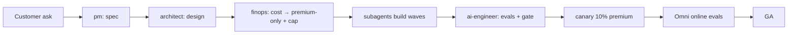

| # | Who | Does | With |
| --- | --- | --- | --- |
| 1 | 🤖 pm agent | prd-to-spec: EARS requirements with tier gating (premium+), isolation, metering, success metrics and rollout. | prd-to-spec skill |
| 2 | 🤖 architect agent | Design: a Strands agent on AgentCore Runtime, tools via Gateway, a per-tenant inference profile and Policy rules. | tenancy-review, AWS Knowledge MCP |
| 3 | 🤖 finops agent | Estimates cost per tenant per month at forecast usage, so the PM sets premium-only and a monthly cap. | estimate-before-build |
| 4 | 🤖 Developers + subagents | Implement spec task waves in parallel. | Kiro specs, subagents |
| 5 | 🤖 ai-engineer agent | Builds a golden set with isolation probes; the release gate passes; 10% canary of premium tenants. | ai-feature-eval, release_gate |
| 6 | ⚙️ CloudWatch Omni | Online evaluations and latency look healthy, so GA follows. | Omni evaluators |

**Guardrails:** Spec gate on every PR · Eval and cost gates · Tier-gated feature flag

**Outcome:** A measurable, profitable AI feature shipped safely in one sprint.

**Metrics to track:** Lead time idea to GA · Adoption per tier · Cost per active tenant

**Labs:** [45 The AI-first team kit — a Kiro agent and skills for every persona](../labs/45-ai-first-persona-kit/README.md) · [03 Spec-driven development](../labs/03-spec-driven-development/README.md) · [06 Subagents and parallel work](../labs/06-subagents-and-parallel-work/README.md) · [48 Multi-tenant AI features on Bedrock — isolation, cost and budgets per tenant](../labs/48-multi-tenant-ai-on-bedrock/README.md) · [50 An AI engineering platform for SaaS — routing, prompt versions, canaries, release gates](../labs/50-ai-engineering-platform/README.md) · [26 Deploy agents to AgentCore Runtime](../labs/26-agentcore-runtime/README.md) · [27 AgentCore Gateway — any API becomes an MCP tool](../labs/27-agentcore-gateway/README.md) · [30 AgentCore Policy — deterministic tool control with Cedar](../labs/30-agentcore-policy/README.md) · [47 Tenant-aware observability with CloudWatch Omni](../labs/47-tenant-observability-cloudwatch-omni/README.md)

**AWS & Kiro services:** Kiro specs, Strands Agents, AgentCore Runtime, AgentCore Gateway, AgentCore Policy, Amazon Bedrock, Amazon CloudWatch Omni

## Migrating on-prem single-tenant customers into the pooled SaaS

*Modernization · Expert · Architect, Tenant operations, QA, Customer success*

Hundreds of legacy single-tenant installs move onto the multi-tenant platform. Each tenant is proven at parity before cutover.

**Trigger:** Executive decision to retire the on-prem product line within 12 months.

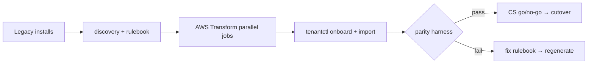

| # | Who | Does | With |
| --- | --- | --- | --- |
| 1 | 🤖 migration-engine skill | Discovery on the legacy schema, then a rulebook mapping legacy entities to pooled keys with tenantId. | migration-engine skill, Kiro |
| 2 | ⚙️ Parity harness | Replays recorded API cases per customer against legacy and the pooled tenant. | parity_harness.py |
| 3 | 🤖 AWS Transform | Runs the same skill files across the customer portfolio as parallel jobs. | AWS Transform |
| 4 | 🤖 Crew bot | Per wave: onboard tenants via tenantctl, import data, run parity and post the report. | tenant-ops skill, Kiro Crew |
| 5 | 🧑 Customer success | Go/no-go per customer from the parity report, then cutover scheduling. | — |

**Guardrails:** No cutover without a parity report · Rulebook changes are reviewed and regenerate output · Rollback window per tenant

**Outcome:** A predictable, evidence-backed migration factory instead of bespoke projects.

**Metrics to track:** Tenants migrated per week · Parity pass rate at first attempt · Post-cutover tickets

**Labs:** [39 Field pattern: a skill-driven, parity-verified migration engine](../labs/39-skill-driven-migration-engine/README.md) · [36 E2E: Legacy monolith to serverless, spec by spec](../labs/36-e2e-legacy-modernization/README.md) · [46 Automate the tenant lifecycle with Kiro, skills and the AWS CLI](../labs/46-tenant-lifecycle-automation/README.md) · [13 Kiro Crew bots — always-on teammates](../labs/13-kiro-crew-bots/README.md) · [45 The AI-first team kit — a Kiro agent and skills for every persona](../labs/45-ai-first-persona-kit/README.md)

**AWS & Kiro services:** Kiro skills, AWS Transform, Kiro Crew, AWS CLI, AWS Database Migration Service

## Multi-region failover game day run by agents

*Reliability & operations · Expert · SRE, Architect, Leadership*

A quarterly DR game day where agents prepare, execute and score a region switch, and humans hold the big red button.

**Trigger:** Quarterly resilience game day for enterprise SLA commitments.

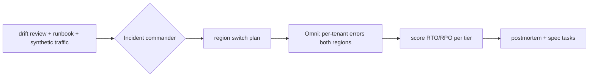

| # | Who | Does | With |
| --- | --- | --- | --- |
| 1 | 🤖 architect agent | Reviews region-switch plans and IaC for drift between primary and secondary, and opens fixes. | iac-author, AWS IaC MCP |
| 2 | 🤖 sre agent | Generates the game day runbook, success criteria per tier and synthetic tenant traffic. | runbook-from-incident |
| 3 | 🧑 Incident commander | Starts the switch using declarative region-switch plans. | Amazon Application Recovery Controller |
| 4 | ⚙️ CloudWatch Omni | Tracks golden metrics and per-tenant error rates across both regions in one space. | Omni spaces |
| 5 | 🤖 sre agent | Scores the run against RTO and RPO per tier, and turns gaps into a postmortem and spec tasks. | runbook-from-incident |

**Guardrails:** Humans initiate failover · Synthetic tenants only during drills · Every finding becomes a tracked task

**Outcome:** Proven, repeatable failover with evidence for enterprise customers.

**Metrics to track:** Measured RTO/RPO vs SLA per tier · Drift findings per drill

**Labs:** [16 Infrastructure as code with MCP](../labs/16-iac-with-mcp/README.md) · [45 The AI-first team kit — a Kiro agent and skills for every persona](../labs/45-ai-first-persona-kit/README.md) · [47 Tenant-aware observability with CloudWatch Omni](../labs/47-tenant-observability-cloudwatch-omni/README.md) · [35 E2E: An AI SRE crew — detect, investigate, fix, learn](../labs/35-e2e-sre-crew/README.md) · [38 E2E: A governed agent platform for your organization](../labs/38-e2e-governed-agent-platform/README.md)

**AWS & Kiro services:** Amazon Application Recovery Controller, Amazon CloudWatch Omni, AWS CDK, Kiro

## Repackaging tiers from real unit economics

*Cost & FinOps · Advanced · FinOps, Product manager, Leadership*

FinOps and product agents turn per-tenant cost data into a pricing proposal, and the change ships behind feature flags with metering already in place.

**Trigger:** Quarterly review shows basic-tier AI usage eroding margin.

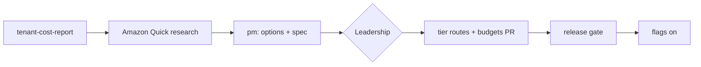

| # | Who | Does | With |
| --- | --- | --- | --- |
| 1 | 🤖 finops agent | tenant-cost-report for the quarter: margin by tier, top negative-margin tenants and drivers (AI tokens on summaries). | tenant-cost-report, Cost Explorer |
| 2 | 🤖 Amazon Quick | Research flow combining usage data, competitor pricing pages and win/loss notes into a briefing. | Quick Research, Quick Flows |
| 3 | 🤖 pm agent | Drafts packaging options and a spec for an AI add-on with metering and a monthly cap. | prd-to-spec |
| 4 | 🧑 Leadership | Chooses the option. | — |
| 5 | ⚙️ AI platform | Tier routes and budgets updated in model_policy and TIER_DEFAULTS via PR and the release gate. | router.py, tenant_ai.py |

**Guardrails:** Agents propose, humans price · Changes ship via reviewed config · Existing contracts are respected (grandfathering flags)

**Outcome:** Pricing grounded in measured cost-to-serve, shipped without code rewrites.

**Metrics to track:** Gross margin per tier · Add-on adoption · Churn after repackaging

**Labs:** [45 The AI-first team kit — a Kiro agent and skills for every persona](../labs/45-ai-first-persona-kit/README.md) · [48 Multi-tenant AI features on Bedrock — isolation, cost and budgets per tenant](../labs/48-multi-tenant-ai-on-bedrock/README.md) · [50 An AI engineering platform for SaaS — routing, prompt versions, canaries, release gates](../labs/50-ai-engineering-platform/README.md) · [18 FinOps with MCP — estimate, explain, optimize](../labs/18-finops-with-mcp/README.md)

**AWS & Kiro services:** Cost Explorer, Amazon Quick, Amazon Bedrock, Kiro specs

## Incident spanning AWS and Azure-hosted tenants

*Reliability & operations · Expert · SRE, Support*

Some enterprise tenants run in a customer-mandated Azure region. One Omni space sees both clouds, so the investigation doesn't split in two.

**Trigger:** Elevated errors for two enterprise tenants, one on AWS and one on Azure.

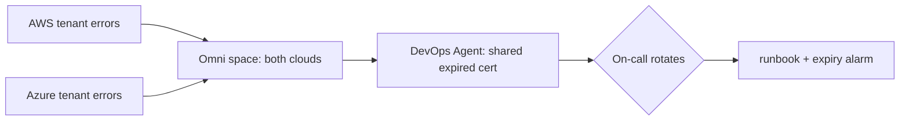

| # | Who | Does | With |
| --- | --- | --- | --- |
| 1 | 🤖 sre agent | Queries the Omni space that includes Azure Monitor metrics, resource logs and Application Insights traces. | CloudWatch Omni, tenant-incident skill |
| 2 | 🤖 AWS DevOps Agent | Correlates both errors to the same expired certificate on a shared identity integration. | Omni root cause |
| 3 | 🧑 On-call SRE | Rotates the certificate and confirms recovery in both clouds. | — |
| 4 | 🤖 sre agent | Runbook plus a certificate-expiry alarm for all clouds. | runbook-from-incident |

**Guardrails:** Read-only investigation · Customer communications reviewed

**Outcome:** One investigation, one root cause, across clouds.

**Metrics to track:** MTTR for multicloud incidents · Certificate-expiry incidents (target 0)

**Labs:** [47 Tenant-aware observability with CloudWatch Omni](../labs/47-tenant-observability-cloudwatch-omni/README.md) · [45 The AI-first team kit — a Kiro agent and skills for every persona](../labs/45-ai-first-persona-kit/README.md) · [19 Incident investigation with CloudWatch & CloudTrail MCP](../labs/19-observability-with-mcp/README.md)

**AWS & Kiro services:** Amazon CloudWatch Omni, AWS DevOps Agent, Azure Monitor (via Omni)

## B2B agent-to-agent integration with a partner

*Integration & ecosystem · Expert · Architect, Security, Partner manager*

A logistics partner's agent needs shipment status for your shared customers. A2A plus Gateway policy lets it in with tenant consent and nothing more.

**Trigger:** Partnership agreement: partner agent may query order status for tenants who opt in.

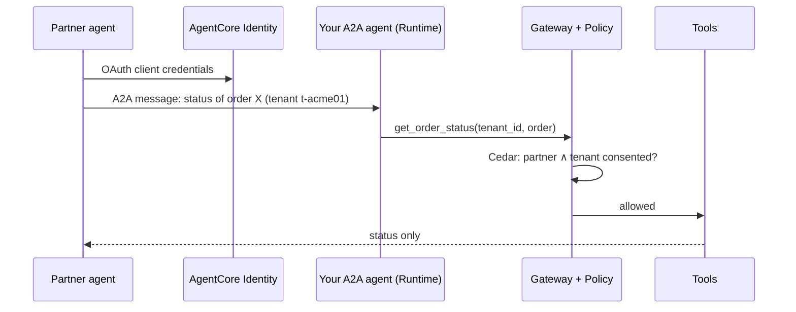

| # | Who | Does | With |
| --- | --- | --- | --- |
| 1 | 🤖 architect agent | Designs an A2A endpoint on AgentCore Runtime with an agent card exposing only get_order_status. | Strands A2A, AgentCore Runtime |
| 2 | 🧑 Security | Configures partner OAuth client credentials in AgentCore Identity, and Cedar rules: partner can call get_order_status only for consenting tenants. | AgentCore Identity, AgentCore Policy |
| 3 | 🧑 Tenant admin | Opts in from the tenant settings page, which writes the consent flag to the tenant record. | — |
| 4 | ⚙️ Policy engine | LOG_ONLY for a week, review the decisions, then ENFORCE. | AgentCore Policy |
| 5 | ⚙️ CloudWatch Omni | Partner calls traced with partner id and tenant id; abuse alarms. | Omni |

**Guardrails:** Consent per tenant · Least-privilege tool surface · Policy enforced outside the agent code

**Outcome:** A new partner channel without exposing tenant data beyond what was agreed.

**Metrics to track:** Denied policy decisions · Partner call volume per tenant

**Labs:** [24 A2A — agents across teams and frameworks](../labs/24-strands-a2a/README.md) · [26 Deploy agents to AgentCore Runtime](../labs/26-agentcore-runtime/README.md) · [29 AgentCore Identity — inbound and outbound auth for agents](../labs/29-agentcore-identity/README.md) · [30 AgentCore Policy — deterministic tool control with Cedar](../labs/30-agentcore-policy/README.md) · [27 AgentCore Gateway — any API becomes an MCP tool](../labs/27-agentcore-gateway/README.md) · [47 Tenant-aware observability with CloudWatch Omni](../labs/47-tenant-observability-cloudwatch-omni/README.md)

**AWS & Kiro services:** Strands A2A, AgentCore Runtime, AgentCore Identity, AgentCore Policy, AgentCore Gateway, Amazon CloudWatch Omni

## Platform upgrade wave: runtime end of life across every stack

*Modernization · Advanced · Platform engineer, SRE, Release manager*

A Lambda runtime and a CDK major version reach end of life. Bots plan the wave, the autonomous agent does the edits, and tenants never notice.

**Trigger:** Runtime deprecation notice and a new CDK major version.

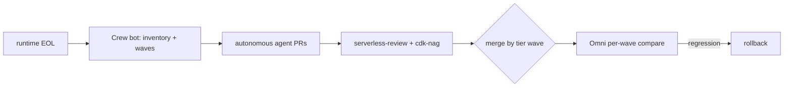

| # | Who | Does | With |
| --- | --- | --- | --- |
| 1 | 🤖 Crew release-readiness bot | Inventories functions per account and stack with the AWS MCP Server, groups them by owner and risk, and plans waves. | AWS MCP Server, Kiro Crew |
| 2 | 🤖 Kiro autonomous agent | One issue per stack: runtime bump, CDK migration and tests, then a PR. | Kiro autonomous agent |
| 3 | 🤖 serverless-review skill | Checks timeouts, memory and arm64 opportunities while it's there. | serverless-review, cdk-nag |
| 4 | 🧑 Release manager | Merges by wave: internal, then basic, then premium, then enterprise. | — |
| 5 | ⚙️ CloudWatch Omni | Per-wave error and latency comparison; automatic rollback alarm. | Omni |

**Guardrails:** Wave order by tier · Rollback alarms · cdk-nag clean

**Outcome:** Upgrades become routine background work instead of quarter-long projects.

**Metrics to track:** Stacks on supported runtimes · Upgrade-related incidents

**Labs:** [13 Kiro Crew bots — always-on teammates](../labs/13-kiro-crew-bots/README.md) · [14 The Kiro autonomous agent — issue to PR](../labs/14-kiro-autonomous-agent/README.md) · [15 The managed AWS MCP Server](../labs/15-aws-mcp-server/README.md) · [16 Infrastructure as code with MCP](../labs/16-iac-with-mcp/README.md) · [07 Agent skills](../labs/07-agent-skills/README.md) · [47 Tenant-aware observability with CloudWatch Omni](../labs/47-tenant-observability-cloudwatch-omni/README.md)

**AWS & Kiro services:** AWS MCP Server, Kiro Crew, Kiro autonomous agent, AWS Lambda, AWS CDK, Amazon CloudWatch Omni

## Continuous audit evidence for SOC 2 and enterprise security reviews

*Security & compliance · Advanced · Security / compliance, Sales engineering*

Security questionnaires and audit requests are answered from live evidence that agents collect continuously, not from a scramble.

**Trigger:** An enterprise prospect sends a 300-question security questionnaire. A SOC 2 period also closes.

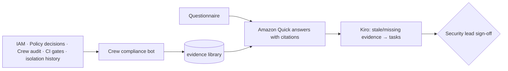

| # | Who | Does | With |
| --- | --- | --- | --- |
| 1 | 🤖 Crew compliance bot | Weekly evidence collection: IAM Identity Center assignments, policy engine decisions, Kiro Crew audit logs, pipeline gate results and isolation test history. | AWS MCP Server, Kiro Crew |
| 2 | 🤖 Amazon Quick | Answers the questionnaire from the evidence library and policies, with citations. | Quick Research |
| 3 | 🤖 security agent (Kiro) | Flags answers whose evidence is stale or missing, and opens tasks. | threat-model skill |
| 4 | 🧑 Security lead | Reviews and signs off. | — |

**Guardrails:** Answers must cite evidence · Human sign-off · Evidence store is read-only to agents

**Outcome:** Faster enterprise deals and stress-free audits.

**Metrics to track:** Questionnaire turnaround · Evidence freshness · Audit findings

**Labs:** [38 E2E: A governed agent platform for your organization](../labs/38-e2e-governed-agent-platform/README.md) · [30 AgentCore Policy — deterministic tool control with Cedar](../labs/30-agentcore-policy/README.md) · [49 The AI-first SDLC pipeline — every persona automated, humans at the gates](../labs/49-ai-sdlc-pipeline/README.md) · [12 Kiro Crew — your persistent agent workspace](../labs/12-kiro-crew-workspace/README.md) · [41 Field pattern: domain skills at scale — coordinator, specialists, A/B evals](../labs/41-domain-skills-at-scale/README.md)

**AWS & Kiro services:** AWS IAM Identity Center, AgentCore Policy, Kiro Crew, Amazon Quick, AWS MCP Server
