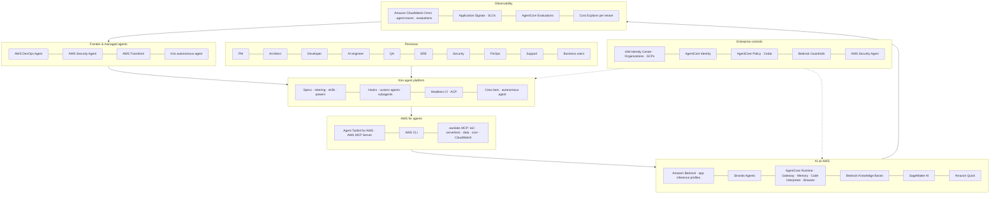

# The AI-first SaaS playbook on AWS

How a multi-tenant SaaS company runs as an **AI-first organization**: every persona delegates repeatable work to agents, humans own intent and judgment, and multi-tenancy (isolation, tiers, metering, per-tenant cost) is designed into every automation. Built on **Kiro** (IDE, CLI, Web, Crew, autonomous agent), **skills**, **MCP** and the **AWS CLI**, with the full AI stack on AWS and **CloudWatch Omni** for observability.

> Principles: *Humans provide intent, AI creates, humans verify* (AWS ProServe's AI-DLC). Expertise lives in versioned files (skills and steering), not in prompts. Every automation is tenant-aware, least-privilege and auditable.

## 1 · The full-stack AI reference architecture on AWS

| Layer | Services | Role in an AI-first SaaS |
| --- | --- | --- |
| Interfaces | Kiro (IDE/CLI/Web/mobile), Amazon Quick (business users), your product UI | Where people delegate work |
| Agent platform for building | Kiro specs, steering, skills, powers, hooks, custom agents, Crew, autonomous agent | How the company *builds and operates* |
| AWS access for agents | Agent Toolkit for AWS (AWS MCP Server, skills, plugins), AWS CLI, awslabs MCP servers | Agents act on AWS under IAM |
| AI runtime for the product | Bedrock (+ per-tenant inference profiles, Guardrails), Strands, AgentCore, Knowledge Bases, SageMaker AI | How the *product* delivers AI to tenants |
| Managed agents | AWS DevOps Agent, AWS Security Agent, AWS Transform, Kiro autonomous agent | Long-running specialist work |
| Observability | CloudWatch Omni (agent tracing, evaluators, DevOps Agent root cause, Kiro extension), Application Signals, AgentCore Evaluations, Cost Explorer | Quality, reliability, cost per tenant |
| Controls | IAM Identity Center, AgentCore Identity and Policy, Bedrock Guardrails, hooks, permissions | Safety and audit |

## 2 · Persona automation catalog

Each row is an activity that an AI worker does and a human gates. "Lab" points to the hands-on build.

### Product management
| Activity | AI worker | Tools | Human gate | Lab |
| --- | --- | --- | --- | --- |
| Customer asks → spec with tier, isolation and metering requirements | `pm` agent + `prd-to-spec` | Kiro specs, Smartsheet/Jira MCP | Approve requirements | 45, 42 |
| Roadmap rows → specs; status synced from commits | Kiro + hooks | Work-management MCP, Stop hook | — | 42 |
| Feature adoption per tier, churn signals | Amazon Quick research and flows | Quick, analytics data | Prioritization | — |
| Release notes per tier | `release-manager` agent | Headless Kiro | Publish | 49 |

### Architecture
| Activity | AI worker | Tools | Human gate | Lab |
| --- | --- | --- | --- | --- |
| Tenancy review of designs and diffs | `architect` + `tenancy-review` | Kiro, AWS Knowledge MCP | Approve design | 45, 49 |
| IaC authoring with validation | `iac-author` | AWS IaC MCP, cdk-nag | `cdk diff` review | 16 |
| ADRs | `adr-writer` skill | Kiro | Accept ADR | 07 |
| Modernization to SaaS | `migration-engine` skill, AWS Transform | Parity harness | Phase gates | 39, 36 |

### Software engineering
| Activity | AI worker | Tools | Human gate | Lab |
| --- | --- | --- | --- | --- |
| Implement spec tasks in parallel | Kiro + subagents | Specs, steering, skills | PR review | 03, 06 |
| Background issue → PR | Kiro autonomous agent | GitHub | PR review | 14 |
| Guardrails on every save and tool call | Hooks | Lint, tests, secret scan, destructive-command guard | — | 04 |
| Remember decisions across sessions | Memory MCP | AgentCore Memory | — | 40 |
| Fix failing tests nightly | Headless Kiro | GitHub Actions | Draft PR review | 10 |

### AI engineering
| Activity | AI worker | Tools | Human gate | Lab |
| --- | --- | --- | --- | --- |
| Build agents | Kiro + Strands power | Strands, MCP | Code review | 21–24 |
| Tenant-safe AI features (isolation, cost, budgets) | `ai-engineer` + `tenancy-review` | Bedrock profiles, KB filters, Memory namespaces | Isolation tests | 48 |
| Prompt and model changes with eval gates and canaries | `ai-engineer` + `ai-feature-eval` | Router, registry, Omni | Promote to stable | 50 |
| Production hosting and governance | — | AgentCore Runtime, Gateway, Identity, Policy | Policy LOG_ONLY → ENFORCE | 26–30 |
| Fine-tuning | Kiro in SageMaker AI | Model customization skills | Eval review | 44 |

### QA
| Activity | AI worker | Tools | Human gate | Lab |
| --- | --- | --- | --- | --- |
| Cross-tenant negative test matrix (API, cache, export, RAG, memory, tools) | `qa` + `tenant-isolation-tests` | Test framework, dev tenants | Block release on failure | 45 |
| Agent and LLM regression suites | `ai-feature-eval`, Strands Evals | Golden sets, judges | Pass-rate thresholds | 25, 50 |
| Parity testing for migrations | Parity harness | Recorded cases | Gap inventory approval | 39 |

### SRE / operations
| Activity | AI worker | Tools | Human gate | Lab |
| --- | --- | --- | --- | --- |
| Tenant-scoped incident investigation | `sre` + `tenant-incident`, AWS DevOps Agent | CloudWatch Omni, Logs Insights, CloudTrail | Incident commander | 47, 19 |
| Always-on watch | Crew heartbeat and build-health bots | Alarms, CI | Escalation | 12, 13 |
| Runbooks, alarms and regression tests from incidents | `runbook-from-incident` | IaC | PR review | 45 |
| Tenant lifecycle (onboard, suspend, offboard) | `tenant-ops` skill + Crew bot | `tenantctl.sh`, AWS CLI | Approvals; ticket + CONFIRM for offboarding | 46 |

### Security & compliance
| Activity | AI worker | Tools | Human gate | Lab |
| --- | --- | --- | --- | --- |
| Design and PR security review, pen testing | AWS Security Agent | GA managed agent | Risk acceptance | 49 |
| Threat models | `threat-model` skill | Kiro | Security sign-off | 41 |
| Tool-call policy for production agents | AgentCore Policy | Cedar from natural language | LOG_ONLY review | 30, 48 |
| Agent permissions, hooks, audit | Kiro permissions, hooks, Crew audit log | — | Periodic review | 04, 05, 12 |

### FinOps
| Activity | AI worker | Tools | Human gate | Lab |
| --- | --- | --- | --- | --- |
| Estimate before build; price every IaC diff | `estimate-before-build` | Pricing MCP, CI | Budget owner | 08, 49 |
| Per-tenant margin and AI cost | `finops` + `tenant-cost-report` | Cost Explorer (tenantId tag), EMF usage | Pricing decisions | 45, 48 |
| Daily anomaly watch | Cost sentinel bot | Billing MCP | — | 13, 18 |
| Hard per-tenant AI budgets | `TokenBudget` | DynamoDB | Limit changes | 48 |

### Customer support / success
| Activity | AI worker | Tools | Human gate | Lab |
| --- | --- | --- | --- | --- |
| Ticket → redacted, reproducible bug | `support` + `ticket-to-repro` | Tenant-scoped logs and traces | Engineering triage | 45 |
| Customer-facing support agent | Production agent | AgentCore + Gateway + Policy + Memory | Escalation to humans | 34 |
| Tenant health briefings | Amazon Quick flows | Usage metrics | Account plan | — |

## 3 · Multi-tenant automation map (tenant lifecycle)

| Stage | Automation | Isolation / safety control |
| --- | --- | --- |
| Signup & onboarding | Crew bot reads signups → `tenantctl.sh onboard` (record, admin user with `custom:tenantId`, API key in the tier usage plan, Bedrock inference profile) | Conditional writes; dry run plus approval |
| Configuration | Tier features read from the tenant record; AI route per tier | Model policy in git |
| Daily operation | EMF `TenantUsage` metrics, `tenant.id` on traces | Low-cardinality dimension design |
| AI usage | Tenant-bound converse calls; KB filters; memory namespaces | Budgets; Policy on tool `tenant_id` |
| Noisy neighbour | Per-tier anomaly alarms; per-tenant token alarms | Throttle via usage plan, not a global change |
| Incidents | `tenant-incident` skill + DevOps Agent in Omni | Read-only investigation |
| Billing | Per-tenant AI and infra cost, margin reports | Read-only FinOps role |
| Tier change | `tenantctl.sh upgrade` (Lab 46 extension) | Usage plan move, audited |
| Suspension | `tenantctl.sh suspend` disables keys | Reversible |
| Offboarding | Export → suspend → mark offboarded → delayed delete | Ticket + CONFIRM, hook-enforced |

## 4 · Maturity model

| Level | What it looks like | Next step |
| --- | --- | --- |
| 1 · Assisted | Individuals chat with Kiro ad hoc | Shared steering + Lab 45 persona kit |
| 2 · Specified | Specs are the source of truth; hooks enforce basics | Spec gate + isolation tests in CI (Lab 49) |
| 3 · Delegated | Subagents, autonomous agent and Crew bots do routine work; humans gate | Tenant lifecycle and incidents automated (Labs 46, 47) |
| 4 · Governed | Production agents on AgentCore with Identity, Policy and evals; per-tenant AI cost | AI platform with release gates (Labs 48, 50) |
| 5 · AI-first | Every persona's repeatable work is agent-run; skills are versioned and evaluated; metrics prove it | Continuous improvement: evals → skills → agents |

## 5 · Guardrails for an AI-first SaaS

1. **Tenant id only from verified identity**, everywhere: APIs, agents, memory, retrieval and tools.
2. **Least privilege per persona agent.** IAM roles plus Kiro `permissions`, with destructive verbs denied.
3. **Deterministic gates**: hooks, the spec gate, isolation tests, Policy, budgets. Don't rely on prompts alone.
4. **Humans at irreversible steps**: production deploys, offboarding, pricing, policy enforcement.
5. **Everything observable**: traces carry `tenant.id` and prompt version, and Omni evaluates agent quality.
6. **Skills are code**: they get owners, reviews, evals and versions.

## 6 · Metrics that prove it

| Area | Metric |
| --- | --- |
| Delivery | DORA four keys; % PRs with a spec reference; agent-authored PR acceptance rate |
| Quality | Escaped defects; isolation test coverage; eval pass rate per prompt version |
| Operations | MTTD and MTTR per tier; % incidents with an AI-generated first diagnosis |
| Cost | AI cost per tenant per month; margin per tier; agent cost per task |
| People | Time saved per persona; repetitive work hours eliminated |

## Sources

- [CloudWatch Omni announcement](https://aws.amazon.com/about-aws/whats-new/2026/09/amazon-cloudwatch-omni-ai/) · [Introducing CloudWatch Omni](https://aws.amazon.com/blogs/aws/introducing-amazon-cloudwatch-omni-ai-powered-observability-for-generative-ai-and-agentic-workloads/) · [Omni adds Azure](https://aws.amazon.com/about-aws/whats-new/2026/11/amazon-cloudwatch-omni-microsoft-azure/) · [InfoWorld on Omni](https://www.infoworld.com/article/4225120/aws-launches-cloudwatch-omni-to-unify-observability-for-ai-agents-and-applications.html)
- [Agent Toolkit for AWS](https://aws.amazon.com/about-aws/whats-new/2026/05/agent-toolkit) · [AWS Security Agent GA](https://aws.amazon.com/about-aws/whats-new/2026/03/aws-security-agent-ondemand-penetration)
- [Amazon Quick](https://aws.amazon.com/blogs/aws/reimagine-the-way-you-work-with-ai-agents-in-amazon-quick-suite)
- [Multi-tenant Bedrock costs with application inference profiles](https://aws.amazon.com/blogs/machine-learning/manage-multi-tenant-amazon-bedrock-costs-using-application-inference-profiles/) · [Multi-tenant generative AI gateway guidance](https://aws.amazon.com/solutions/guidance/multi-tenant-generative-ai-gateway-with-cost-and-usage-tracking-on-aws)
- [How AWS ProServe became a frontier team](https://aws.amazon.com/blogs/machine-learning/built-from-the-inside-out-how-aws-professional-services-became-a-frontier-team-first/)
