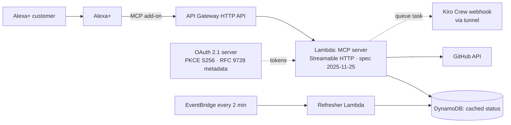
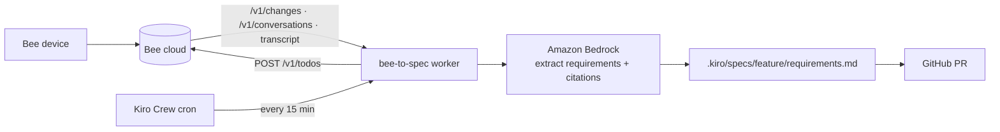
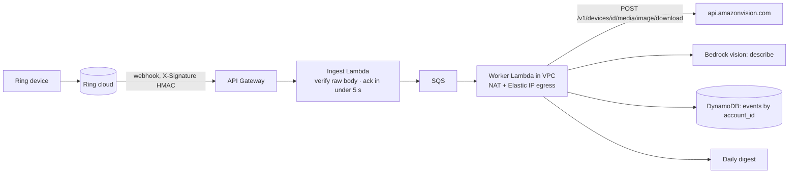

# Build plan: Amazon devices with Kiro IDE and Kiro Crew

A plan for building projects on the four Amazon device tracks (**Alexa+**, **Bee**, **Ring** and **Fire TV**) with Kiro IDE for interactive building and Kiro Crew for everything that should keep running while you're away. For each track it gives the hard rules, idea options with one recommended pick, the architecture, the exact runtime hook that satisfies the "imported and actually called" rule, a demo script and risks. A shared Kiro setup and a timeline cover all four.

> This plan also covers **Echo Show** visuals for Alexa+ add-ons (section 3). Facts about each platform come from the official docs read on 27 Nov 2026 (links in [Sources](#sources)). Items marked **unverified** need checking before you rely on them. The ideas and architectures are proposals.

## 1. The rules, in one table

| Track | Must be true in the repo | Must be shown in the demo | Platform facts that shape the design |
| --- | --- | --- | --- |
| **Alexa+** | A working **Agent Skill or self-hosted MCP server** on MCP spec **2025-11-25** over **Streamable HTTP**, imported and called at runtime. *Or* a simulated Alexa+ experience (any AI tool; exempt from the runtime-hook rule, but the simulation's source must be in the repo) | The add-on (or the clearly labelled simulation) working | Alexa+ is the MCP client and reaches your server through an MCP add-on. Requirements: OAuth 2.1 authorization code + PKCE (S256), `resource` set to the server's canonical URI, RFC 9728 Protected Resource Metadata, and **401 without a `WWW-Authenticate` header**. Dynamic Client Registration is not supported. Round-trip latency must be **< 500 ms**. Tooling: `alexa-ai configure` / `alexa-ai new mcp` / `alexa-ai deploy`, plus an Add-on Agent Skill that works with Kiro |
| **Bee** | Code that uses data **recorded and processed by a real Bee device** (or Apple Watch running Bee) | A live interaction with that Bee data doing something for a customer | `@beeai/cli`: `bee login`, `bee sync`, `bee proxy` (local `/v1/*` on 127.0.0.1:8787), and an MCP server (`bee mcp serve` over stdio, or `serve-http` on localhost). The API covers conversations, transcripts (MCP tool), **writable** facts and todos, daily summaries, journals, keyword and neural search, an SSE stream (`/v1/stream`) and a change feed (`/v1/changes`) |
| **Ring** | Any Ring API, SDK, simulator or device from Ring's developer docs, imported and called at runtime | The project working through a simulator or a real Ring device | The Ring Partner API (`api.amazonvision.com`) is REST + OAuth 2.0 and must be called **server-to-server**, with `User-Agent` and `Hardware_Id` headers. Datacenter IPs can get 406, so use a static egress IP. Webhooks are HMAC-signed (`X-Signature`), need a reply within 5 s, are retried up to 6 times and dedupe on `meta.request_id`. Snapshots always carry a Ring watermark. Default limit is 100 TPS. A staging environment and a Developers Playground exist; there is **no official simulator** |
| **Fire TV** | Any framework, but it **must run on Fire OS or Vega OS** | Running on a real Fire TV device **or** the Fire TV/Vega simulator | Vega OS 2.0 is GA and uses React Native 0.83. Commands: `vega sdk install`, and `vega run-app <vpkg> <app-id> -d VirtualDevice` for the Vega Virtual Device. Amazon Devices Builder Tools (ADBT) offer "Skills and MCP based workflows" for AI coding agents |

## 2. Shared setup: one monorepo, Kiro IDE for building, Kiro Crew for running

```
amazon-devices-builds/
├── .kiro/
│   ├── steering/      product.md (always) · alexa.md / ring.md / bee.md / firetv.md (fileMatch per package)
│   ├── specs/         one spec per track: requirements (EARS) → design with correctness properties → tasks
│   ├── agents/        alexa-addon-builder · ring-integrator · bee-builder · vega-tv-dev · demo-director
│   ├── hooks/         secret scan · runtime-hook proof · contract tests · "done means green"
│   └── settings/mcp.json   Ring MCP · ADBT MCP · Bee MCP · AWS Knowledge · AWS Pricing
├── packages/alexa-mcp/  packages/bee-to-spec/  packages/ring-visitor-log/  packages/firetv-mission-control/
├── infra/             AWS CDK (one stack per package)
└── proof/             runtime-hook evidence + demo scripts per track
```

**How Kiro IDE is used** (interactive, spec-first):

- **Specs per track**, with property-based tests for the parts that are easy to get wrong:
  - Ring webhook signing: `verify(sign(body)) == true`, and any byte flip makes it false.
  - The Alexa+ 401 behaviour: never a `WWW-Authenticate` header.
  - `addon.json` limits: name ≤ 30 characters, 3–4 example phrases, all six icon sizes.
  - Bee-to-spec parsing: every extracted requirement keeps a link to its transcript span.
- **Steering per package** (`fileMatch`), holding each platform's hard rules from the table above, so the agent can't forget the 500 ms budget, the server-to-server rule or the watermark.
- **Custom agents with the vendors' own tools.** Each agent gets only that track's MCP server and write access only to its own package:
  - `alexa-addon-builder` loads the Alexa+ Add-on Agent Skill;
  - `ring-integrator` uses Ring's MCP for AI coding assistants (Ring's docs name Kiro);
  - `vega-tv-dev` uses ADBT;
  - `bee-builder` uses the Bee MCP server.
- **Hooks:**
  - a secret scan extended to Ring HMAC keys, Ring client secrets and Bee tokens;
  - a **runtime-hook proof** Stop hook that runs `proof/check.py` (see section 7);
  - contract tests on save.

**How Kiro Crew is used** (always on, [Labs 51–61](../labs/51-crew-scheduling-heartbeats-webhooks/README.md)):

| Crew job | What it does |
| --- | --- |
| Nightly contract tests (cron, script job) | Calls Ring staging, the Bee API and your Alexa MCP endpoint, and notifies only on a failure |
| Token watch (heartbeat) | Ring refresh tokens last about 30 days and rotate on every use; Bee tokens expire. Warns before demo day, never after |
| Task Runner overnight | Builds each track's spec on its own branch, with force-approval on anything that deploys |
| PR babysitting (`monitor_watch`) | Watches each package's PR until checks are green |
| Ops Mission Control | Watches the CloudWatch alarms of the deployed backends (Lambda errors, MCP p95 latency > 400 ms) |
| Demo-day checklist (cron, T-3 days) | Re-runs every demo path against live devices and posts a go/no-go to Slack |

## 3. Alexa+ track

### Ideas

| # | Idea | Why it's interesting |
| --- | --- | --- |
| **A1 (recommended)** | **"Alexa, how's my crew?"** An MCP server that gives Alexa+ read-mostly tools over your engineering work: `build_status`, `failing_checks`, `open_incidents`, `whats_blocking_release`, `start_research` (queues a Kiro Crew task through its webhook) | Ties voice to the Kiro/Crew work this site is about; each tool is small, fast and easy to demo |
| A2 | **Household logistics** add-on: shared lists, chores and pickup schedule, with writes guarded by per-user OAuth scopes | Broad appeal; shows the two-tier auth model |
| A3 | **Caregiver check-ins**: medication and appointment reminders an adult child can review | High impact; needs careful privacy design |

### Architecture (A1)



- **Latency:** the tools read a DynamoDB cache refreshed every 2 minutes, so a voice request never waits on GitHub. Target p95 is < 300 ms against the 500 ms rule.
- **Auth:**
  - Serve `/.well-known/oauth-protected-resource` (RFC 9728) and `/.well-known/oauth-authorization-server`.
  - Return 401 **without** `WWW-Authenticate`.
  - Choose an authorization server that supports PKCE (S256) and the `resource` parameter. **Verify** your choice supports `resource` before committing to it.
- **Runtime hook:** the official MCP SDK is imported and its Streamable HTTP server transport serves the tools in `packages/alexa-mcp/src/server.ts`. `addon-package/addon.json` (created by `alexa-ai new mcp`) points at the endpoint.

### Build steps

1. Write the spec and steering in Kiro IDE.
2. `alexa-addon-builder` installs the **Add-on Agent Skill** and introspects the server.
3. `alexa-ai configure`.
4. `alexa-ai deploy` (Alexa+ refreshes tools only on deploy).
5. Test in the Alexa+ web simulator, then on a device.

### Demo (≈ 2 min)

1. "Alexa, how's my crew?" → a red build is named.
2. "What's blocking the release?" → two PRs.
3. "Research a fix for the flaky checkout test" → the Crew dashboard shows the new task.
4. Show the CloudWatch p95 latency.

### Risks and fallback

- **Access:** search results describe the Alexa+ Category SDK and MCP Toolkit as available "to select partners only"; the quickstart doesn't say. **Check access on day 1.** If it isn't available, take the **simulated Alexa+** path:
  - a web voice UI using Amazon Transcribe and Polly, or the browser speech API;
  - an agent built with Strands Agents on Bedrock that calls the **same MCP server**.

  The repo then contains the simulation's source and the demo labels it as simulated.

### Echo Show: visual Alexa+ add-ons

Echo Show is where an Alexa+ add-on gets a screen.
- If a tool declares a `ui://` resource in `_meta.ui.resourceUri`, Alexa+ renders that **single-file HTML widget** (MCP Apps) on the device.
- Without one, the tool is **data-only**: Alexa renders it with native components, or by voice on devices without a screen.

| Rule | Detail |
| --- | --- |
| Runtime | Sandboxed, opaque-origin iframe. The MCP Apps **postMessage bridge** is the only channel to the host. No `window.parent`, cookies or `localStorage`. External domains must be declared in `_meta.ui.csp` (`connectDomains`, `resourceDomains`) |
| Device info | `hostContext` (`deviceClass`, `maxWidth`, `maxHeight`, `displayMode`, `safeAreaInsets`, `theme`…). Read it at render time and again on `host-context-changed`. `deviceClass` is authoritative |
| Canvas | Author at **768×480** and apply one root scale. Echo Show 8 and 15 render at 1280×800 (`zoom: 1.667`) |
| Patterns | **List, Carousel, Card, Map** only. Carousel: 3–5 items, first item within **500 ms**. Map: compact by default (map + 3 ranked results) |
| Look | Type tokens 48…8 px. Light and dark both tested. Readable at ~3 ft, essentials at ~10 ft. Must work with VoiceView |
| Parity | Speech and screen never contradict. Visuals update with each voice turn. Anything critical on screen is also available by voice. Tapping does what the voice equivalent does |
| Speed | Results within **3 s** (send an interim message if slower) |
| Test | **Local Inspector** (`addon-local-inspector <mcp-url>`) renders the widget in Echo Show 8/15, mobile and voice-only frames and writes a certification verdict. Then verify on a real Echo Show |

**Echo Show ideas**

| # | Idea | Pattern | Why it's interesting |
| --- | --- | --- | --- |
| **S1 (recommended)** | **Crew status on the office Echo Show 15.** "Alexa, how's my crew?" speaks the summary and shows a List of failing checks and incidents. "Show me the checkout failure" opens a Card | List → Card | Same MCP server as A1, plus one widget. Sample in [Lab 62](../labs/62-build-kiro-skills-and-agents/README.md) |
| S2 | **Today's visitors.** A Carousel of the day's doorbell events with snapshot thumbnails | Carousel | Pairs with Ring R1. The first item must arrive within 500 ms, so thumbnails come from a cache |
| S3 | **Morning brief from Bee** on the kitchen Echo Show: yesterday's todos and today's plan from Bee daily summaries | List | Pairs with Bee. The widget only shows what the user asked for |
| S4 | **EV chargers or pharmacies near me**, as a compact Map with 3 ranked results | Map | Exercises the Map pattern. The developer supplies the map |
| S5 | **Step-by-step recipe or repair guide**, one Card per step with timers, advanced by voice ("next step") | Card | Shows voice and touch parity on every step |

**How Kiro helps:**
- The [`echo-show-widget-review`](../labs/62-build-kiro-skills-and-agents/.kiro/skills/echo-show-widget-review/SKILL.md) skill and its `check_widget.py` lint every widget on save. A Kiro hook can run it, and Kiro Crew can run it nightly as a zero-token script job.
- The `alexa-addon-builder` agent runs `alexa-addon-preflight` and then the Local Inspector before asking to deploy.

**Demo:**
1. Ask on an Echo Show 15.
2. The List appears while Alexa speaks the same summary.
3. Tap a row: the Card opens and Alexa reads it.
4. Say "next" to move on, showing the voice path matches the touch path.
5. Finish on a voice-only Echo, which gets the same answer by speech.

## 4. Bee track

### Ideas

| # | Idea | Why it's interesting |
| --- | --- | --- |
| **B1 (recommended)** | **"Walk-and-talk specs."** You describe a feature out loud while wearing Bee. Bee-to-Spec pulls the conversation, turns it into a Kiro spec (`requirements.md` in EARS form, with each requirement linked to its transcript span), opens a PR, and writes follow-up **todos back to Bee** ("review spec PR #12") | Uses real Bee data end to end, writes back to the customer's Bee, and connects to Kiro's spec-driven development |
| B2 | **Meeting-to-backlog:** Bee conversations become GitHub issues with owners and due dates, and Bee todos stay in sync both ways | Clear value for teams |
| B3 | **Personal memory for an agent:** Bee facts and daily summaries become steering for a personal Kiro agent ("I prefer TypeScript", "the client meeting is Thursday") | Shows Bee as context for coding agents |

### Architecture (B1)



- **Runtime hook:** `packages/bee-to-spec` calls the Bee HTTP API, either directly (`api.developer.bee.amazon.dev`, Bearer token) or through `bee proxy` locally. The Kiro Crew agent that runs it loads the Bee MCP server (`bee mcp serve`) in its agent config, and fetches transcripts with the `bee_get_conversation_transcript` tool.
- **Trigger:** a Crew script job polls `/v1/changes` every 15 minutes (no model call when nothing changed). It wakes the spec agent only for conversations tagged with a phrase such as "spec this".
- **Privacy:** only conversations the customer explicitly tags are processed. Bystander speech is dropped before any model call, and transcripts never leave the customer's own AWS account.

### Demo

1. Live: say "Spec this: a dark-mode toggle that remembers per device" while wearing Bee.
2. `bee sync`.
3. The Crew job runs.
4. The PR with `requirements.md` appears, each requirement citing the transcript.
5. A new todo shows up in the Bee app.

### Risks

- **Unverified** how a third-party developer obtains an API token beyond `bee login`.
- Threads are "Preview: test users only".
- You need a real Bee device or an Apple Watch running Bee; plan recording time into the schedule.

## 5. Ring track

### Ideas

| # | Idea | Why it's interesting |
| --- | --- | --- |
| **R1 (recommended)** | **Visitor and package log.** On `button_press` or `motion_detected`, fetch a snapshot. Amazon Bedrock (a vision model) writes a one-line description ("courier left a parcel at 14:02"), stored with the event. The customer gets a daily digest and can ask "did anything get delivered today?" | Uses webhooks, snapshots and history; clear customer value |
| R2 | **Ring as a signal source for Kiro Crew Ops Mission Control**, through its documented companion contract (`SignalSource` / `EvidenceSource`). Ring events become "incidents" on a home board, with a remembered "fix" (for example "that's the neighbour's cat") | A distinctive Crew-plus-Ring combination |
| R3 | **Small-business front desk:** after-hours doorbell presses get an auto-reply and a note for the morning team | B2B angle |

### Architecture (R1)



- **Runtime hook:** `packages/ring-visitor-log/ring_client.py` calls the Ring Partner API (OAuth 2.0 with refresh-token rotation; `User-Agent` and `Hardware_Id` headers). `webhook.py` verifies `X-Signature` HMAC-SHA256 over the raw body before parsing.
- **Rules built into the design:**
  - acknowledge within 5 s, do the work asynchronously;
  - dedupe on `meta.request_id`;
  - keep the Ring watermark on every image;
  - use the Ring **account ID**, not email or name, as the user key;
  - send traffic from a static egress IP so datacenter calls don't get 406.
- **Test without a doorbell press:** use the Developers Playground and staging. Replay recorded, re-signed webhook payloads from the property tests (a third-party "hardware twin" simulator exists, but it isn't an official Ring tool).

### Demo

1. Press the doorbell.
2. Show the webhook arriving (signature verified).
3. The snapshot with its watermark appears, plus the generated description.
4. Ask the digest page "anything delivered today?"

### Risks

- The Playground requires at least one Ring camera or doorbell.
- Partner-initiated OAuth is invitation-only, so use the standard user-linking flow.
- Identity verification is required before submitting apps.

## 6. Fire TV track

### Ideas

| # | Idea | Why it's interesting |
| --- | --- | --- |
| **F1 (recommended)** | **Crew Mission Control for the office TV.** A lean-back, D-pad-friendly wall dashboard of builds, incidents and agent activity from Kiro Crew and CloudWatch, with a focus mode that cycles through what changed | Runs on Vega OS; data from your own backend; fits the frontier engineering theme |
| F2 | **Lab player:** Kiro Reinvent Labs as a TV learning app, with progress synced to a phone | Reuses this site's content |
| F3 | **Ring + TV:** doorbell snapshots and the visitor log on the TV (a stretch goal combining R1 and F1) | Strong demo, more scope |

### Architecture (F1)

- **App:** React Native 0.83 on **Vega OS 2.0**, built with the Vega SDK. Focus management and D-pad navigation, with a 10-foot UI (large type, high contrast).
- **Data:** an API Gateway + Lambda endpoint returns one JSON snapshot. The data comes from Crew (a scheduled export from the work ledger) and CloudWatch (alarm states). The app polls every 30 s.
- **Tooling:**
  - `vega sdk install`;
  - `vega run-app <vpkg> <app-id> -d VirtualDevice` for daily work;
  - a Fire TV Stick for the final demo;
  - ADBT skills and MCP for the `vega-tv-dev` agent in Kiro.
- **Requirement met:** the app runs on Vega OS. Record the demo on the Vega Virtual Device and, ideally, a real Fire TV Stick.

### Demo

1. Launch on the Vega Virtual Device.
2. Navigate with the remote between Builds, Incidents and Agents.
3. Trigger a failing build; the tile turns red within 30 s.
4. Switch to the real Fire TV Stick.

## 7. Proving the runtime hook (all tracks)

Judges check that the required technology is **imported and actually called**, not just named. Make that obvious:

| Track | Import and call | Evidence file |
| --- | --- | --- |
| Alexa+ | MCP SDK server with Streamable HTTP transport in `packages/alexa-mcp/src/server.ts`; `addon.json` endpoint | `proof/alexa.md`: an `alexa-ai deploy` log excerpt + a simulator screenshot |
| Bee | Bee API client calls (`/v1/changes`, `/v1/conversations`, `POST /v1/todos`) and the Bee MCP server in the agent config | `proof/bee.md`: request IDs from a live run (no personal content) |
| Ring | `ring_client.py` calls to `api.amazonvision.com`; HMAC verification in `webhook.py` | `proof/ring.md`: a redacted webhook delivery and a snapshot request ID |
| Fire TV | Vega build and run commands; the app's entry point | `proof/firetv.md`: `vega run-app … -d VirtualDevice` output and a device photo |

A Kiro **Stop hook** runs `proof/check.py`, which fails the session if:
- an evidence file is missing, or
- the key import is gone from its package (a static check that the import exists and is called from an entry point).

## 8. Timeline (three weeks; adjust to the real deadline)

| Days | Goal | Kiro IDE | Kiro Crew |
| --- | --- | --- | --- |
| 1–2 | **Access and track choice** | Steering and specs drafted | Token-watch heartbeat; nightly "can I still log in?" job for each platform |
| 3–7 | **Walking skeleton** per chosen track (end-to-end path with fake data) | Specs → tasks; property tests for signing, auth and limits | Task Runner builds the scaffolding overnight; PR babysitting |
| 8–13 | **Real data** (Bee recordings, Ring presses, Alexa+ simulator, Vega device) | Fix and refine through specs | Nightly contract tests against live APIs; Ops Mission Control on backends |
| 14–17 | **Polish and harden** (latency, privacy, error states) | Hooks keep the build and proofs green | Demo-day checklist cron |
| 18–21 | **Record and submit** | README, proof files, architecture diagram | Final go/no-go run on every demo path |

**If you can only enter one or two tracks:**
- **Fire TV** has the lowest access risk: it runs on the Vega Virtual Device, and the toolchain is public and GA.
- **Bee** is the most distinctive with Kiro: real device data becomes specs.
- **Alexa+** is the best fit for MCP skills, but confirm access on day 1. The simulated path keeps it viable either way.
- **Ring** needs a device and identity verification up front.

## Sources

- **Alexa+ and Echo Show:**
  - [Design guide: layout and rendering](https://developer.amazon.com/docs/alexaplus/add-ons/mcp-addon-layout-and-rendering)
  - [Visual foundations](https://developer.amazon.com/docs/alexaplus/add-ons/mcp-addon-visual-foundations)
  - [Components and patterns](https://developer.amazon.com/docs/alexaplus/add-ons/mcp-addon-components-and-patterns)
  - [Functional requirements](https://developer.amazon.com/docs/alexaplus/add-ons/functional-requirements.html)
  - [Local Inspector](https://developer.amazon.com/docs/alexaplus/add-ons/mcp-toolkit-local-inspector)
  - [MCP Toolkit overview](https://developer.amazon.com/docs/alexaplus/add-ons/mcp-toolkit-overview)
  - [MCP QuickStart](https://developer.amazon.com/docs/alexaplus/add-ons/mcp-toolkit-quickstart)
  - [MCP authentication](https://developer.amazon.com/docs/alexaplus/add-ons/mcp-toolkit-authentication.html)
  - [Alexa AI CLI reference](https://developer.amazon.com/docs/alexaplus/add-ons/alexa-ai-cli-reference)
- **Ring:**
  - [Getting started](https://developer.amazon.com/docs/ring/get-started.html)
  - [Ring Partner API](https://developer.amazon.com/docs/ring/api-documentation.html)
  - [Release notes](https://developer.amazon.com/docs/ring/release-notes.html)
  - [Ring MCP for AI coding assistants](https://developer.amazon.com/docs/ring/ring-mcp.html)
- **Bee:**
  - [Bee](https://bee.computer/)
  - [Developer docs](https://docs.bee.computer/)
  - [API](https://docs.bee.computer/docs/api)
  - [MCP](https://docs.bee.computer/docs/mcp)
  - [bee-cli](https://github.com/bee-computer/bee-cli)
- **Fire TV:**
  - [Vega 2.0 GA](https://developer.amazon.com/apps-and-games/blogs/2026/10/vega-2-0-sdk-launch)
  - [Install the Vega SDK](https://developer.amazon.com/docs/vega/2.0/install-vega-sdk)
  - [React Native 0.83 for Vega OS](https://developer.amazon.com/apps-and-games/blogs/2026/10/react-native-for-vega-os)
  - [Amazon Devices Builder Tools](https://developer.amazon.com/docs/adbt/get-started)
- **Kiro:**
  - [Kiro features in this repo](kiro-features-in-this-repo.md)
  - [Kiro Crew labs](../labs/51-crew-scheduling-heartbeats-webhooks/README.md)
  - [Frontier engineering teams](frontier-engineering-teams.md)
