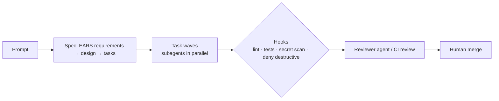
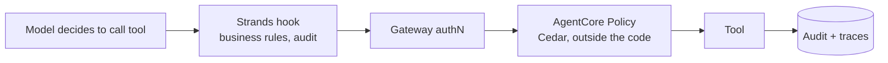

# Architecture patterns

Reusable patterns for building with Kiro and shipping agents on AWS. Each pattern names the labs that implement it.

## P1 · Spec → guarded implementation loop

**Use when** a change is bigger than a single function. **Labs:** 03, 04, 05, 06, 10.
**Anti-pattern:** vibe-coding a multi-service change and reviewing a 2,000-line diff at the end.

## P2 · Grounded infrastructure

The agent writes IaC only after it has current docs (Knowledge MCP), schemas and validation (IaC MCP), and live state (AWS MCP Server, read-only). Every synth runs cdk-nag or checkov, and every suppression is justified. Deployment stays with humans.
**Labs:** 15, 16.

## P3 · Least-privilege agent roles

| Who | Credential | Controls |
| --- | --- | --- |
| Developer's Kiro (interactive) | Dev profile, read-only by default | Agent `permissions`, PermissionRequest hook |
| CI Kiro | `KIRO_API_KEY` plus an OIDC role for AWS | `ci-reviewer` agent: read-only, deny shell by default |
| Crew bots | Per-bot role | Charter "never" list enforced by permissions and hooks |
| Production agents | Runtime execution role, plus Gateway outbound creds via Identity | Policy (Cedar) at Gateway |

**Labs:** 05, 10, 13, 15, 29, 30.

## P4 · One tool plane: AgentCore Gateway

Each agent holds one MCP connection and one token. Tools are owned by the teams that own the APIs (Lambda, OpenAPI, Smithy, API Gateway, MCP servers). The gateway adds semantic search, interceptors, rate limits, and the policy hook.
**Labs:** 27, 30, 34.

## P5 · Identity-bound memory

`actor_id = sub` from the **validated inbound JWT**. Memory namespaces are scoped by `{actorId}`, and retention and deletion follow policy. The actor id is never taken from the prompt.
**Labs:** 28, 29, 34.

## P6 · Defence in depth for tool calls

**Labs:** 25, 30, 32.

## P7 · Multi-agent topology selection

| Situation | Pattern |
| --- | --- |
| One conversation; an orchestrator with helpers | Agents as tools |
| Known steps, gates, compliance | Graph (bound the cycles) |
| Path unknown; exploration | Swarm (cap hand-offs and time) |
| Different teams or frameworks | A2A |

**Labs:** 23, 24.

## P8 · Evaluate everywhere

Offline evals gate CI. Online evals sample production and raise alarms. The lowest-scoring sessions become new eval cases, and Kiro writes them.
**Labs:** 25, 32, 34.

## P9 · Async agent workforce

| Work shape | Tool |
| --- | --- |
| Pipeline step | Headless CLI |
| Recurring responsibility | Crew bot |
| Issue → PR | Autonomous agent |
| Exploratory / parallel research | Crew parallel agents or subagents |

**Labs:** 10, 12, 13, 14.

## P10 · Strangler modernization with characterization tests

Map the code, pin current behaviour with tests, write a bugfix-style spec (current / expected / unchanged), build the new service, run in shadow mode, cut over, then delete the old path.
**Lab:** 36.
