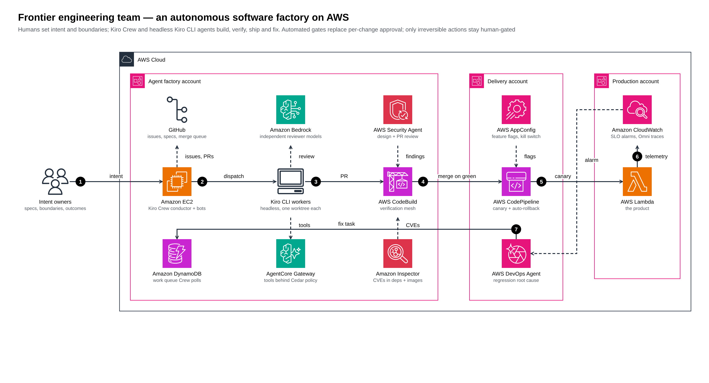

# Frontier engineering teams on Kiro Crew, Kiro CLI and AWS

How to build a team where agents deliver software engineering, AI engineering and the SDLC end to end, and humans stop approving individual changes. This page covers:

- what Kiro means by frontier engineering;
- what "no human in the loop" can safely mean;
- a reference architecture on AWS;
- 16 advanced ideas, each with its guard rail and a metric;
- a 90-day rollout plan.

[Interactive diagram](https://akashtalole.github.io/Kiro-Reinvent/docs/diagrams/frontier-factory.html) · [SVG](https://akashtalole.github.io/Kiro-Reinvent/docs/diagrams/frontier-factory.svg) · [draw.io](https://akashtalole.github.io/Kiro-Reinvent/docs/diagrams/frontier-factory.drawio)

## 1. What Kiro means by frontier engineering

Kiro's [frontier engineering guide](https://kiro.dev/topics/frontier-engineering/) sums it up: developers "are no longer building the software directly, they are building the agent setup that builds the software." It is "not vibe coding", and it is "an engineering investment, not a switch you flip". The first weeks feel slower; the weeks after feel dramatically faster.

**The ten principles**

1. You are the architect, not the typist.
2. Maximize agent time, minimize your involvement.
3. Build your codebase for agents.
4. Give agents a fast feedback loop.
5. Execution is cheap. Direction is everything.
6. Treat code as disposable.
7. Hold AI output to human standards.
8. Trust the boundaries, not the agent.
9. Use agents for everything, not just code.
10. Continuously tune your agent setup.

**The [manager guide](https://kiro.dev/topics/frontier-teams/)** lists five practices of the highest-performing Amazon teams:
- invest in agent context;
- slow down to speed up;
- feed agents instead of babysitting them;
- make intent explicit;
- shift testing left.

It also reports results, which Kiro labels "measured results, not guarantees": up to 20x for an Amazon Bedrock team, ~6x throughput for Prime Video, and a 4.5x median in an Amazon Stores pilot.

**Two lines from the principles shape everything below:**
- *Maximize agent time:* "progressively remove yourself from the loop until your involvement is limited to setting direction and verifying outcomes."
- *Trust the boundaries:* "Start narrow, then widen it as you build confidence in the limits, until the only things you gate are the actions you can't undo." Also: an agent should never have production or deployment credentials "unless you've explicitly and deliberately granted it."

## 2. What "no human in the loop" should mean

Taking humans out of **every change** is achievable. Taking humans out of **the system** is not, and Kiro doesn't recommend it. The practical target:

| Position | Human does | Agents do | Use for |
| --- | --- | --- | --- |
| **In the loop** | Approves every change | Propose | Week 1, new repos, regulated code paths |
| **On the loop** | Sets intent and boundaries, watches outcomes, can stop the line | Build, verify, merge and ship inside the boundary | The steady state for most work |
| **Over the loop** | Owns policy, budgets and the irreversible-action list; reviews the factory's metrics weekly | Everything else, including fixing the factory | Mature, well-instrumented services |

**Four rules make "on the loop" safe:**

1. **Automated gates replace approval clicks.** A change merges and ships because it passed the *verification mesh* (section 4), not because a person pressed a button.
2. **Reversible by default.** Every shipped change sits behind a feature flag and a canary with alarm-based rollback. Agents may only do what can be undone automatically.
3. **A short, explicit irreversible list stays human (two-key).** For example: destructive data migrations, deleting backups or KMS keys, IAM/SCP and network-boundary changes, anything touching payments or pricing, making data public, legal or customer-facing commitments, and spend above a threshold. Enforce it with SCPs, permissions boundaries, Cedar policy and Crew's denied commands, not with prompts.
4. **Autonomy is earned and lost automatically.** Each service has an autonomy level in a ledger. It rises when escaped-defect and rollback rates stay inside an error budget, and drops by itself, with no meeting, when they don't.

### The autonomy ladder (per service, per change class)

| Level | What agents may do without a human | Promotion criteria (example) | Automatic demotion |
| --- | --- | --- | --- |
| **L0 Suggest** | Open draft PRs | Steering, tests and a local full-stack run exist | n/a |
| **L1 Merge low-risk** | Merge docs, tests, dependency patches and flaky-test fixes on green | 4 weeks, < 2% revert rate on L0 PRs | Any escaped Sev2 from an agent change |
| **L2 Ship behind flags** | Merge and deploy feature work dark (flag off) via canary | Mutation score and property tests on the service; alarm-based rollback proven in a game day | Rollback rate > 5% in 14 days |
| **L3 Release** | Turn flags on progressively per tenant or cohort | 30 days at L2 inside the error budget; SLO burn alerts wired | SLO error budget burn > 50% |
| **L4 Self-improve** | Change its own steering, skills, hooks and evals through the same mesh | 90 days at L3; changes to the factory are reviewed by a second agent and replayed against history | Any policy violation in the security event log |

## 3. Reference architecture on AWS

The diagram above, step by step:

1. **Intent owners** write a spec: problem, constraints, testable acceptance criteria, budget, and the boundary (which repos, services and accounts).
2. **Kiro Crew** runs on EC2 in an *agent factory account*. Its conductor decomposes the spec and dispatches **headless Kiro CLI workers**, each in its own git worktree with a fresh context. Bots own recurring responsibilities, crons and heartbeats keep work flowing, and a DynamoDB work ledger holds the queue and each service's autonomy level.
3. Workers self-verify locally (fast feedback loop), then open a PR. Tools reach internal systems only through **AgentCore Gateway** with **Cedar policy**.
4. **CodeBuild** runs the verification mesh. **AWS Security Agent** and **Amazon Inspector** feed findings; independent reviewer models on **Amazon Bedrock** do the AI review. Green means the merge queue merges.
5. **CodePipeline** in a separate *delivery account* ships through a canary. **AppConfig** flags keep features dark and act as a kill switch. CloudWatch alarms roll back automatically (CodeDeploy alarm-based rollback or pipeline stage conditions).
6. The *production account* reports SLOs, traces and business metrics through **CloudWatch**.
7. On a regression the system **rolls back first**. **AWS DevOps Agent** finds the root cause, which becomes a new fix task in the ledger, and the loop closes without a human.

**AWS controls that make it safe**

| Control | Why |
| --- | --- |
| Separate accounts (AWS Organizations): factory, delivery, production | The agent factory never holds production credentials; only the pipeline role can deploy |
| SCPs + IAM permissions boundaries | The irreversible list is enforced in IAM, not in prompts |
| GitHub/CodeBuild OIDC, short-lived roles | No long-lived keys on the Crew host |
| Crew `strict` sandbox, denied commands, `POLICY ∩ PROFILE` ceiling, hash-chained audit log | Host-level limits the agent cannot edit ([Lab 58](../labs/58-crew-governance-for-teams/README.md)) |
| AgentCore Gateway + Policy (Cedar) | Every tool call checked against tool, arguments and caller |
| **Amazon Bedrock Guardrails** on agent inputs that come from untrusted text (issue bodies, PR comments, web pages) | Autonomous agents read attacker-controllable text; filter prompt attacks before it reaches a worker that can push code |
| AWS Budgets + per-service credit budgets in the ledger | Stops runaway loops; a budget breach pauses the service's queue |
| CloudTrail + Crew security event log | Every agent action is attributable |

## 4. The verification mesh (what replaces human review)

Kiro's principle 7 says "hold AI output to human standards". In this design the standards are executable.

| Gate | Catches | Built from |
| --- | --- | --- |
| Spec clarity check | Vague intent before any code is written | Kiro specs; reject specs without testable criteria |
| Unit + integration tests, full stack on a laptop | Regressions | Fast feedback loop ([Lab 10](../labs/10-headless-kiro-in-ci/README.md)) |
| Property-based tests from requirements | Intent mismatch | Kiro spec correctness / PBT |
| Mutation score threshold | Tests that assert nothing | Mutation testing in CodeBuild |
| SAST, secret scan, dependency CVEs | Security debt | Security Agent, Inspector, scanners in CodeBuild |
| Independent AI review (different model family from the builder) | Design smells, missed edge cases | Bedrock models; the builder never grades its own work |
| Policy-as-code on IaC diffs | Boundary violations (public buckets, wide IAM) | cfn-guard / Checkov + Cedar |
| Cost diff | Changes that blow the budget | AWS Pricing MCP ([Lab 18](../labs/18-finops-with-mcp/README.md)) |
| Eval suite (for AI features) | Quality or safety regressions in prompts and models | AgentCore Evaluations ([Lab 32](../labs/32-agentcore-observability-evaluations/README.md)) |
| Canary + SLO alarms | Everything the above missed | CodePipeline / CodeDeploy + CloudWatch |

## 5. Team topology

**Humans** (a frontier team of 4–6 can run a portfolio that used to need several teams):

- **Intent architect:** writes specs and acceptance criteria and decides what "done" means. This is the product and staff-engineer role merged.
- **Boundary engineer:** owns accounts, SCPs, Cedar policy, Crew governance, the irreversible list and the verification mesh. The factory's platform team.
- **Outcome verifier:** watches SLOs, the autonomy ledger and weekly factory metrics; can stop the line. SRE, on the loop.

**Agents** (Crew bots, Kiro CLI workers and AWS agents):

| Agent | Runs as | Owns |
| --- | --- | --- |
| Conductor | Crew conductor mode | Decomposition, dispatch, parallelism, budgets |
| Spec agent | Kiro CLI + specs | Turns tickets, incidents and feedback into specs with testable criteria |
| Builders | Headless Kiro CLI workers / cloud sessions | Implementation in isolated worktrees |
| Adversarial reviewer | Bedrock model of a different family | Review, plus red-team prompts against the change |
| Release agent | Crew bot + CodePipeline | Merge queue, canary, flag ramp |
| Production verifier | Ops Mission Control + DevOps Agent | Watches the change in production, rolls back, files fix tasks |
| Gardener | Crew bot on a schedule | Tech debt, dependency bumps, doc drift |
| Factory tuner | Crew bot, weekly | Analyses rejected PRs, rollbacks and denials, and proposes steering, skill and hook changes (principle 10) |

## 6. Sixteen advanced ideas

Each idea lists how to build it, the autonomy level it needs, its guard rail and the metric that proves it works.

### Software engineering

1. **Ticket in, canary out.** A labelled issue goes to the spec agent, then to builders, the mesh, merge and a dark deploy, with no human between label and production.
   - *How:* Crew webhook from GitHub; Task Runner for multi-step work; flags in AppConfig.
   - *Autonomy:* L2. *Guard rail:* the flag stays off until L3.
   - *Metric:* label-to-dark-deploy lead time.
2. **Self-healing main.** A red main branch triggers a bot.
   - *How:* the bot bisects, classifies the failure (flaky or real), quarantines a flaky test *with evidence*, and opens a fix PR that merges through the mesh.
   - *Autonomy:* L1. *Guard rail:* quarantine expires in 7 days and re-opens as a task.
   - *Metric:* minutes main is red per week.
3. **Parallel speculative implementations.** For a risky spec, three builders try different designs in separate worktrees.
   - *How:* the mesh plus a benchmark picks the winner; the losers' insights are recorded as lessons. "Code is disposable" (principle 6) made literal.
   - *Autonomy:* L2. *Guard rail:* the credit budget per spec.
   - *Metric:* defects per change for speculative work versus single-path work.
4. **Fleet-wide CVE and dependency autopatch.** An Inspector finding fans out to every affected repo.
   - *How:* a Crew workflow (fan-out plus judge) patches, the mesh verifies, and changes ship by canary in waves (one repo, then 10%, then all).
   - *Autonomy:* L1–L2. *Guard rail:* a wave halts on the first rollback.
   - *Metric:* mean time to remediate critical CVEs.
5. **Continuous modernization overnight.** Legacy modules are migrated one module per night, each scoped to a module that is ready for agents (principle 3).
   - *How:* skills encode the method ([Lab 39](../labs/39-skill-driven-migration-engine/README.md)), with parity tests as the gate.
   - *Autonomy:* L2. *Guard rail:* old and new run side by side with shadow-traffic comparison before cutover.
   - *Metric:* modules migrated per week at zero parity diffs.

### AI engineering

6. **Eval-gated prompt and model releases.** Any prompt, tool or model change runs the eval suite; winners go out as a canary behind per-tenant inference profiles.
   - *How:* AgentCore Evaluations, Bedrock application inference profiles, AppConfig.
   - *Autonomy:* L3 for quality-neutral changes. *Guard rail:* the safety eval set is a hard gate.
   - *Metric:* eval score trend and cost per 1k requests.
7. **Model-upgrade bot.** When a new model is released, a bot replays production traces (scrubbed) against it.
   - *How:* compares quality, latency and cost, then proposes or ships the switch per route.
   - *Guard rail:* a human signs off once per model family (irreversible commercial impact).
   - *Metric:* time from model release to safe adoption.
8. **Self-writing eval sets.** Every production incident, thumbs-down or support ticket on an AI feature becomes a new eval case.
   - *How:* a Crew bot reads them, de-identifies them and opens a PR to the eval suite.
   - *Guard rail:* PII scrubbing plus Bedrock Guardrails on ingestion.
   - *Metric:* eval coverage of real failure modes.
9. **Prompt-injection red team on every agent change.** An adversarial agent attacks each change to an agent's tools, prompts or policy with injection payloads.
   - *How:* Cedar policy and Guardrails must hold.
   - *Guard rail:* runs only in the factory account against sandbox tools.
   - *Metric:* attack success rate (target: 0).

### SDLC and operations

10. **Production verifier with rollback-first.** After every deploy, an agent compares SLOs, error-log patterns and business metrics with the previous version.
    - *How:* any doubt means automatic rollback first, then a fix task. Ops Mission Control's verified-fix ledger makes repeat incidents faster ([Lab 56](../labs/56-crew-ops-mission-control/README.md)).
    - *Metric:* change failure rate and mean time to restore.
11. **Agent-run game days.** Weekly, a bot runs AWS Fault Injection Service experiments in staging and checks that alarms fire, rollback works and runbooks are right.
    - *How:* gaps become fix tasks.
    - *Guard rail:* staging only, with FIS stop conditions.
    - *Metric:* alarm and runbook coverage.
12. **Cost-aware merge gate.** Every IaC diff gets a monthly cost delta.
    - *How:* changes above a per-service threshold go to the intent owner (part of the irreversible list); below it they merge.
    - *Metric:* cost surprises per quarter (target: 0).
13. **Compliance evidence autopilot.** A nightly bot assembles audit evidence, mapped to controls, into an artifact for auditors.
    - *How:* it uses the Crew security event log, CloudTrail, the PR mesh results and flag history.
    - *Metric:* audit prep hours.

### Improving the factory itself

14. **Factory tuner (principle 10).** Every agent mistake becomes a candidate improvement.
    - *How:* every rejected PR, rollback, denied command and human interruption is clustered weekly; the bot proposes steering rules, skills, hooks or tool access that would have prevented it, and replays the proposal against last month's tasks before it merges.
    - *Metric:* human interruptions per 100 agent tasks.
15. **Autonomy ledger and auto-promotion.** A Crew cron computes each service's error budget, revert and rollback rates nightly, and promotes or demotes the autonomy level in DynamoDB. The conductor reads it before dispatching.
    - *Metric:* share of changes shipped at L2 or above.
16. **Agent capacity planner.** "How many agents you can keep meaningfully busy" (principle 2) becomes a scheduling problem.
    - *How:* the conductor keeps a backlog of well-scoped tasks, sizes parallelism to the credit budget and test-environment capacity, and moves long work to cloud sessions or the Task Runner overnight.
    - *Metric:* agent-hours per human-hour and queue wait time.

## 7. Scorecard

| Metric | Why it matters |
| --- | --- |
| Intent-to-production lead time | The headline outcome |
| Share of changes merged and shipped with no human touch | How far "on the loop" you are |
| Change failure rate and escaped defects per 100 agent changes | Quality has to hold while autonomy rises |
| Mean time to restore (rollback-first) | Reversibility working |
| Human interruptions per 100 agent tasks | Setup quality (principle 10) |
| Agent-hours per human-hour; credits per shipped change | Leverage and cost |
| Policy denials and their causes | Boundaries working, or too tight |

## 8. A 90-day rollout

This follows the onboard → experiment → scale → sustain stages in Kiro's manager guide.

| Days | Goal | Do |
| --- | --- | --- |
| 1–14 | **Onboard** one service | Steering, a full stack on a laptop, the verification mesh in CodeBuild, accounts and SCPs, Crew on EC2 with strict governance. Everything at L0 |
| 15–45 | **Experiment** | Specs for every task, parallel builders, ideas 2, 4 and 10. Promote to L1, then L2 when the criteria hold |
| 46–75 | **Scale** | Flags and progressive release (L3) for one service; ideas 1, 6 and 12; a second service onboarded with the same app package |
| 76–90 | **Sustain** | Factory tuner and autonomy ledger (ideas 14 and 15); weekly scorecard; a champion team trains the next team |

## 9. Labs that build each piece

| Piece | Labs |
| --- | --- |
| Context, specs, hooks, custom agents, skills | [02](../labs/02-steering-and-agents-md/README.md), [03](../labs/03-spec-driven-development/README.md), [04](../labs/04-agent-hooks/README.md), [05](../labs/05-custom-agents/README.md), [07](../labs/07-agent-skills/README.md) |
| Headless Kiro CLI in CI | [10](../labs/10-headless-kiro-in-ci/README.md) |
| Crew scheduling, Task Runner, workflows, apps | [51](../labs/51-crew-scheduling-heartbeats-webhooks/README.md), [52](../labs/52-crew-task-runner-overnight/README.md), [53](../labs/53-crew-workflows-pr-babysitting/README.md), [54](../labs/54-crew-build-your-first-app/README.md) |
| Review, triage, auto-improvement | [55](../labs/55-crew-engineering-apps/README.md) |
| Production verification | [56](../labs/56-crew-ops-mission-control/README.md), [47](../labs/47-tenant-observability-cloudwatch-omni/README.md) |
| Hosting and governance | [57](../labs/57-crew-24x7-on-aws/README.md), [58](../labs/58-crew-governance-for-teams/README.md), [30](../labs/30-agentcore-policy/README.md) |
| AI engineering gates | [32](../labs/32-agentcore-observability-evaluations/README.md), [48](../labs/48-multi-tenant-ai-on-bedrock/README.md), [50](../labs/50-ai-engineering-platform/README.md) |
| The whole SDLC and the whole team | [49](../labs/49-ai-sdlc-pipeline/README.md), [61](../labs/61-e2e-ai-first-team-on-crew/README.md) |

## Sources

- Kiro: [Frontier engineering](https://kiro.dev/topics/frontier-engineering/) and its principle pages ([architect, not typist](https://kiro.dev/topics/frontier-engineering/architect-not-typist/), [maximize agent time](https://kiro.dev/topics/frontier-engineering/maximize-agent-time/), [trust the boundaries](https://kiro.dev/topics/frontier-engineering/trust-the-boundaries/), [human standards](https://kiro.dev/topics/frontier-engineering/human-standards/), [fast feedback loop](https://kiro.dev/topics/frontier-engineering/fast-feedback-loop/), [build for agents](https://kiro.dev/topics/frontier-engineering/build-for-agents/), [tune your setup](https://kiro.dev/topics/frontier-engineering/tune-your-setup/)) and the [frontier teams guide for managers](https://kiro.dev/topics/frontier-teams/).
- Kiro Crew: [docs](https://kiro.dev/docs/crew/) and [kirodotdev/KiroCrew](https://github.com/kirodotdev/KiroCrew). See also [Kiro Crew under the hood](kiro-crew-internals.md) and [How Kiro IDE and Kiro CLI work](kiro-ide-cli-internals.md).
- The autonomy ladder, verification mesh, irreversible list and the sixteen ideas are this site's design proposals built on those principles. They are not Kiro or AWS product features. Productivity figures are Kiro's self-reported Amazon results.
