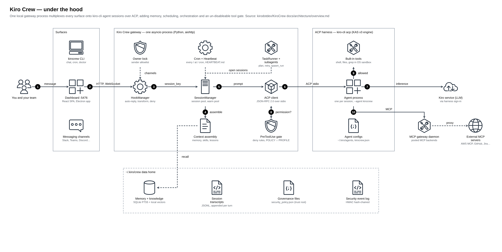
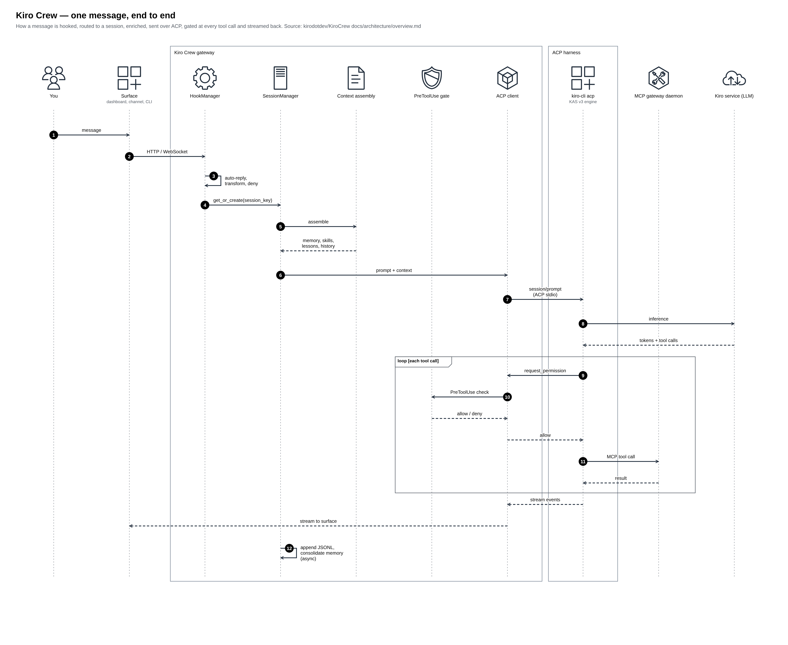

# Kiro Crew under the hood

How Kiro Crew is built: the processes it runs, the parts inside its gateway, how one message moves through it, and where its security controls sit. This page is based on the open-source repository [`kirodotdev/KiroCrew`](https://github.com/kirodotdev/KiroCrew) (commit `967a2fad`, 25 Nov 2026), mainly `docs/architecture/overview.md` and the module specs in `docs/system-specs/modules/`. File paths below are relative to that repository.



[Interactive diagram](https://akashtalole.github.io/Kiro-Reinvent/docs/diagrams/kiro-crew-architecture.html) · [SVG](https://akashtalole.github.io/Kiro-Reinvent/docs/diagrams/kiro-crew-architecture.svg) · [draw.io](https://akashtalole.github.io/Kiro-Reinvent/docs/diagrams/kiro-crew-architecture.drawio)

## The short version

Kiro Crew is **not** a new agent runtime. It is a **gateway**: one local Python asyncio process (aiohttp) that sits between you and `kiro-cli`. It drives many agent sessions at once through the **Agent Client Protocol (ACP)**, which is JSON-RPC 2.0 over stdio. It adds everything a single terminal session lacks: many concurrent sessions, chat surfaces, memory across sessions, schedules, autonomous tasks, subagents, and a tool gate the agent cannot switch off.

There are three layers, and the difference between them matters:

| Layer | What it is | What it owns |
| --- | --- | --- |
| **ACP harness** | The agent runtime. Defaults to **KAS**, kiro-cli's v3 engine (`kiro-cli acp --agent-engine v3`); the Kiro CLI harness is the fallback. | LLM connection, built-in tools (shell, file read/write, grep, glob), MCP servers, session files, context compaction, the ACP interface |
| **Agent configs** | JSON under `~/.kiro/agents/` (or a project's `.kiro/agents/`) | System prompt, enabled tools, MCP servers. Kiro Crew writes its own `kirocrew.json` here. |
| **Kiro Crew gateway** | One process that multiplexes surfaces onto harness sessions | Sessions, memory, scheduling, orchestration, security layers, dashboard, apps |

Kiro Crew only uses ACP providers (`agent.provider` is fixed to `acp`). `agent.acp_backend` picks the harness. The baseline selectable list includes `kas` (the default), `kiro`, and ACP harnesses from other vendors (for example Claude, Strands, Codex, OpenCode, Goose and Copilot). Any ACP agent can sit behind the same gateway.

## What Kiro Crew adds to kiro-cli

| Capability | kiro-cli alone | With Kiro Crew |
| --- | --- | --- |
| Sessions | One per terminal | Many at once: channel threads, dashboard slots, cron jobs, subagents, task steps |
| Surfaces | Terminal | CLI, web dashboard (`:5476`), Electron desktop app, Slack, Discord, Telegram, Teams, WeChat and more |
| Memory | Transcript per directory | Preferences, projects, daily history and lessons shared across sessions on the same memory store |
| Scheduling | None | Cron jobs (`every`, `at`, cron expressions) and a heartbeat that checks `HEARTBEAT.md` |
| Autonomous work | None | TaskRunner: spec → plan → steps, with retries, replanning, test checks and checkpoints |
| Self-learning | None | Lessons pulled from your corrections and added to later sessions |
| Tool control | Per-agent config | Its own PreToolUse gate plus a two-level governance ceiling the agent cannot weaken |
| Resilience | Restart by hand | Warm pool, circuit breaker, crash recovery, idle clean-up, orphan process tracking |

## The components

### Surfaces

- **CLI** (`kirocrew chat`, `setup`, `doctor`, `cron`, `cloud …`): `src/kiro_crew/cli.py`.
- **Web dashboard**: a React 18, TypeScript and Tailwind single-page app built with Vite. The Python backend serves it on port 5476 (`KIROCREW_PORT`). One multiplexed WebSocket at `/api/ws` carries chat chunks, slot state, subagent events and notifications, with Server-Sent Events as a fallback.
- **Desktop app**: Electron wraps the same app in multiple tabs.
- **Messaging channels**: Slack, Discord, Telegram, Teams, Webex, WeCom, WeChat and others, behind one messaging transport layer (`src/kiro_crew/messaging/`). Channel senders must pass an **owner lock**, an allowlist of who may talk to it.

### Inside the gateway

| Part | Source | Job |
| --- | --- | --- |
| HookManager | `hooks.py` | Inbound hooks that can auto-reply, transform, inject or block a message before it reaches an agent |
| SessionManager | `session.py` | Pool of ACP sessions keyed by `session_key`, which encodes the origin. Optional warm pool, 1-hour idle timeout, 4-hour turn ceiling, a circuit breaker after 5 failures, and auto-compaction at 70% of the context window. |
| Context assembly | `context.py`, `context_assembly/` | Builds each prompt's context within a token budget: memory, skills, lessons, recent history and what other sessions are doing |
| ACP client | `acp/` | JSON-RPC 2.0 over stdio to the harness process; streams `text_chunk`, `tool_call` and `complete` events back |
| Cron + heartbeat | `cron.py`, `cron_service/`, `heartbeat.py` | Scheduled jobs with file locking that works across processes, plus a 60-second heartbeat. The heartbeat runs tasks from `HEARTBEAT.md`, rebuilds the full-text index, prunes old data, consolidates idle sessions and backs up memory. |
| TaskRunner | `taskrunner.py`, `taskrunner_parts/` | Reads a spec, asks the model to split it into steps, and runs each step in its own session. It commits or reverts with git, verifies with tests, reviews the real diffs, and survives restarts. |
| Subagents | `subagent.py`, `subagent_manager/` | `spawn_run` starts isolated background agents in parallel. Each subagent inherits its parent's member and memory store, and you can continue one later with `spawn_continue`. |
| Crew MCP servers | `mcp_core.py`, `mcp_cron.py`, … | The tools the coordinator agent uses to ask the gateway for more sessions: `spawn_run`, `cron_add`, `task_run`, `select_crew` and others |
| MCP gateway daemon | `mcp_gateway/gatewayd.py` | A separate process that pools MCP backends across sessions so each session does not start its own copies. Its liveness is tied to the gateway that started it. |
| PreToolUse gate | `hooks.py`, `security/`, `platform/governance.py` | Checks every tool call before the harness runs it |
| Security event log | `sel.py` | Append-only, HMAC-SHA256 hash-chained JSONL audit trail |
| Apps | `apps/builtins/` | Purpose-built screens that combine agents, skills and schedules, such as Dev Fleet, Issue Radar, Spec Builder, Code Review Sage, Ops Mission Control, AWS Control and Workflows |

### The agent hierarchy (who coordinates)

`kirocrew` is just another agent config. It becomes the coordinator because the gateway uses it by default and it holds the Crew MCP tools that open sessions with other agents. The gateway code itself does not depend on any particular agent.

```
Kiro Crew gateway
  ├── CLI chat / channel DM   → agent.default_agent (falls back to kirocrew)
  ├── Dashboard slot          → the slot's chosen agent
  ├── Cron job                → per-job agent_id or agent_sequence
  ├── Subagent (spawn_run)    → the spawn's agent, else the parent's
  └── TaskRunner (task_run)   → the agent named when the plan starts
```

**Crews and Bots.** A *crew* is a named entry in the config's `agents` map. It ties an agent template to a workspace, a memory store, a model, a reasoning effort and free-text `triggers` that tell the orchestrator when to route work to it (`select_crew`). On the **Bots** / **Members** page each one is a standing agent with its own thread, rules, activity log and memory. **Conductor mode** runs a dashboard chat on a conductor agent (`kirocrew-conductor`) that dispatches work to other sessions and shows their timeline.

## One message, end to end



[Interactive sequence diagram](https://akashtalole.github.io/Kiro-Reinvent/docs/diagrams/kiro-crew-message-flow.html)

1. You write in the dashboard, a channel thread or the CLI.
2. The surface reaches the gateway over HTTP or WebSocket. Channel senders pass the owner lock first.
3. HookManager can auto-reply, transform, inject or block.
4. SessionManager gets or creates the session for this `session_key`, using a warm process if one is available or starting a cold one.
5. Context assembly adds memory, skills, lessons and history.
6. The enriched prompt goes to the ACP client.
7. The ACP client sends it to `kiro-cli acp` over stdio.
8. The harness calls the model through its own sign-in and streams back tokens and tool calls.
9. **For every tool call**, the harness asks permission over ACP. The ACP client checks Kiro Crew's PreToolUse gate, which answers allow or deny and logs the decision.
10. Allowed built-in tools run inside the OS sandbox. MCP tools go through the pooled MCP gateway daemon.
11. Events stream back to the surface. The turn is appended to the session's JSONL transcript, and memory consolidation runs in the background.

## Session lifecycle by caller

| Caller | Pattern |
| --- | --- |
| Channel thread | Long-lived per thread; reclaimed when idle |
| Dashboard slot | Long-lived per slot; you close it |
| Cron job | Key `cron:{id}`. With `persistent_session: false` each run gets a fresh key, so no context builds up. Overrunning jobs are reset. |
| Heartbeat | One shared key per cycle, recycled at the end of the cycle |
| Subagent | Key `subagent:{id}`; session files are kept so `spawn_continue` works |

## Memory

- **Immediate:** every message and response is appended to a JSONL transcript per session.
- **Consolidation (async, LLM):** after about 30 messages it updates `preferences.md` and `projects.md`. After 3 hours idle it writes `history/YYYY-MM-DD.md`. Corrections become `lessons.jsonl`.
- **Retrieval:** SQLite FTS5 full-text search plus vector similarity. Embeddings are computed **in-process** by a vendored `llama-cpp-python`, so there is no embedding service to run.
- **Decay:** the last 14 days are included in full. Days 15–60 are summarized, days 61–180 shrink to a one-line marker, and anything older is not read. Files are pruned after 365 days.
- **Stores:** there is a Global V1 store, or private per-member V2 stores (SQLite under `~/.kiro/crew/memory_stores/`). Sessions share what they learn only when they are bound to the same store.

## Security layers (outside to inside)

1. **Owner lock** – channel senders who aren't on the allowlist are rejected.
2. **Governance** – `effective = POLICY ∩ PROFILE`, and the tightest rule wins. POLICY is the enterprise ceiling in `security_policy.json`, loaded from a trust-root path; PROFILE is a narrow-only scope for each surface. The agent can neither read nor write these files, which is what makes the ceiling impossible to turn off.
3. **PreToolUse gate** – the one place the built-in deny rules are enforced. They are deliberately **not** written into kiro-cli's agent JSON as `deniedCommands`, because the agent can edit that JSON. The gate also blocks sensitive paths (`~/.aws`, `~/.ssh`, trust-root files) for file tools.
4. **OS sandbox** – Linux user namespaces or macOS Seatbelt. The default `standard` tier masks `~/.gnupg`, `~/.docker`, `~/.azure`, gcloud config and the crew vault, but leaves `~/.aws`, `~/.ssh` and `~/.kube` visible so the AWS CLI, git over SSH and kubectl still work. The `strict` tier masks those too.
5. **Output redaction** – vendor tokens, private keys, AWS secret keys, presigned-URL signatures and similar secrets are masked before text reaches you or leaves through a tool.
6. **Security event log** – an append-only audit trail at `~/.kiro/crew/security_events.jsonl`, where each entry is HMAC-chained to the one before.

One known limit, stated in the repository itself: an installed app's Python runs inside the gateway process with full gateway privileges. The controls above restrict the *agent*, not app code. An RFC for app sandbox isolation is open.

## Data home (`~/.kiro/crew/`)

```
config.json, .env              configuration, channel tokens
security_policy.json, profiles/   governance ceiling + scopes (trust root)
workspace/memory/              preferences.md, projects.md, history/
workspace/knowledge/           knowledge.db (FTS5 + graph + vectors)
workspace/HEARTBEAT.md         heartbeat task list
members/, memory_stores/       crew-member identities and their stores
sessions/                      JSONL conversation logs
crons.json, crons/             scheduled jobs and script bodies
security_events.jsonl          audit chain
artifacts/, apps/, skills/, snapshots/
```

Generated agent JSON is written to `~/.kiro/agents/`, because that is where kiro-cli reads agent specs.

## Running it on AWS

`kirocrew cloud launch` runs Kiro Crew on **your own EC2 instance**. It creates a CloudFormation stack, signs the instance's Kiro backend in over SSM, and opens the dashboard through an SSM port-forward. Its permissions boundaries also cover Fargate crews. The `cloud` commands are human-only: they are not exposed as MCP or LLM tools, and the default `deniedCommands` block the raw `aws ec2 terminate-instances` and `aws cloudformation delete-stack` calls.

## Try it in the labs

- [Lab 12 – Kiro Crew workspace](../labs/12-kiro-crew-workspace/README.md)
- [Lab 13 – Kiro Crew bots](../labs/13-kiro-crew-bots/README.md)
- [Lab 35 – End-to-end SRE crew](../labs/35-e2e-sre-crew/README.md)

Sources: [`docs/architecture/overview.md`](https://github.com/kirodotdev/KiroCrew/blob/main/docs/architecture/overview.md), [`docs/system-specs/modules/`](https://github.com/kirodotdev/KiroCrew/tree/main/docs/system-specs/modules) (session, subagent, taskrunner, heartbeat, crew-mode, providers, cloud, mcp-gateway-daemon-lifecycle), [`src/kiro_crew/agent_sdk/backends.py`](https://github.com/kirodotdev/KiroCrew/blob/main/src/kiro_crew/agent_sdk/backends.py). Details change quickly in this project, so check the repository for the current behaviour.
