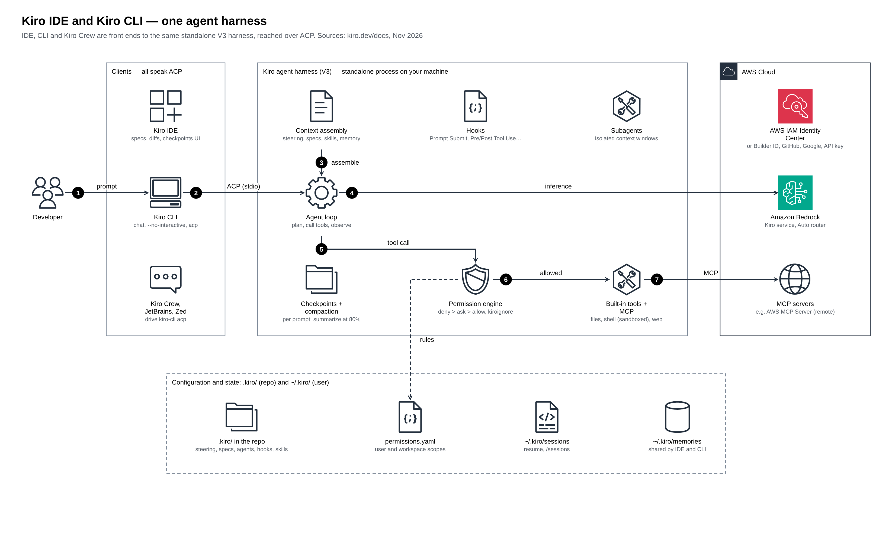

# How Kiro IDE and Kiro CLI work (and how Kiro Crew differs)

Kiro IDE and Kiro CLI are two front ends to **one agent harness**. Kiro Crew is a different kind of product: a gateway that runs *many* harness sessions and adds memory, schedules and orchestration on top. This page explains the shared harness first, then what is specific to each product, and ends with a side-by-side comparison.

Facts come from the Kiro docs (pages dated October–November 2026; links at the end) and, for Crew, from the [`kirodotdev/KiroCrew`](https://github.com/kirodotdev/KiroCrew) repository. See also [Kiro Crew under the hood](kiro-crew-internals.md).



[Interactive diagram](https://akashtalole.github.io/Kiro-Reinvent/docs/diagrams/kiro-harness.html) · [SVG](https://akashtalole.github.io/Kiro-Reinvent/docs/diagrams/kiro-harness.svg) · [draw.io](https://akashtalole.github.io/Kiro-Reinvent/docs/diagrams/kiro-harness.drawio)

## 1. One harness, many clients

- **The harness is a separate process**, "not a library compiled into each app". It plans, calls tools, manages context, evaluates permissions and talks to the models. The IDE, CLI, Web and Mobile apps are front ends to it.
- **Clients talk to it over ACP**, the open Agent Client Protocol (JSON-RPC). Kiro adds optional extensions under a `_kiro/` namespace for live steering, specs, richer permission prompts and context-usage tracking. Clients discover these through `initialize` capabilities and must ignore methods they don't know.
- **Where it runs.** For the IDE and CLI, the harness runs on your machine and is reached over **stdio**. Web and Mobile connect over **WebSocket** to a harness in a managed cloud sandbox. Cloud sessions (`kiro-cli --cloud`, currently us-east-1 only) run in that same sandbox, and the IDE and CLI can attach to them.
- **Third-party clients.** JetBrains IDEs, Zed and **Kiro Crew** drive the same harness through `kiro-cli acp`.
- **Client-provided tools.** A client can replace a built-in tool with its own; the IDE, for example, does file operations through the editor's APIs.
- **V3 vs V2.** Since CLI 3.0 (3 Nov 2026), **V3** is the default for interactive chat. It is "the same unified agent harness as the Kiro IDE and Kiro Web". V2 is still available with `--v2` but gets no new features. Local headless runs still default to V2 unless you pass `--v3`, `--cloud`, `--repo` or `--trust-all-tools`. Choose the engine with `--v3`/`--v2`, `chat.agentEngine`, or `acp.agentEngine` for `kiro-cli acp`.

## 2. One turn of the agent loop

This loop is the same on every surface.

1. **Assemble context:** your prompt, the history, steering files and attachments. *Prompt Submit* hooks run here.
2. **The model plans:** the request goes to the model you chose or to the **Auto** router, and comes back as text, tool calls or both.
3. **Check every tool call** against the permission rules and `.kiroignore`. *Pre Tool Use* and *Permission Request* hooks can block it.
4. **Run the tool.** *Post Tool Use* hooks run afterwards.
5. **Feed the results back** and repeat until the turn ends. *Agent Stop* hooks run at the end.
6. **Compact** the history when context nears the limit.

## 3. Context

| Source | When it's loaded |
| --- | --- |
| Steering (`.kiro/steering/*.md`, `~/.kiro/steering/`, `AGENTS.md`, now also in subfolders) | Depends on inclusion mode: `always`, `fileMatch`, `auto` (matched by description) or `manual` |
| Active spec (`requirements.md` → `design.md` → `tasks.md`) | Always loaded while you work on it |
| Skills (`SKILL.md`) | On demand, when the description matches (progressive disclosure) |
| Powers (`POWER.md` + MCP + hooks) | When matching keywords come up; unloaded when the topic changes |
| MCP tools | On demand through tool search (IDE 1.3+, CLI V3) |
| Memories | Preference, Fact or Other records, if memory is turned on |
| Subagents | Each has its own isolated context window (`invoke_sub_agent`) |

**Compaction** starts automatically at `compaction.autoCompactionThreshold`, which defaults to **80%** of the context window. It writes a structured summary (goals, decisions, progress, next steps) and keeps the last few message pairs word for word. It is one-way. The CLI also has `/compact`, and *Pre/Post Compaction* hooks.

Most current models have a 1M-token window; some older ones have 200K.

## 4. Tools

| Group | Tools |
| --- | --- |
| Read | `read_file`, `list_directory`, `file_search` (glob), `grep_search` (regex) |
| Write | `fs_write`, `fs_append`, `str_replace`, `delete_file` |
| Shell | `execute_bash` (`execute_pwsh` on Windows) |
| Web | `web_search`, `web_fetch` (10 MB, 30 s, text/HTML only) |
| Agents | `invoke_sub_agent`, `disclose_context`, `introspect` |
| IDE only | process control (`control_bash_process`, `get_process_output`, `list_processes`), `read_code`, semantic rename |
| CLI only | `code` (tree-sitter/LSP intelligence for 18 languages), `knowledge` (experimental) |

V3 has **no `use_aws` tool**: the AWS CLI runs through the shell tool and its approval rules.

## 5. Permissions, trust and sandbox

**Rules** live in `permissions.yaml`. The CLI and the IDE read the same file.

```yaml
rules:
  - capability: shell
    match: ["git *", "npm *", "npx *"]
    effect: allow
```

- **Capabilities:** `fs_read`, `fs_write`, `shell`, `web_fetch`, `web_search`, `mcp`, `subagent`, `skill`, `power`, `context`, `diagnostics`, `sandbox_network`.
- **Effects:** `deny > ask > allow > evaluate`. The strictest effect always wins, whichever scope it comes from.
- **Scopes:**
  - Kiro's built-in invariants;
  - admin (`managed-settings.json`);
  - user (`~/.kiro/settings/permissions.yaml`);
  - workspace (`~/.kiro/workspace-roots/<hash>/`, stored *outside* the repo so a cloned repository can't grant itself trust);
  - agent;
  - session.
- **Presets:** `read-only-shell`, `dev-shell`, `edit-workspace`, `approve-for-me` and others.
- **Approve for me:** Kiro approves routine actions itself and labels them "Approved for you".
- **Built-in invariants:** writes to Kiro's own settings folders and to `.kiroignore` are always denied. Writes to `.git/**` and to the agents/hooks/workflows/powers folders always ask.
- **Workspace trust:** an untrusted workspace doesn't load its agents, steering, MCP config or skills, and asks before every shell command.
- **Headless:** with no interactive client, every `ask` counts as a deny.

**Local command sandbox.** It is off by default, and available in IDE 1.3+ and CLI V3.
- It wraps shell commands and their child processes. It uses Seatbelt on macOS and `bwrap` on Linux, and needs a one-time setup on Windows.
- The harness itself and the built-in file tools stay outside it and are governed by the permission rules.
- `sandbox.json` sets network access; the default is `DEFAULT_BLOCKED`. A project's file can only make the global policy *tighter*.
- Kiro says plainly: "it is not a guarantee of isolation."

## 6. Hooks, checkpoints, sessions, memory

- **Hook events:**
  - Prompt Submit;
  - Agent Stop and Subagent Stop;
  - Session Start and Session End;
  - Pre and Post Compaction;
  - Pre Tool Use, Permission Request and Post Tool Use;
  - File Create, File Save and File Delete;
  - Pre and Post Task Execution;
  - Manual.
  
  Exit code 2 blocks the action where blocking is supported. A hook's stdout goes to the agent.
- **Checkpoints:** one is created per prompt. Restoring rewinds the files the agent changed with its built-in tools (not your manual edits, shell or MCP changes) and drops the context after that point. You can also fork a conversation from an earlier turn: *Fork conversation* in the IDE, `/rewind` in the CLI.
- **Sessions:** stored in `~/.kiro/sessions/`. In the CLI you can resume, browse with `/sessions` and branch with `/tangent`. V3 can resume a V2 session, but not the other way round.
- **Memory:** stored per user account in `~/.kiro/memories/` and shared by the IDE and CLI on one machine. It is off by default. Subagents and untrusted workspaces can read memories but not write them.

## 7. Models, inference and sign-in

- **Models:** frontier and open-weight models from Anthropic, OpenAI and other providers.
- **Auto** is Kiro's model router and is the baseline for credits (1.0x). Other models are priced as multiples of Auto; see the [model catalog](https://kiro.dev/docs/models/available-models/) for current values.
- **Inference runs on Amazon Bedrock** with cross-region inference. US profiles use us-east-1, us-east-2 and us-west-2; EU profiles use EU Regions. Some models use Global routing.
- **Data handling:** enterprise content isn't used to improve the service and can be encrypted with customer-managed keys.
- **Sign-in:** GitHub, Google, AWS Builder ID, AWS IAM Identity Center, or an external IdP (Okta, Entra).
- **Headless CI:** `KIRO_API_KEY` (paid plans). Remote shells can sign in with a device flow. Check who you're signed in as with `kiro-cli whoami`.

## 8. What's specific to each product

**Kiro IDE**
- A desktop editor built on Code OSS (the open-source base of VS Code).
- Visual spec panes and inline diffs.
- A checkpoint UI and dockable chat.
- `#Problems` shares the editor's diagnostics with the agent.
- Uses the editor's own APIs for file operations.
- Independent spec tasks can run in waves.
- Three autonomy modes:
  - **Supervised:** pauses after each turn that edits files.
  - **Accept file changes** (formerly Autopilot): edits without asking, but still asks before commands.
  - **Approve for me.**

**Kiro CLI**
- `kiro-cli` (interactive chat in the terminal UI).
- `kiro-cli chat --no-interactive` for CI, with `--output-format stream-json` and exit codes.
- `kiro-cli acp` to serve other editors and Kiro Crew.
- `--cloud` / `--repo` for cloud sessions.
- Slash commands: `/spec new`, `/memories`, `/sessions`, `/tangent`, `/compact`, `/permissions`, `/rewind`.
- Opt-in **workflows** (plan → implement → review, each step in a fresh session).
- `code` and `knowledge` tools.
- `--sandbox` makes a headless run fail if the sandbox can't start.

## 9. Kiro IDE vs Kiro CLI vs Kiro Crew

| | Kiro IDE | Kiro CLI | Kiro Crew |
| --- | --- | --- | --- |
| **What it is** | Agentic editor | Terminal client and ACP server | Open-source (Apache-2.0) gateway and workspace |
| **Agent runtime** | The V3 harness (local) | The V3 harness (V2 by choice) | Drives `kiro-cli acp` with the V3 engine (KAS) by default; other ACP agents are selectable |
| **Sessions** | One chat per tab, attached to a workspace | One per terminal; resumable | Many at once: channel threads, dashboard slots, cron jobs, subagents, task steps |
| **How you use it** | Editor UI | Terminal, scripts, CI | Dashboard (`:5476`), desktop app, CLI, Slack, Teams, Discord, Telegram and more |
| **Runs when you're away** | No (unless you attach a cloud session) | Headless jobs you schedule yourself; cloud sessions | Yes: cron, heartbeat (`HEARTBEAT.md`), TaskRunner, standing bots |
| **Multi-agent** | Subagents, parallel spec tasks | Subagents, workflows | Coordinator agent with `spawn_run`, `task_run`, `cron_add`, `select_crew`; conductor mode; bots with their own threads |
| **Memory** | `~/.kiro/memories` (shared with the CLI) | Same | Its own stores under `~/.kiro/crew/`: transcripts → preferences, projects, daily history, lessons; FTS5 + local vector search |
| **Tool control** | `permissions.yaml`, trust, sandbox | Same | Everything the harness does, **plus** Crew's own PreToolUse gate and a governance ceiling (`POLICY ∩ PROFILE`) the agent can't edit |
| **Sandbox** | Local command sandbox (optional) | Same | Crew's OS sandbox (namespaces or Seatbelt) by default; on macOS it hands over to kiro-cli's sandbox when that is on |
| **Audit** | Session history | Session history, stream-json | Hash-chained security event log |
| **Configuration** | `.kiro/` + `~/.kiro/` | Same | Reuses `.kiro/` and `~/.kiro/agents`; adds `~/.kiro/crew/` (config, crons, memory, apps) |
| **Best for** | Specs, design, reviewing diffs | Terminal work, automation, CI, serving other editors | Long-running, scheduled, multi-agent and chat-driven work for a person or a team |

**How they fit together.** Think of them as layers:
1. The **harness** does the agent work.
2. The **IDE and CLI** are interactive windows onto it.
3. **Crew** is a supervisor process. It starts many CLI harness sessions over ACP, feeds them context and memory, decides when they run, and puts its own policy gate in front of their tools.

Your `.kiro/` steering, skills, agents and MCP config carry across all three.

## Sources

- Kiro docs:
  - [How Kiro works](https://kiro.dev/docs/how-kiro-works/)
  - [Choose an agent harness](https://kiro.dev/docs/cli/agent-harness/)
  - [ACP](https://kiro.dev/docs/acp/)
  - [Tools](https://kiro.dev/docs/tools/)
  - [Permissions](https://kiro.dev/docs/permissions/)
  - [Sandbox](https://kiro.dev/docs/sandbox/)
  - [Compaction](https://kiro.dev/docs/compaction/)
  - [Checkpoints](https://kiro.dev/docs/checkpoints/)
  - [Memory](https://kiro.dev/docs/memory/)
  - [Hook types](https://kiro.dev/docs/hooks/types/)
  - [Models](https://kiro.dev/docs/models/)
  - [Data protection](https://kiro.dev/docs/privacy-and-security/data-protection/)
  - [Authentication](https://kiro.dev/docs/getting-started/authentication/)
  - [Headless CLI](https://kiro.dev/docs/cli/headless/)
  - [IDE autonomy modes](https://kiro.dev/docs/ide/chat/autopilot/)
  - [Crew](https://kiro.dev/docs/crew/)
- Kiro blog: [Kiro CLI V3](https://kiro.dev/blog/cli-3/)
- Community: [Kiro agent harness architecture (AWS Builder Center)](https://builder.aws.com/content/3GhG0MrwbtQo9CJwURtVOXOhzeS/kiro-agent-harness-architecture-built-in-capabilities-and-the-layers-beyond). This is a third-party reference architecture, not product docs.
- Kiro Crew: [`docs/architecture/overview.md`](https://github.com/kirodotdev/KiroCrew/blob/main/docs/architecture/overview.md)

Kiro changes quickly; check the docs for current versions, model multipliers and defaults.
