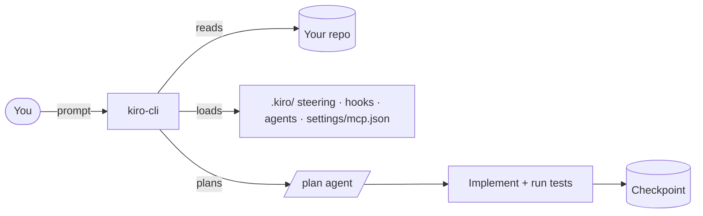

# Lab 01 · Kiro CLI quick start

> **Outcome:** Kiro CLI installed, authenticated, and used to plan, implement and verify a small change in a real repository — with a checkpoint you can roll back to.

## Scenario

You maintain a small TypeScript service and want an agent in the terminal that understands the repo, proposes a plan before touching code, and lets you rewind if it goes wrong. The same agent harness (V3) powers Kiro IDE, Kiro Web and Kiro CLI, so everything you configure here (steering, hooks, custom agents, MCP) carries over.



## How it works

| Concept | What it does |
| --- | --- |
| **Harness V3** | The unified agent loop shared by IDE, CLI and Web (default since CLI 3.0). Select per run with `--v3` / `--v2`. |
| **Plan mode** | Reasons about the change and writes a plan before editing. |
| **Checkpoints** | Snapshots of the workspace you can rewind to. |
| **Trust / permissions** | Tools run under allow / ask / deny rules; you approve risky actions. |

## Prerequisites

- macOS, Linux or Windows (WSL recommended for some labs)
- A Kiro account (free tier works) — sign in with GitHub, Google, AWS Builder ID or IAM Identity Center
- Git and Node.js 20+ for the sample app

## Step 1 — Install and sign in

```bash
curl -fsSL https://cli.kiro.dev/install | bash
kiro-cli --version
kiro-cli login
```

> Windows: use the PowerShell installer from [kiro.dev/cli](https://kiro.dev/cli/). Kiro CLI 3.x ships as a single standalone `kiro-cli` binary.

## Step 2 — Get a sample repo

Use any repo, or the tiny sample in this lab folder:

```bash
cp -r labs/01-kiro-cli-quickstart/sample-app ~/kiro-quickstart && cd ~/kiro-quickstart
git init -q && git add . && git commit -qm "baseline"
npm install
```

## Step 3 — Start a session and explore

```bash
kiro-cli
```

Useful first prompts and commands:

```text
> Explain the architecture of this repo in 5 bullets
> /model            # pick a model for this session
> /help             # all slash commands
```

## Step 4 — Plan, then implement

```text
> /plan Add a GET /health endpoint that returns {status:"ok", version} from package.json, with a unit test
```

Review the plan. When you accept it, Kiro edits files and runs the test command. Approve shell commands as they're proposed (or allow `npm test` for the session).

## Step 5 — Rewind with a checkpoint

Ask for something you'll regret, then roll it back:

```text
> Rename every function to snake_case
```

Open the checkpoint list (run `/help` to see the checkpoint / rewind command for your CLI version) and restore the checkpoint taken before the rename. See [Checkpoints](https://kiro.dev/docs/checkpoints/).

## Step 6 — Run one prompt headless

The same agent works non-interactively — the foundation for [Lab 10](../10-headless-kiro-in-ci/README.md):

```bash
kiro-cli chat --no-interactive --trust-tools=read,grep \
  "List every HTTP route in this repo as a markdown table"
```

## Verify

- [ ] `kiro-cli --version` prints 3.x or later
- [ ] `npm test` passes, including the new health test
- [ ] Checkpoint restore removed the unwanted rename (`git diff` is clean apart from the health endpoint)

## Clean up

```bash
rm -rf ~/kiro-quickstart
```

## Learn more

- [Kiro CLI docs](https://kiro.dev/docs/cli/) · [Choose an agent harness](https://kiro.dev/docs/cli/agent-harness/)
- [Introducing Kiro CLI](https://kiro.dev/blog/introducing-kiro-cli/) · [One agent, every surface](https://kiro.dev/blog/one-agent/)
- Next: [Lab 02 — Steering and AGENTS.md](../02-steering-and-agents-md/README.md)
