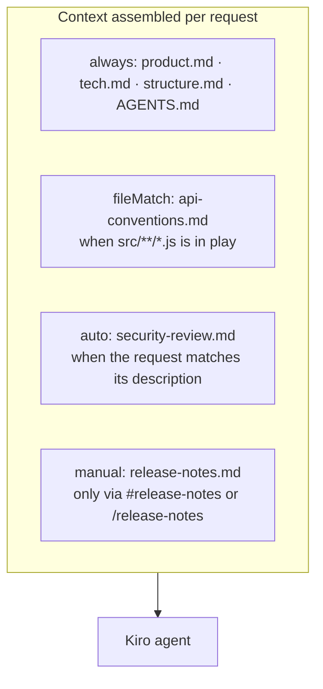

# Lab 02 · Steering and AGENTS.md

> **Outcome:** A `.kiro/steering/` set that makes Kiro follow your product rules, stack and conventions — loading only what's relevant, when it's relevant.

## Scenario

Every new chat, the agent re-discovers that you use `node --test`, that errors have a specific shape, and that PII must never be logged. Steering turns that tribal knowledge into versioned markdown the agent reads automatically.



## How it works

| Where | Scope |
| --- | --- |
| `.kiro/steering/*.md` | This workspace (commit it) |
| `~/.kiro/steering/*.md` | Every workspace on your machine |
| `AGENTS.md` (root, subfolders, or `~/.kiro/steering/`) | Always included, no front matter |

Workspace steering wins on conflict. Inclusion is set by YAML front matter at the very top of the file:

```yaml
---
inclusion: always            # default
---
```
```yaml
---
inclusion: fileMatch
fileMatchPattern: ["src/**/*.js", "docs/openapi.yaml"]
---
```
```yaml
---
inclusion: auto
name: security-review
description: Security review checklist… Use when reviewing or writing code that handles requests, credentials or user data.
---
```
```yaml
---
inclusion: manual            # pull in with #release-notes or /release-notes
---
```

Steering can embed live files: `#[[file:src/app.js]]`, line ranges `#[[file:src/app.js:10-40]]`, or a folder `#[[folder:docs/adr]]`.

## Step 1 — Generate foundation files

In the IDE choose **Kiro → Steering → Generate project steering**, or in the CLI:

```text
> Generate steering docs (product.md, tech.md, structure.md) for this repository
```

Compare what Kiro wrote with the curated examples in [`.kiro/steering/`](.kiro/steering/).

## Step 2 — Add scoped and on-demand steering

Copy this lab's steering folder and `AGENTS.md` into the quick-start repo from Lab 01:

```bash
cp -r labs/02-steering-and-agents-md/.kiro ~/kiro-quickstart/
cp labs/02-steering-and-agents-md/AGENTS.md ~/kiro-quickstart/
```

## Step 3 — Watch inclusion change

```text
> What error format should a new endpoint use?          # fileMatch / always
> Review src/app.js for security problems              # auto → security-review loads
> /release-notes summarise the last 3 commits           # manual
```

In the CLI, the context view shows which steering files are active for the turn.

## Step 4 — Custom agents need opt-in

Custom agents (Lab 05) don't inherit steering automatically. Add it explicitly:

```json
"resources": ["file://.kiro/steering/**/*.md", "file://AGENTS.md"]
```

## Patterns that work

- **Short, imperative, testable rules.** "Use `node --test`" beats "we like simple tests".
- **Link, don't paste.** Reference the canonical file with `#[[file:…]]` so steering never drifts.
- **Use `auto` for checklists** (security, accessibility, migrations) so they load only when relevant — cheaper context, sharper answers.
- **Global steering for personal taste**, workspace steering for team rules.

## Verify

- [ ] A new endpoint written by Kiro uses the `{ error: { code, message } }` shape without being told
- [ ] The security checklist appears only for security-flavoured requests

## Learn more

- [Steering docs](https://kiro.dev/docs/steering/) · [Configuration scopes](https://kiro.dev/docs/configuration/)
- Next: [Lab 03 — Spec-driven development](../03-spec-driven-development/README.md)
