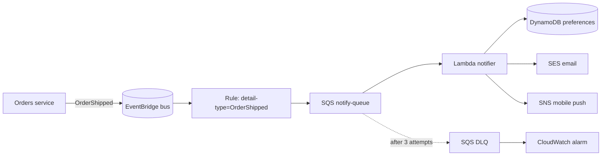

# Design Document — Order notifications

## Overview
Event-driven fan-out on AWS serverless primitives.

## Architecture


## Components and interfaces
| Component | Responsibility | Interface |
| --- | --- | --- |
| `notifier` Lambda | Load prefs, send per channel, idempotency | SQS batch event, partial batch failure |
| `preferences` table | PK `customerId`; attrs `email`, `push`, `updatedAt` | GetItem |
| `idempotency` table | PK `eventId#channel`, TTL 7 days | conditional PutItem |

## Data models
```ts
type OrderShipped = { eventId: string; orderId: string; customerId: string; shippedAt: string };
```

## Error handling
Retries via SQS `maxReceiveCount=3`; Lambda returns `batchItemFailures`.

## Testing strategy
Unit tests for preference filtering and idempotency; property test: for any sequence of duplicate events, sends per (eventId, channel) ≤ 1.
