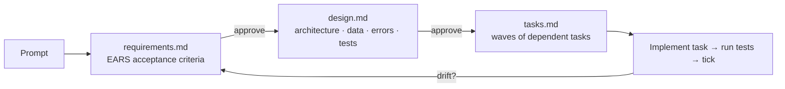

# Lab 03 · Spec-driven development

> **Outcome:** A complete feature spec (`requirements.md`, `design.md`, `tasks.md`) for an event-driven notification service, implemented task by task with every change traceable to an acceptance criterion.

## Scenario

"Add order notifications" sounds small until you hit retries, idempotency, preferences and alarms. Vibe-coding it produces something that *demos*; a spec produces something you can *review*. Kiro's specs make the agent write down what "done" means before writing code.



## How it works

| Spec type | Flow | Use when |
| --- | --- | --- |
| **Feature — Requirements-first** | Requirements → Design → Tasks | Behaviour is clear, architecture is open |
| **Feature — Design-first** | Design → Requirements → Tasks | You start from an architecture or a constraint |
| **Bugfix** | `bugfix.md` (current / expected / unchanged behaviour) → Design → Tasks | Regressions — protects what must *not* change |
| **Quick spec** | All three generated without approval gates | Small, well-understood changes |

Specs live in `.kiro/specs/<feature>/`. Requirements use **EARS** (Easy Approach to Requirements Syntax):

```text
WHEN <trigger> THE SYSTEM SHALL <response>
IF <unwanted condition> THEN THE SYSTEM SHALL <response>
WHILE <state> THE SYSTEM SHALL <response>
```

Tasks are a checkbox list (max two levels: `1.`, `1.1`) with `_Requirements: x.y_` back-references; Kiro runs independent tasks in parallel **waves** derived from the dependency graph.

## Step 1 — Create the spec

IDE: **Kiro panel → Specs → +** · CLI / Web: just ask.

```text
> Create a spec: when an order ships, notify the customer by email and push
  according to their preferences. Retries, idempotency and a DLQ alarm required.
  Target AWS serverless with CDK.
```

## Step 2 — Interrogate the requirements

Don't accept the first draft. Good review prompts:

```text
> Which acceptance criteria are not testable? Rewrite them.
> Add an unwanted-behaviour (IF … THEN) criterion for every external call.
> What happens when preferences change mid-flight? Add a criterion.
```

Compare with the reference spec in [`.kiro/specs/order-notifications/`](.kiro/specs/order-notifications/requirements.md).

## Step 3 — Approve the design

Check that the design has: a diagram, interfaces per component, data models, error handling, and a **testing strategy that names properties** (e.g. "at most one send per eventId+channel"). In the IDE, specs can generate **property-based tests** from such correctness properties.

## Step 4 — Execute tasks

```text
> Run task 1.1
> Run all tasks in wave 1
```

After each task: tests run, the checkbox ticks, and the diff is reviewable against the criterion it cites.

## Step 5 — Handle drift

Requirements changed? Edit `requirements.md` and ask:

```text
> Requirements 2.2 changed. Update design and tasks, and list impacted code.
```

## Step 6 — Try a bugfix spec

```text
> Create a bugfix spec: duplicate push notifications when SQS redelivers a batch.
```

Note the **unchanged behaviour** section — it becomes regression tests.

## Verify

- [ ] Every task references at least one requirement
- [ ] Every requirement is covered by at least one test
- [ ] `cdk synth` succeeds and unit + property tests pass

## Learn more

- [Specs](https://kiro.dev/docs/specs/) · [Feature specs](https://kiro.dev/docs/specs/feature-specs/)
- [EARS (Mavin et al.)](https://alistairmavin.com/ears/)
- Next: [Lab 04 — Agent hooks](../04-agent-hooks/README.md)
