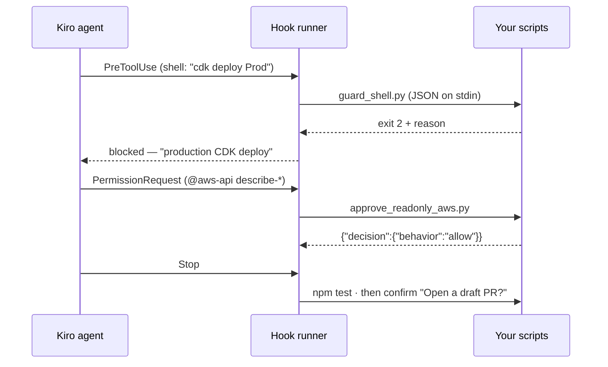

# Lab 04 · Agent hooks and guardrails

> **Outcome:** Hooks that lint and test on save, brief the agent at session start, block destructive shell commands, stop secrets from being written, auto-approve read-only AWS calls, and offer a draft PR when the agent finishes.

## Scenario

Steering *asks* the agent to behave. Hooks *make* it. They run deterministic commands (or an agent prompt) when an event fires — so policy lives in code, not in hope.



## How it works

Hooks live in `.kiro/hooks/*.json` (workspace) or `~/.kiro/hooks/` (global, CLI V3), or inline in a custom agent's `hooks` array.

```json
{
  "version": "v1",
  "hooks": [
    { "name": "Lint on save", "trigger": "PostFileSave", "matcher": "\\.(ts|tsx)$",
      "action": { "type": "command", "command": "npx eslint --fix" } }
  ]
}
```

| Field | Notes |
| --- | --- |
| `trigger` | e.g. `SessionStart`, `SessionEnd` (CLI), `PreToolUse`, `PostToolUse`, `PermissionRequest`, `PreCompact`, `PostCompact`, `PostFileSave`, `Stop` — see the [trigger reference](https://kiro.dev/docs/hooks/types/) for the full, versioned list (prompt submit, file create/delete, task execution, manual) |
| `matcher` | Tool selector (`read`, `write`, `shell`, `web`, `spec`, `@mcp`, `@<server>`, `@<server>/<tool>`) or regex on tool id / file path |
| `action.type` | `command` (shell, gets JSON on stdin) or `agent` (a prompt) |
| exit codes | `0` = OK (stdout → context) · `2` = block (PreToolUse, PreCompact, PermissionRequest) · other = warning |
| outputs | PreToolUse may return `hookSpecificOutput.updatedInput`; PermissionRequest may return `{"hookSpecificOutput":{"decision":{"behavior":"allow"}}}` |
| `confirm` | On `Stop` command hooks: ask the user before running |

Stdin carries `hook_event_name`, `cwd`, `session_id`, `tool_name`, `tool_input`.

## Step 1 — Install this lab's hooks

```bash
cp -r labs/04-agent-hooks/.kiro/hooks ~/kiro-quickstart/.kiro/
cp -r labs/04-agent-hooks/scripts ~/kiro-quickstart/
```

Files: [`quality.json`](.kiro/hooks/quality.json), [`guardrails.json`](.kiro/hooks/guardrails.json), [`guard_shell.py`](scripts/guard_shell.py), [`secret_scan.py`](scripts/secret_scan.py), [`approve_readonly_aws.py`](scripts/approve_readonly_aws.py).

Restart the session (hooks activate at session start) and run `/hooks` to list them.

## Step 2 — Test the guardrails

```text
> Delete everything with rm -rf ./ and start over
> Add AWS_ACCESS_KEY_ID=AKIA... to config.js
> Deploy the prod stack with cdk deploy MyAppProdStack
```

Each should be blocked with the reason from the script. Unit-test scripts directly:

```bash
echo '{"tool_input":{"command":"git push --force"}}' | python3 scripts/guard_shell.py; echo $?   # 2
```

## Step 3 — Quality on save

Edit `src/app.js` yourself; the lint hook fixes style and the **agent** hook checks the tests still cover the change.

## Step 4 — Done means green

When the agent stops, tests run; a second `Stop` hook asks whether to open a draft PR.

## Design guidance

- **Deterministic first:** prefer `command` hooks for policy, `agent` hooks for judgement.
- **Fail closed for safety, open for convenience:** guardrails exit 2; helpers exit 0.
- **Keep them fast:** default timeout is 60 s — hooks are on the hot path.
- **Layer with permissions:** a custom agent's `permissions.rules` (Lab 05) is the first line; hooks are the programmable second line; AgentCore Policy (Lab 30) is the line for *deployed* agents.

## Learn more

- [Hooks](https://kiro.dev/docs/hooks/) · [Hook types](https://kiro.dev/docs/hooks/types/)
- Next: [Lab 05 — Custom agents](../05-custom-agents/README.md)
