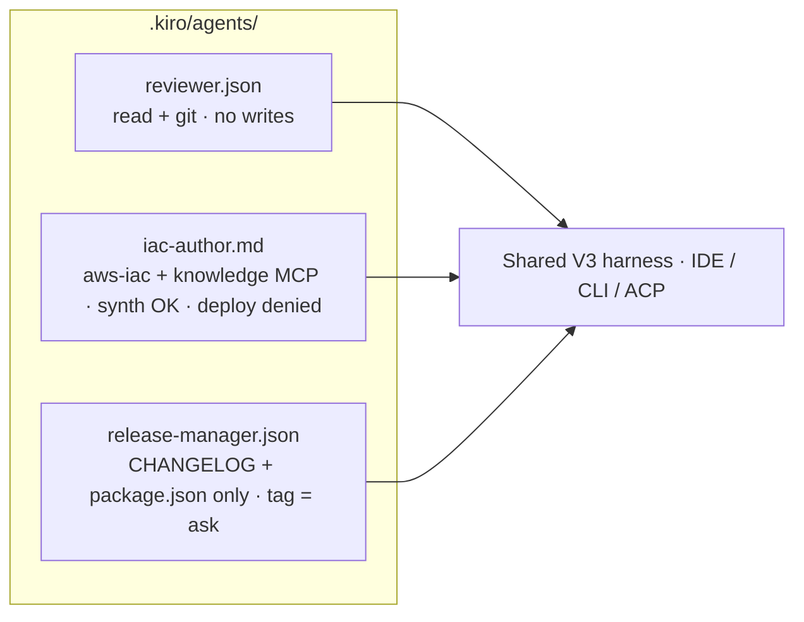

# Lab 05 · Custom agents with scoped permissions

> **Outcome:** Three specialist agents in `.kiro/agents/` that your whole team gets from version control, each with least-privilege tools and permissions.

## Scenario

One general agent with every tool is convenient and risky. Teams get better results from **specialists**: narrow prompt, the right MCP servers, and permissions that make the wrong action impossible rather than unlikely.



## How it works

Agents are JSON or Markdown (front matter = config, body = prompt) in `.kiro/agents/` (workspace) or `~/.kiro/agents/` (global). Key fields:

| Field | Purpose |
| --- | --- |
| `prompt` | System prompt, or `file://` reference |
| `tools` / `excludedTools` | Categories `read` `write` `shell` `web` `subagent`, `@builtin`, `@mcp`, `@server`, `@server/tool`, `*` |
| `permissions.rules` | `{capability, match[], effect: allow \| ask \| deny, exclude[]}` — **deny wins**. Capabilities: `fs_read` `fs_write` `shell` `web_fetch` `web_search` `mcp` `subagent` `skill` `power` |
| `resources` | `file://…`, `skill://…`, or `{type: "knowledgeBase", source, indexType}` |
| `mcpServers` / `includeMcpJson` / `includePowers` | Agent-local MCP and whether to inherit workspace MCP and powers |
| `hooks` | Inline hooks (Lab 04 format) |
| `model`, `welcomeMessage` | Defaults for the agent |

> Custom agents do **not** auto-load steering or skills — add them to `resources`. Old CLI 2.x profiles (`allowedTools`, `toolsSettings`) convert with `/upgrade-agent`.

## Step 1 — Install the agents

```bash
cp -r labs/05-custom-agents/.kiro/agents labs/05-custom-agents/.kiro/prompts ~/kiro-quickstart/.kiro/
```

- [`reviewer.json`](.kiro/agents/reviewer.json) — read-only reviewer with a git MCP server
- [`iac-author.md`](.kiro/agents/iac-author.md) — Markdown-format agent with AWS IaC + AWS Knowledge MCP
- [`release-manager.json`](.kiro/agents/release-manager.json) — inline `SessionStart` hook, `ask` before tagging

## Step 2 — Use them

```bash
kiro-cli --agent reviewer          # start with a specific agent
```
```text
> /agent swap iac-author            # switch mid-session
> Add an SQS queue with a DLQ to the notifications stack
```

In the IDE pick the agent from the chat agent selector.

## Step 3 — Prove least privilege

```text
(reviewer)   > Fix the bug you found          → write denied
(iac-author) > Now deploy it                   → shell rule denies *deploy*
(release)    > Tag v1.3.0 and push             → asks before running
```

## Step 4 — Generate your own

```text
> Create a custom agent called "db-migrator" that can only edit files in migrations/,
  run "npm run migrate:dry-run", and uses the postgres MCP server read-only.
```

Kiro writes the agent file; review the `permissions` block before committing.

## Patterns

- **One agent per accountability**, named for the job (`reviewer`, not `agent2`).
- **Deny-list destructive verbs** even if the tool set looks safe — MCP servers grow new tools.
- **Prompts in files** so reviewers can diff them.
- **Pair with subagents** (Lab 06): an orchestrator delegates to these specialists in parallel.

## Learn more

- [Custom agents](https://kiro.dev/docs/custom-agents/) · [Configuration reference](https://kiro.dev/docs/custom-agents/configuration-reference/)
- Next: [Lab 06 — Subagents and parallel work](../06-subagents-and-parallel-work/README.md)
