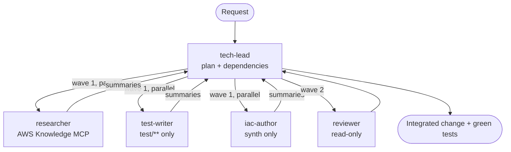

# Lab 06 · Subagents and parallel work

> **Outcome:** An orchestrator agent that splits a feature into independent units, runs specialists in parallel (researcher, test-writer, reviewer, iac-author), and integrates their summaries.

## Scenario

Long tasks die from context bloat: by the time the agent has read the docs, written the code and the tests, the original intent has scrolled out. Subagents give each unit of work a **fresh context window** and return only a summary, keeping the orchestrator sharp.



## How it works

- An agent with the `subagent` tool (and a `subagent` permission) can delegate to built-in or custom agents.
- Each subagent runs with **its own context and its own tool permissions** — a delegated `reviewer` still can't write.
- Subagents can run **in parallel** and support **task dependencies**, so the orchestrator can express waves.
- Spec task execution uses the same idea: independent tasks in a wave run concurrently.

## Step 1 — Install

Combine with Lab 05's agents:

```bash
cp labs/06-subagents-and-parallel-work/.kiro/agents/* ~/kiro-quickstart/.kiro/agents/
```

Files: [`tech-lead.json`](.kiro/agents/tech-lead.json), [`test-writer.md`](.kiro/agents/test-writer.md), [`researcher.md`](.kiro/agents/researcher.md).

## Step 2 — Delegate a feature

```bash
kiro-cli --agent tech-lead
```
```text
> Add per-API-key rate limiting (token bucket, 100 req/min) to the todo API.
  Research API Gateway vs in-app options, write the tests first,
  add any infra to the CDK app, then get a review.
```

Watch the CLI's subagent view: three units run at once, then the reviewer runs on the integrated diff.

## Step 3 — Tune the contract

The orchestrator is only as good as its delegation contract. Try adding to its prompt:

```text
Every delegated task must state: goal, inputs (files/URLs), output format (≤ 15 lines),
definition of done, and which tools the subagent may use.
```

## When to use what

| Need | Use |
| --- | --- |
| Independent units, same repo, minutes | **Subagents** (this lab) |
| Long-running, recurring or scheduled work | **Kiro Crew bots** (Lab 13) |
| Issue → PR in the background, many repos | **Autonomous agent** (Lab 14) |
| Agents *you* ship to users | **Strands multi-agent** (Lab 23) on **AgentCore** (Lab 26) |

## Learn more

- [Subagents](https://kiro.dev/docs/custom-agents/subagents/) · [Custom agents](https://kiro.dev/docs/custom-agents/)
- Next: [Lab 07 — Agent skills](../07-agent-skills/README.md)
