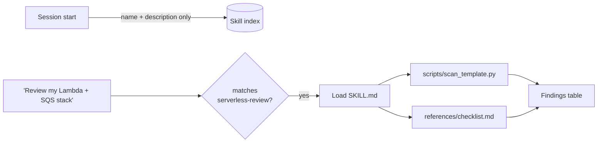

# Lab 07 · Agent skills

> **Outcome:** Two production-style skills — a **serverless reviewer** with a runnable template scanner and a checklist, and an **ADR writer** with a template — wired into the default agent and a custom agent.

## Scenario

Steering is always-on context; skills are **expertise on demand**. Kiro reads only each skill's `name` and `description` at startup, then loads the full instructions (and any scripts/references) when a request matches. That keeps context cheap while making deep, procedural knowledge available.



## How it works

```text
.kiro/skills/                 # workspace (team)  — ~/.kiro/skills/ for personal
└── serverless-review/        # folder name == skill name
    ├── SKILL.md              # required: YAML front matter + instructions
    ├── scripts/              # optional executable helpers
    ├── references/           # optional docs loaded when needed
    └── assets/               # optional templates
```

| Front matter | Rules |
| --- | --- |
| `name` | required, lowercase-hyphenated, ≤ 64 chars, **must equal the folder name** |
| `description` | required, ≤ 1024 chars — *this is the trigger*: say what it does **and when to use it** |
| `license`, `compatibility`, `metadata` | optional |

Skills follow the open **Agent Skills** format, so the same folder works across skill-aware agents. Invoke explicitly with `/serverless-review`; in the CLI, `$ARGUMENTS` / `${1}` substitute arguments.

## Step 1 — Install

```bash
cp -r labs/07-agent-skills/.kiro/skills ~/kiro-quickstart/.kiro/
```

- [`serverless-review/SKILL.md`](.kiro/skills/serverless-review/SKILL.md) + [`scan_template.py`](.kiro/skills/serverless-review/scripts/scan_template.py) + [`checklist.md`](.kiro/skills/serverless-review/references/checklist.md)
- [`adr-writer/SKILL.md`](.kiro/skills/adr-writer/SKILL.md) + [`template.md`](.kiro/skills/adr-writer/assets/template.md)

## Step 2 — Trigger implicitly and explicitly

```text
> Is my SQS → Lambda setup in infra/ production-ready?          # implicit match
> /adr-writer Use EventBridge instead of SNS for order events     # explicit
```

Run the scanner on its own to see what the agent sees:

```bash
npx cdk synth --json > /tmp/t.json
python3 .kiro/skills/serverless-review/scripts/scan_template.py /tmp/t.json
```

## Step 3 — Give a custom agent the skill

```json
"resources": ["skill://.kiro/skills/*/SKILL.md", "skill://~/.kiro/skills/*/SKILL.md"]
```

## Step 4 — Import a skill from GitHub

In the IDE or CLI, import skills from a GitHub/GitLab URL (e.g. a team skills repo or this repo's [lab-creator skill](../../.kiro/skills/lab-creator/SKILL.md)).

## Writing good skills

- **Description = routing rule.** Start with the verb, end with "Use when …".
- **Scripts for determinism**, prose for judgement. Scripts should print compact, parseable output.
- **Progressive disclosure:** keep SKILL.md short; move long checklists into `references/`.
- **Steering vs skill vs power:** steering = always-true project facts; skill = a procedure; power = procedure **plus** tools (MCP) packaged for install (Lab 08).

## Learn more

- [Kiro skills](https://kiro.dev/docs/skills/) · [Agent Skills format](https://agentskills.io/)
- Next: [Lab 08 — Build a Kiro power](../08-build-a-kiro-power/README.md)
