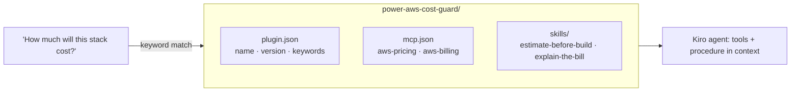

# Lab 08 · Build a Kiro power

> **Outcome:** `power-aws-cost-guard`, a power that bundles the AWS Pricing and Billing MCP servers with two skills, activates when someone talks about cost, and installs from a folder or a GitHub URL.

## Scenario

Plain MCP loads every tool into context up front — dozens of tool schemas for servers you may not need this turn. **Powers** load *on demand*: their keywords decide when the MCP tools and skills enter context. They're also the unit of distribution: one install gives a teammate the tools, the know-how and the guardrails.



## How it works

Powers use the **Agent Plugins** layout (legacy `POWER.md` powers still load):

| File | Required | Purpose |
| --- | --- | --- |
| `plugin.json` | ✅ | `$schema`, `name` (kebab), `version` (semver), `description`, `author.name`, `keywords` (drive activation) |
| `mcp.json` | — | MCP servers (`type: stdio`, `command`, `args`, `env` with `${VAR}`) — namespaced on install, e.g. `power-aws-cost-guard-aws-pricing` |
| `skills/<name>/SKILL.md` | — | Agent Skills (Lab 07) |

Powers install in the IDE, CLI V3, Web and Mobile; custom agents opt in with `"includePowers": true` and permission capability `power`.

## Step 1 — Inspect the power

- [`plugin.json`](power-aws-cost-guard/plugin.json)
- [`mcp.json`](power-aws-cost-guard/mcp.json)
- [`estimate-before-build/SKILL.md`](power-aws-cost-guard/skills/estimate-before-build/SKILL.md) + [`inventory.py`](power-aws-cost-guard/skills/estimate-before-build/scripts/inventory.py)
- [`explain-the-bill/SKILL.md`](power-aws-cost-guard/skills/explain-the-bill/SKILL.md)

Prereqs: [`uv`](https://docs.astral.sh/uv/) installed, an AWS profile with `pricing:*` read and `ce:Get*` permissions.

## Step 2 — Import locally

IDE: **Powers panel → Add Custom Power → Import power from a folder** → select `labs/08-build-a-kiro-power/power-aws-cost-guard`.

## Step 3 — Trigger it

```text
> Estimate the monthly cost of the order-notifications spec at 2M orders/month in eu-west-1
> Why did our AWS bill go up last month?
```

Note that the pricing/billing tools are absent from context until a keyword matches.

## Step 4 — Share it

Push the folder to a public repo (root or subfolder), then teammates choose **Add Custom Power → Import power from GitHub** and paste the URL. For partner-grade powers, browse [kiro.dev/powers](https://kiro.dev/powers/) and [kirodotdev/powers](https://github.com/kirodotdev/powers) — launch partners included Stripe, Figma, Datadog, Dynatrace, Neon, Netlify, Postman and Supabase.

## Design checklist

- [ ] Keywords are **specific** (avoid "aws" alone — it would fire constantly)
- [ ] Every MCP server is read-only by default, or the skill says when to ask
- [ ] Skills say *how* to use the tools, not just *that* they exist
- [ ] Version bumps on every change; changelog in the repo

## Learn more

- [Powers](https://kiro.dev/docs/powers/) · [Create a power](https://kiro.dev/docs/powers/create/) · [Introducing powers](https://kiro.dev/blog/introducing-powers/)
- Next: [Lab 09 — MCP servers in Kiro](../09-mcp-servers-in-kiro/README.md)
