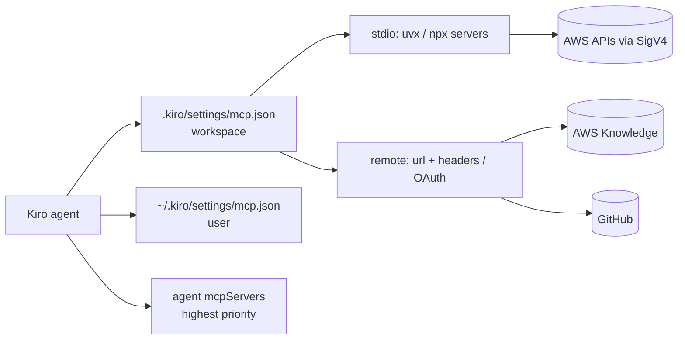

# Lab 09 · MCP servers in Kiro

> **Outcome:** A workspace `mcp.json` with the managed AWS MCP Server, the AWS Knowledge server, the AWS IaC server and GitHub — with sensible auto-approval and disabled destructive tools.

## Scenario

MCP is how Kiro reaches outside the repo: your AWS accounts, docs, tickets, browsers, databases. Getting the config right — scope, auth, approval — is what separates a useful agent from a dangerous one.



## How it works

| Setting | Meaning |
| --- | --- |
| `command`, `args`, `env` | Local stdio server; `env` supports `${VAR}` |
| `url`, `headers` | Remote server (HTTPS; HTTP only for localhost) |
| `oauth` | `{clientId, clientSecret (CLI), redirectUri, mode: browser \| enterprise \| auto}` |
| `autoApprove` | Tool names (or `"*"`) that run without prompting |
| `disabledTools` | Hide specific tools from the agent |
| `disabled` | Keep config, don't start the server |
| `timeout` / `requestTimeout` | ms (CLI) |

Precedence for a same-named server: **agent `mcpServers` > workspace `mcp.json` > user `mcp.json`**. Saving the file hot-reloads only the changed servers.

## Step 1 — Prerequisites

```bash
curl -LsSf https://astral.sh/uv/install.sh | sh     # uvx for awslabs servers
aws configure sso --profile dev                     # or any credential source
```

## Step 2 — Install the config

```bash
mkdir -p ~/kiro-quickstart/.kiro/settings
cp labs/09-mcp-servers-in-kiro/.kiro/settings/mcp.json ~/kiro-quickstart/.kiro/settings/
```

Open [`mcp.json`](.kiro/settings/mcp.json):

- **aws-mcp** — the AWS-managed remote MCP Server, reached through `mcp-proxy-for-aws` which signs requests with SigV4 using your profile. It combines API access, documentation and agent SOPs.
- **aws-knowledge** — remote, no auth; read-only, so `autoApprove: ["*"]`.
- **aws-iac** — CDK / CloudFormation authoring and validation.
- **github** — remote with a bearer token from the environment; merge and delete tools disabled.
- **playwright** — present but `disabled` until you need it.

## Step 3 — Check and authenticate

```text
> /mcp                      # list servers, status and tools
```

For OAuth servers: `/mcp auth`. CLI ≥ 3.5 can add remote OAuth servers directly:

```bash
kiro-cli mcp add --name figma --url https://mcp.figma.com/mcp --oauth-client-id <client-id>
```

## Step 4 — Use them together

```text
> Using AWS docs, what's the max payload for an EventBridge PutEvents entry?
> List my Lambda functions in eu-west-1 with runtime and memory, as a table
> Open a GitHub issue summarising functions still on python3.9
```

## Safety checklist

- [ ] Write-capable servers are **not** in `autoApprove`
- [ ] Credentials come from env / profiles, never literals in `mcp.json`
- [ ] Production profiles are only used by agents whose `permissions` deny mutations (Lab 05) or behind a PermissionRequest hook (Lab 04)
- [ ] Prefer **powers** (Lab 08) for big servers so their tools load only when relevant

## Learn more

- [MCP in Kiro](https://kiro.dev/docs/mcp/) · [MCP configuration](https://kiro.dev/docs/mcp/configuration/)
- [AWS MCP servers catalog](../../docs/aws-mcp-catalog.md) · [awslabs/mcp](https://awslabs.github.io/mcp/)
- Next: [Lab 10 — Headless Kiro in CI](../10-headless-kiro-in-ci/README.md)
