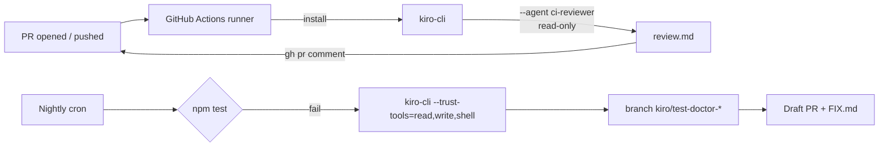

# Lab 10 · Headless Kiro in CI/CD

> **Outcome:** Two workflows — PR review on every push and a nightly failing-test fixer — using `kiro-cli chat --no-interactive`, API-key auth and a locked-down CI agent.

## Scenario

Your best reviewer can't look at every PR at 2 a.m. Headless Kiro can, with the **same steering, skills and agents** your team uses interactively, so CI feedback matches house rules.



## How it works

| Piece | Detail |
| --- | --- |
| `--no-interactive` | One prompt in, answer on stdout, process exits. Also implied when stdin isn't a TTY. |
| Auth | `KIRO_API_KEY` env var (API keys are a paid-tier feature) — store it as a CI secret. |
| Tool trust | `--trust-tools=read,grep` trusts listed categories; or run a custom agent (`--agent`) whose `permissions` define exactly what is allowed. |
| Harness | Local headless defaults to V2; pass `--v3` to opt in to the unified V3 harness. Check [agent-harness docs](https://kiro.dev/docs/cli/agent-harness/). |
| Exit codes | Non-zero on failure — see the [exit code reference](https://kiro.dev/docs/reference/exit-codes/). |

## Step 1 — Create the secret

Generate a Kiro API key in your Kiro account, then in GitHub: **Settings → Secrets and variables → Actions → New secret** `KIRO_API_KEY`.

## Step 2 — Add the CI agent

Copy [`.kiro/agents/ci-reviewer.json`](.kiro/agents/ci-reviewer.json) into your repo. It allows `git diff/log/show`, tests and lint — and denies every other shell command and every write.

## Step 3 — Add the workflows

```bash
mkdir -p .github/workflows
cp labs/10-headless-kiro-in-ci/workflows/*.yml .github/workflows/
```

- [`kiro-pr-review.yml`](workflows/kiro-pr-review.yml) — reviews non-draft PRs, posts/edits a single comment, cancels superseded runs.
- [`kiro-fix-failing-tests.yml`](workflows/kiro-fix-failing-tests.yml) — weekday nightly; only invokes Kiro if tests fail; opens a **draft** PR for a human.

> The install step assumes the installer puts `kiro-cli` in `~/.local/bin`; adjust if your runner differs.

## Step 4 — Try it locally first

```bash
git diff main...HEAD > /tmp/pr.diff
KIRO_API_KEY=... kiro-cli chat --no-interactive --agent ci-reviewer "Review /tmp/pr.diff"
```

## Hardening

- **Least privilege:** use `permissions` in an agent rather than broad `--trust-tools` for anything that writes.
- **Never auto-merge** agent output; drafts + required human review.
- **Fork PRs:** secrets aren't exposed to `pull_request` from forks — keep it that way; don't switch to `pull_request_target` with checkout of untrusted code.
- **Budget:** `timeout-minutes` and `concurrency` bound cost.
- **Prompt injection:** PR content is untrusted. The read-only agent limits blast radius; the doctor workflow only runs on your default branch.

## Variations

- Changelog / release-notes generation on tag push (reuse Lab 05's `release-manager`).
- Spec-drift check: fail the build when code changes lack a matching `tasks.md` tick.
- Run in GitLab CI, Jenkins or CodeBuild — the CLI is the same.

## Learn more

- [Headless mode](https://kiro.dev/docs/cli/headless/) · [CLI 2.0 changelog](https://kiro.dev/changelog/cli/2-0/)
- Next: [Lab 11 — ACP editor integration](../11-acp-editor-integration/README.md)
