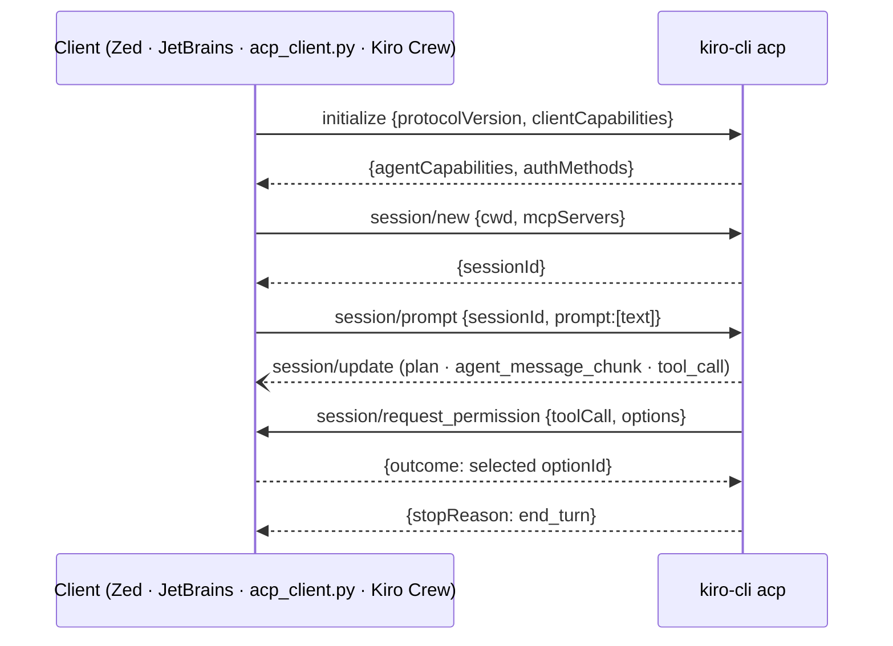

# Lab 11 · ACP — Kiro inside any editor or app

> **Outcome:** Kiro running as the agent behind Zed / JetBrains, plus a Python client ([`acp_client.py`](acp_client.py)) that embeds Kiro in your own tooling with a custom permission policy.

## Scenario

Your team lives in JetBrains, your platform has an internal portal, and Kiro Crew drives agents for you. All three use the same trick: **ACP**, an open JSON-RPC protocol between a client (editor/app) and an agent process. `kiro-cli acp` makes Kiro that agent — with your steering, skills, custom agents and MCP servers.



## How it works

```bash
kiro-cli acp                         # default agent
kiro-cli acp --agent reviewer        # a custom agent from .kiro/agents/
kiro-cli acp --agent-engine=v3       # explicitly use the V3 harness
```

Messages are newline-delimited JSON-RPC 2.0 on stdin/stdout. The client owns the UX (rendering, approvals); the agent owns reasoning and tools.

## Step 1 — Use Kiro from Zed

In Zed `settings.json`:

```json
{
  "agent_servers": {
    "Kiro": { "command": "kiro-cli", "args": ["acp"] }
  }
}
```

Open the Agent panel and choose **Kiro**.

## Step 2 — Use Kiro from JetBrains

JetBrains IDEs with AI Assistant support ACP agents via `~/.jetbrains/acp.json`:

```json
{
  "agent_servers": {
    "Kiro": { "command": "kiro-cli", "args": ["acp", "--agent", "reviewer"] }
  }
}
```

(Paths and UI vary by IDE version — see your editor's ACP docs.)

## Step 3 — Embed Kiro in your own tool

```bash
python3 labs/11-acp-editor-integration/acp_client.py "List risky TODOs in this repo" --cwd ~/kiro-quickstart
```

The client:
1. Streams `agent_message_chunk` text to stdout, tool calls and plan entries to stderr.
2. Implements a **policy** in `session/request_permission`: approve `read`/`search`/`fetch`, reject everything else.

Change `READ_ONLY_KINDS` to experiment, or route approvals to Slack / a web UI — that's how Kiro Crew's approval gates work.

## Ideas

- **Internal developer portal:** "Ask the codebase" box backed by `kiro-cli acp --agent researcher`.
- **ChatOps:** a Slack bot that maps threads → ACP sessions.
- **Evaluation harness:** replay prompts over ACP and score transcripts (pairs with Lab 25 / 32).

## Learn more

- [Kiro ACP](https://kiro.dev/docs/cli/acp/) · [Agent Client Protocol](https://agentclientprotocol.com/)
- Next: [Lab 12 — Kiro Crew workspace](../12-kiro-crew-workspace/README.md)
