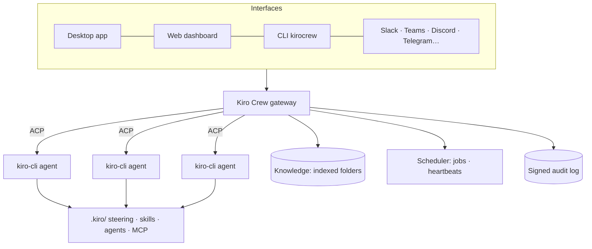

# Lab 12 · Kiro Crew — your persistent agent workspace

> **Outcome:** Kiro Crew running locally (desktop + web dashboard), driving `kiro-cli` agents with your existing steering/skills/agents, with a scheduled job, a heartbeat monitor, a knowledge folder and a Slack channel.

## Scenario

Interactive chat stops when you close the laptop. **Kiro Crew** (open source, Apache-2.0, born inside Amazon as *MeshClaw*) is a long-lived workspace that runs many Kiro agents for you: unattended multi-step tasks, recurring jobs, monitors that wake up only when something needs attention — all with an activity view, approval gates and an audit log.



## How it works

| Capability | What you get |
| --- | --- |
| **Agents over ACP** | Crew drives `kiro-cli` via the Agent Client Protocol (Lab 11) — the same harness and config you already have |
| **Parallel work** | Background agents research or build concurrently without blocking the main thread |
| **Schedules & heartbeats** | Cron-style jobs, and monitors that only surface when attention is needed |
| **Knowledge** | Add local folders; they're chunked, indexed and embedded for retrieval |
| **Channels** | Talk to Crew from Slack, Teams, Discord, Telegram, Webex, WeCom, WeChat |
| **Safety** | OS-level sandbox, deny-by-default commands, sensitive-path blocking, credential redaction, signed audit log |
| **Bots** | Long-running single-responsibility agents with their own memory → Lab 13 |

## Step 1 — Install

Prereqs: `kiro-cli` installed and logged in (Lab 01), Node.js 18+.

```bash
curl -fsSL https://download.crew.kiro.dev/cli.sh | sh
kirocrew setup      # first-run configuration
kirocrew doctor     # verify kiro-cli, auth, ports
kirocrew gateway    # start the gateway; open the printed local URL
```

macOS/Linux desktop apps: [kiro.dev/downloads](https://kiro.dev/downloads/). Build from source: `git clone https://github.com/kirodotdev/KiroCrew && make build`. On Windows use WSL.

## Step 2 — Point it at a repo

Add `~/kiro-quickstart` (or your service) as a workspace. Crew agents pick up its `.kiro/` — steering from Lab 02, hooks from Lab 04, agents from Lab 05, skills from Lab 07.

## Step 3 — Parallel research

```text
Research in parallel and report back in one summary:
1) DynamoDB vs Aurora Serverless v2 for our access patterns (see docs/adr),
2) the cheapest way to send 2M push notifications/month on AWS,
3) which of our dependencies have known CVEs.
```

Watch the **Activity view**: each agent's plan, tool calls, approval gates and results.

## Step 4 — Schedule a job and a heartbeat

- **Job (weekdays 08:30):** "Summarise yesterday's merged PRs and open incidents into a standup note; post to #team-standup."
- **Heartbeat (every 30 min):** "Check the `main` CI status and the error-rate alarm. Stay silent unless something is red; then open a thread with the failing job/alarm and a first diagnosis."

## Step 5 — Add knowledge and a channel

1. **Knowledge → Add folder** → `docs/` (runbooks, ADRs). Ask: "Per our runbooks, how do we rotate the partner API keys?"
2. **Channels → Slack** → follow the app setup; mention Crew in a channel to start a task, approve gated actions from the thread.

## Step 6 — Review the audit trail

Every action is logged and signed. Export it and confirm approvals are recorded for each write or shell action.

## Cost & safety notes

- Crew can consume credits faster than interactive CLI use (many agents, recurring jobs) — start with tight schedules and review usage.
- Keep production credentials out of Crew workspaces unless an agent's permissions deny mutations.
- Treat channel messages as untrusted input; approvals stay with humans.

## Learn more

- [Introducing Kiro Crew](https://kiro.dev/blog/introducing-kiro-crew/) · [KiroCrew on GitHub](https://github.com/kirodotdev/KiroCrew)
- [Getting started with Kiro Crew (AWS Builder Center)](https://builder.aws.com/content/3HYByHPgtbAQqGjoelhwVLzem7j/getting-started-with-kiro-crew)
- Next: [Lab 13 — Kiro Crew bots](../13-kiro-crew-bots/README.md)
