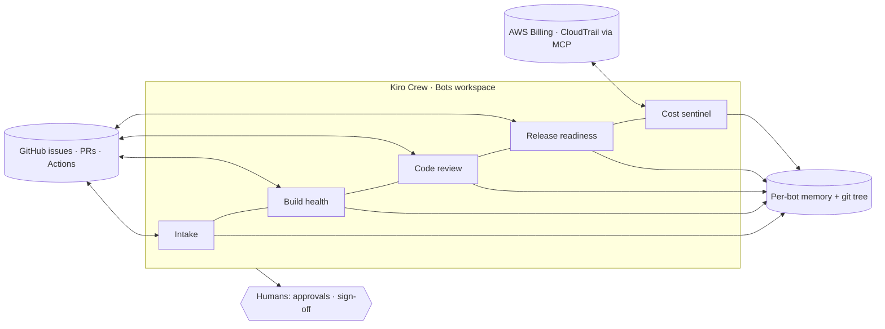

# Lab 13 · Kiro Crew bots — always-on teammates

> **Outcome:** Five bots, each owning one recurring responsibility, built from charters in [`bots/`](bots/) and started with tight limits you can loosen as they earn trust.

## Scenario

Some engineering work is *recurring*: triage, CI babysitting, enforcing decisions in review, release checklists, cost watching. **Bots** (GA in Kiro Crew, Nov 2026) are long-running agents with a name, avatar and instructions, **their own memory and their own git tree**, and notes on decisions and open items. Each bot lives in its own universe — changing one doesn't affect the others.

## How it works

AWS's design guidance for bots, distilled:

1. **Break workflows into recurring responsibilities.** One bot, one job.
2. **Pick processes that can be clearly described and judged.** If you can't say what "done" looks like, it's not bot-ready.
3. **Start with tight limits.** Comment-only, no merges/closes, then loosen as the bot proves itself.
4. **Define inputs, sources, hand-off, and stop conditions** — how tasks reach the bot, what it may read, what a finished hand-off looks like, and when it must stop and ask.

A bot is built on the **default agent or a custom agent** (Lab 05) — the custom agent supplies the prompt, model, tools and skills, which is where you enforce the "never" rules technically, not just in prose.

## Step 1 — Read the charters

| Bot | Charter | Hard limit |
| --- | --- | --- |
| Intake | [`intake-bot.md`](bots/intake-bot.md) | Can comment/label, cannot close |
| Build health | [`build-health-bot.md`](bots/build-health-bot.md) | One re-run max, silent when green |
| Code review | [`code-review-bot.md`](bots/code-review-bot.md) | Comment/request changes, never approve or merge |
| Release readiness | [`release-readiness-bot.md`](bots/release-readiness-bot.md) | Never tags or deploys |
| Cost sentinel | [`cost-sentinel-bot.md`](bots/cost-sentinel-bot.md) | Read-only AWS profile |

## Step 2 — Create the backing agents

Create custom agents whose `permissions` enforce each charter's *Never* list (e.g. the review bot's GitHub MCP server with `disabledTools: ["merge_pull_request"]`, or a PreToolUse hook denying approve/merge calls — Lab 04).

## Step 3 — Create the bots

Kiro Crew sidebar → **Bots** → **Add bot** → choose the custom agent → paste the charter as instructions → set the trigger/schedule.

## Step 4 — Run a week in "shadow mode"

For the first week, have each bot post to a private channel instead of GitHub. Review: precision (were comments right?), noise (how many were useless?), misses. Record corrections — the bot's memory keeps them.

## Step 5 — Promote

Move the bot to the real channel / repo once precision is high. Loosen one limit at a time.

## Measuring bots

| Bot | Metric |
| --- | --- |
| Intake | % issues labelled within 15 min; duplicate precision |
| Build health | Time from red to first diagnosis; false-alarm rate |
| Code review | Accepted-suggestion rate |
| Release readiness | Releases with missing notes/tests (→ 0) |
| Cost sentinel | $ anomalies caught before month-end |

## Learn more

- [AWS launches Kiro bots](https://thelettertwo.com/2026/11/05/aws-kiro-bots-kiro-crew) · [Kiro Crew bots blog](https://kiro.dev/blog/crew-bots/)
- Next: [Lab 14 — Kiro autonomous agent](../14-kiro-autonomous-agent/README.md)
