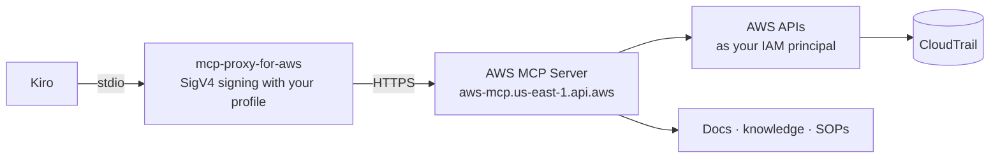

# Lab 15 · The managed AWS MCP Server

> **Outcome:** Kiro operating your AWS account through the managed AWS MCP Server, with a least-privilege role, CloudTrail visibility, and read-only defaults.

## Scenario

Before managed MCP, agents juggled a local AWS API server, a docs server and hand-written runbooks. The **AWS MCP Server** (remote, AWS-managed; preview since re:Invent 2025) unifies **API access across AWS services, up-to-date documentation and knowledge, and pre-built agent SOPs** for multi-step tasks. Fully-managed **EKS**, **ECS** and **SageMaker** MCP servers launched alongside it.



## How it works

- Authentication is **IAM + SigV4** — no static API keys. Every call runs as the principal behind your profile, so **IAM is the guardrail** and **CloudTrail is the audit log**.
- `mcp-proxy-for-aws` is a small local bridge that signs requests from stdio-only clients.
- If you used the local `aws-api` and `aws-knowledge` servers, remove them to avoid duplicate tools — the managed server covers both.

## Step 1 — Create a scoped role

Start read-only. Use [`readonly-agent-policy.json`](readonly-agent-policy.json) or the AWS managed `ReadOnlyAccess` + an explicit deny on sensitive data reads:

```bash
aws iam create-role --role-name kiro-agent-readonly \
  --assume-role-policy-document file://trust.json
aws iam attach-role-policy --role-name kiro-agent-readonly \
  --policy-arn arn:aws:iam::aws:policy/ReadOnlyAccess
aws iam put-role-policy --role-name kiro-agent-readonly \
  --policy-name deny-data-plane --policy-document file://readonly-agent-policy.json
```

Add a profile in `~/.aws/config`:

```ini
[profile kiro-ro]
role_arn = arn:aws:iam::<account>:role/kiro-agent-readonly
source_profile = default
region = eu-west-1
```

## Step 2 — Configure Kiro

```json
{
  "mcpServers": {
    "aws-mcp": {
      "command": "uvx",
      "args": ["mcp-proxy-for-aws@latest", "https://aws-mcp.us-east-1.api.aws/mcp",
               "--metadata", "AWS_REGION=eu-west-1"],
      "env": { "AWS_PROFILE": "kiro-ro" }
    }
  }
}
```

## Step 3 — Multi-step tasks

```text
> Inventory this account: count resources by service and region, flag anything untagged
> Which Lambda functions run deprecated runtimes? Group by owner tag.
> Find security groups open to 0.0.0.0/0 on ports other than 80/443
> Walk me through enabling S3 Block Public Access account-wide — show the exact steps, don't do it
```

## Step 4 — Graduate to write access, safely

1. Create a separate `kiro-dev-rw` role scoped to **dev accounts** and specific services.
2. Use it only from a custom agent with `permissions` that `ask` on mutating MCP tools, plus the PermissionRequest hook from Lab 04 that auto-approves `describe/list/get` only.
3. Tag agent sessions: add `aws:SourceIdentity` or session tags so CloudTrail shows which agent did what.

## Verify

- [ ] `/mcp` shows `aws-mcp` connected with tools
- [ ] A `s3:GetObject` attempt is denied by the role (check the error)
- [ ] CloudTrail shows the agent's calls under `kiro-agent-readonly`

## Learn more

- [AWS MCP Server preview announcement](https://aws.amazon.com/about-aws/whats-new/2025/11/aws-mcp-server/)
- [Understanding IAM for managed AWS MCP servers](https://aws.amazon.com/blogs/security/understanding-iam-for-managed-aws-mcp-servers/)
- [Managed EKS & ECS MCP servers](https://aws.amazon.com/about-aws/whats-new/2025/11/amazon-eks-ecs-fully-managed-mcp-servers-preview/)
- Next: [Lab 16 — Infrastructure as code with MCP](../16-iac-with-mcp/README.md)
