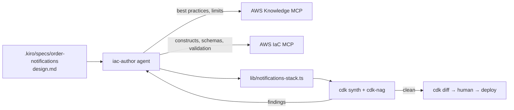

# Lab 16 · Infrastructure as code with MCP

> **Outcome:** The order-notifications infrastructure from Lab 03, written by Kiro, validated with CloudFormation tooling and **cdk-nag**, with every suppression justified — and nothing deployed without a human.

## Scenario

LLMs write plausible IaC with stale properties, wildcard IAM and missing DLQs. Grounding the agent in **current docs and schemas** via MCP, and **validating every change**, turns plausible into correct.



## How it works

| Server | Use it for |
| --- | --- |
| **AWS IaC MCP** (`awslabs.aws-iac-mcp-server`) | CDK and CloudFormation guidance, resource schemas, template validation and security/compliance checks |
| **AWS Knowledge MCP** (remote) | Current docs, quotas, what's-new, regional availability |
| **Terraform MCP** (AWS or HashiCorp) | Provider/module docs and checks if you're a Terraform shop |
| **AWS MCP Server** (Lab 15) | Read live account state to avoid name collisions and drift |

The reference solution lives in [`reference-cdk/`](reference-cdk/lib/notifications-stack.ts): EventBridge → SQS (+DLQ, visibility 6× timeout) → arm64 Lambda with partial batch failures → DynamoDB (PITR, TTL idempotency) → DLQ alarm, with `AwsSolutionsChecks` from cdk-nag applied to the whole app.

## Step 1 — Use the iac-author agent

Install Lab 05's [`iac-author.md`](../05-custom-agents/.kiro/agents/iac-author.md) (synth allowed, deploy denied) and Lab 03's spec.

```bash
kiro-cli --agent iac-author
```
```text
> Implement tasks 1.1–1.2 and 3.2 of .kiro/specs/order-notifications/tasks.md as a CDK v2 app in infra/.
  Apply cdk-nag AwsSolutionsChecks to the app. Synth until clean.
```

## Step 2 — Make the agent fix, not suppress

When cdk-nag reports findings, require justification:

```text
> For each cdk-nag finding: fix it if possible. Only suppress when AWS doesn't support
  a narrower permission, and put the evidence (doc link) in the reason.
```

In our run, the first synth produced `AwsSolutions-L1` (old runtime), `IAM4` (managed policy) and `IAM5` (X-Ray `*`). The final stack fixes L1 via `determineLatestNodeRuntime` and documents IAM4/IAM5 suppressions.

## Step 3 — Validate the template

```bash
cd infra && npm install
npx cdk synth --quiet
python3 ../.kiro/skills/serverless-review/scripts/scan_template.py cdk.out/*Stack.template.json   # Lab 07 skill
```

Ask the agent to also run the IaC MCP server's CloudFormation validation and compliance checks on `cdk.out/*.template.json`.

## Step 4 — Diff for a human

```bash
npx cdk diff
```

A human (not the agent — its permissions deny `*deploy*`) runs `npx cdk deploy` in a dev account.

## Step 5 — Terraform variant (optional)

```text
> Produce the same architecture as a Terraform module in terraform/, using the
  terraform-aws-modules where sensible. Run terraform validate and checkov until clean.
```

## Verify

- [ ] `cdk synth` exits 0 with cdk-nag applied
- [ ] Every suppression has a reason with evidence
- [ ] SQS visibility timeout ≥ 6 × Lambda timeout; DLQ alarm present

## Clean up

`npx cdk destroy` in the dev account if you deployed.

## Learn more

- [awslabs MCP servers](https://awslabs.github.io/mcp/) · [cdk-nag](https://github.com/cdklabs/cdk-nag)
- Next: [Lab 17 — Serverless with MCP](../17-serverless-with-mcp/README.md)
