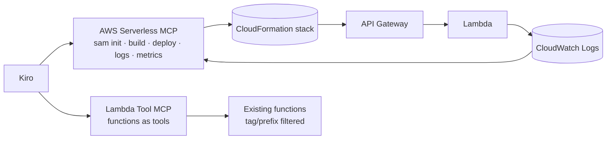

# Lab 17 · Serverless build-deploy-debug loop with MCP

> **Outcome:** A SAM-based HTTP API built and deployed through Kiro, with logs and metrics pulled back into the conversation to fix a seeded bug — and your existing Lambda functions callable as tools.

## Scenario

The slow part of serverless isn't writing handlers; it's the loop: init → build → deploy → invoke → read logs → fix. The **AWS Serverless MCP server** gives the agent that loop (SAM init/build/deploy, logs/metrics, web-app deployment guidance). The **Lambda Tool MCP server** turns selected Lambda functions into tools the agent can call.



## Step 1 — Configure servers

```json
{
  "mcpServers": {
    "aws-serverless": {
      "command": "uvx",
      "args": ["awslabs.aws-serverless-mcp-server@latest", "--allow-write", "--allow-sensitive-data-access"],
      "env": { "AWS_PROFILE": "dev", "AWS_REGION": "eu-west-1" }
    },
    "lambda-tools": {
      "command": "uvx",
      "args": ["awslabs.lambda-tool-mcp-server@latest"],
      "env": { "AWS_PROFILE": "dev", "AWS_REGION": "eu-west-1",
               "FUNCTION_PREFIX": "tools-", "FUNCTION_TAG_KEY": "agent-tool" }
    }
  }
}
```

> `--allow-write` lets the server deploy and `--allow-sensitive-data-access` lets it read logs. Use them **only with a dev profile**, and pair with an `ask` permission on the deploy tool.

## Step 2 — Scaffold and deploy

```text
> Create a SAM app "url-shortener": POST /links (store in DynamoDB, return code),
  GET /{code} (302 redirect). Python 3.13, arm64, Powertools logging & tracing.
  Build and deploy to dev; give me the API URL.
```

## Step 3 — Debug with logs

Seed a bug: ask Kiro to change the redirect to read `event["pathParameters"]["id"]`, redeploy, then:

```text
> GET /{code} returns 502. Pull the last 15 minutes of logs and error metrics for the
  function, find the root cause, fix it, redeploy and prove it with a curl.
```

## Step 4 — Lambdas as tools

Tag an existing function `agent-tool=true` (and/or prefix `tools-`) with a clear description — the description becomes the tool's description.

```text
> /mcp                         # see tools-* functions listed as tools
> Use the order-lookup tool to fetch order 1234 and summarise its status history
```

## Production checklist

- [ ] Separate dev/prod profiles; serverless MCP write access only in dev
- [ ] Lambda Tool MCP limited by prefix/tag — never "all functions"
- [ ] Tool Lambdas validate input (they are now an agent-facing API)
- [ ] For production agents, front tool Lambdas with **AgentCore Gateway** instead (Lab 27)

## Clean up

```text
> Delete the url-shortener stack
```
(or `sam delete`)

## Learn more

- [AWS Serverless MCP server](https://awslabs.github.io/mcp/servers/aws-serverless-mcp-server/) · [Lambda Tool MCP server](https://awslabs.github.io/mcp/servers/lambda-tool-mcp-server/)
- Next: [Lab 18 — FinOps with MCP](../18-finops-with-mcp/README.md)
