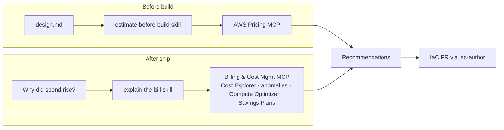

# Lab 18 · FinOps with MCP — estimate, explain, optimize

> **Outcome:** A cost estimate appended to the Lab 03 spec, a plain-English explanation of last month's bill, and a PR implementing the top savings recommendation.

## Scenario

Cost conversations happen too late — after the bill. With pricing and billing data available to the agent, cost becomes part of **design review** and **code review**.



## Step 1 — Install the power

Use Lab 08's [`power-aws-cost-guard`](../08-build-a-kiro-power/power-aws-cost-guard/plugin.json) (both servers + skills). IAM for the profile: `pricing:*` and read-only `ce:Get*`, `ce:Describe*`, `compute-optimizer:Get*`, `savingsplans:Describe*`, `budgets:View*`.

## Step 2 — Estimate before build

```text
> Estimate monthly cost for .kiro/specs/order-notifications in eu-west-1 at:
  2M orders/month, 1.6 notifications/order, 256 MB-ms… ask me for anything missing.
```

Expect a table with unit prices fetched from the Pricing API, explicit assumptions, and savings levers (arm64, batch size, log retention, on-demand vs provisioned DynamoDB). The skill appends it to `design.md`.

## Step 3 — Explain the bill

```text
> Compare last month to the month before. What drove the change? Group by service,
  then usage type for the top 3. Include any cost anomalies.
```

## Step 4 — Optimize

```text
> Get rightsizing and Savings Plans recommendations. Rank by monthly savings and risk.
> Take the top Lambda/EC2 rightsizing recommendation and open a PR changing the IaC.
```

Hand the IaC change to the `iac-author` agent (Lab 16) so it's validated.

## Step 5 — Make it continuous

- **Kiro Crew cost sentinel bot** (Lab 13) — daily anomaly watch.
- **CI cost diff:** in Lab 10's workflow, add a step asking Kiro to price the `cdk diff` and comment the delta on the PR.

## Guardrails

- Read-only Billing permissions; no budget or commitment changes by agents.
- Always show assumptions — estimates are only as good as the usage drivers.
- Cost Explorer API calls are billed per request; cache results in the conversation.

## Learn more

- [AWS Pricing MCP server](https://awslabs.github.io/mcp/servers/aws-pricing-mcp-server/) · [Billing and Cost Management MCP server](https://awslabs.github.io/mcp/servers/billing-cost-management-mcp-server/)
- Next: [Lab 19 — Observability with MCP](../19-observability-with-mcp/README.md)
