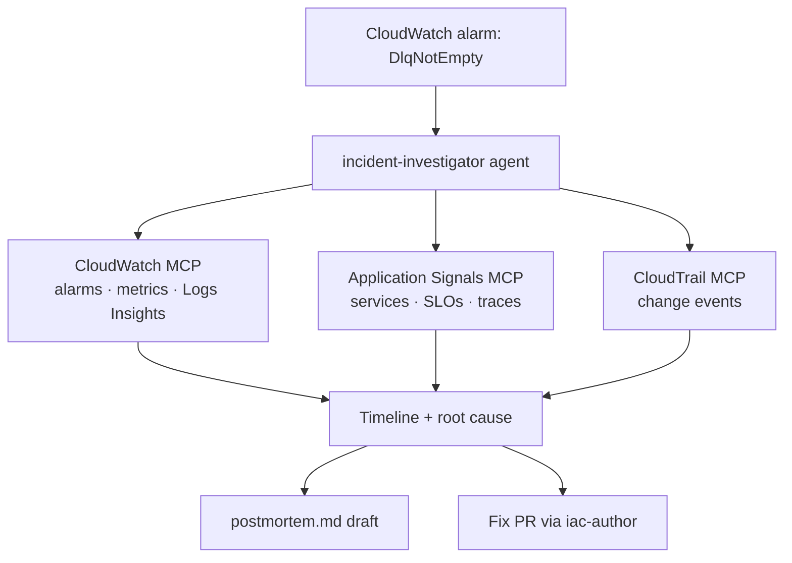

# Lab 19 · Incident investigation with CloudWatch & CloudTrail MCP

> **Outcome:** A repeatable incident workflow: from a firing alarm to a correlated timeline (metrics + logs + "who changed what"), a fix proposal, and a postmortem draft — saved as an `incident-investigator` agent.

## Scenario

At 02:13 the DLQ alarm from Lab 16 fires. The on-call engineer needs answers fast: *what broke, since when, what changed, who's affected*. Each answer lives in a different console. MCP brings them into one conversation.



## Step 1 — Configure the agent

Save as `.kiro/agents/incident-investigator.json` — use a **separate read-only role that is allowed to read logs** (Lab 15's role denies `logs:FilterLogEvents` deliberately):

```json
{
  "name": "incident-investigator",
  "description": "Read-only incident investigation across CloudWatch, Application Signals and CloudTrail.",
  "prompt": "You are the on-call investigator. Establish: impact (who/what/since when), timeline (UTC), what changed (CloudTrail, deployments), root cause hypothesis with evidence, and next actions. Use Logs Insights queries with tight time windows. Never mutate resources. Finish with a postmortem draft in docs/postmortems/<date>-<slug>.md using the blameless template.",
  "tools": ["read", "write", "@cloudwatch", "@appsignals", "@cloudtrail"],
  "permissions": { "rules": [ { "capability": "fs_write", "match": ["docs/postmortems/**"], "effect": "allow" } ] },
  "mcpServers": {
    "cloudwatch": { "command": "uvx", "args": ["awslabs.cloudwatch-mcp-server@latest"], "env": { "AWS_PROFILE": "oncall-ro" } },
    "appsignals": { "command": "uvx", "args": ["awslabs.cloudwatch-appsignals-mcp-server@latest"], "env": { "AWS_PROFILE": "oncall-ro" } },
    "cloudtrail": { "command": "uvx", "args": ["awslabs.cloudtrail-mcp-server@latest"], "env": { "AWS_PROFILE": "oncall-ro" } }
  }
}
```

## Step 2 — Inject a fault

Deploy Lab 16's stack to dev, then break it — e.g. remove the notifier's DynamoDB read permission in the console — and publish a few `OrderShipped` events.

## Step 3 — Investigate

```bash
kiro-cli --agent incident-investigator
```
```text
> Alarm DlqNotEmpty is firing in eu-west-1. Investigate.
```

Good follow-ups:

```text
> Show the Logs Insights query you used and its top 5 error messages with counts
> Which IAM or Lambda configuration changes happened in the 2 hours before the first error?
> Is any SLO burning? Which callers are affected?
```

## Step 4 — Fix and write it up

```text
> Draft the postmortem. Then hand the fix to the iac-author agent as a subagent.
```

## Make it automatic

- **Kiro Crew heartbeat** (Lab 12) watching the alarm and starting this investigation.
- **AWS DevOps Agent** (frontier agent) for AWS-managed, always-on incident response across your observability stack.
- **Ship it as a product**: Lab 35 builds an SRE crew on Strands + AgentCore.

## Learn more

- [CloudWatch MCP](https://awslabs.github.io/mcp/servers/cloudwatch-mcp-server/) · [Application Signals MCP](https://awslabs.github.io/mcp/servers/cloudwatch-appsignals-mcp-server/) · [CloudTrail MCP](https://awslabs.github.io/mcp/servers/cloudtrail-mcp-server/)
- Next: [Lab 20 — Data with MCP](../20-data-with-mcp/README.md)
