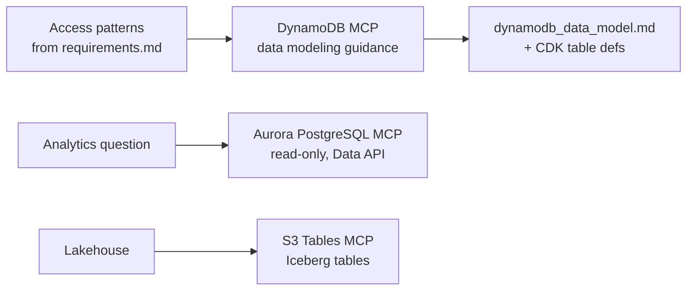

# Lab 20 · Data modeling and querying with MCP

> **Outcome:** A reviewed DynamoDB data model generated from access patterns, read-only analytics questions answered against Aurora PostgreSQL, and a small Iceberg table in S3 Tables.

## Scenario

Data work needs **exact** answers: the right keys for an access pattern, SQL that doesn't scan 400 GB, schemas that exist. The awslabs data MCP servers give the agent real schemas, real query execution (read-only by default) and modeling guidance.



## Step 1 — Configure

```json
{
  "mcpServers": {
    "dynamodb": { "command": "uvx", "args": ["awslabs.dynamodb-mcp-server@latest"], "env": { "AWS_PROFILE": "dev" } },
    "postgres": {
      "command": "uvx",
      "args": ["awslabs.postgres-mcp-server@latest",
               "--resource_arn", "arn:aws:rds:eu-west-1:<acct>:cluster:analytics",
               "--secret_arn", "arn:aws:secretsmanager:eu-west-1:<acct>:secret:analytics-ro",
               "--database", "app", "--region", "eu-west-1", "--readonly", "True"],
      "env": { "AWS_PROFILE": "dev" }
    },
    "s3-tables": { "command": "uvx", "args": ["awslabs.s3-tables-mcp-server@latest"], "env": { "AWS_PROFILE": "dev" } }
  }
}
```

> Check each server's page for current flags — they change between releases.

## Step 2 — Model DynamoDB from access patterns

```text
> Using the DynamoDB data-modeling guidance, design a single-table model for:
  1) get customer by id, 2) list orders for a customer newest-first, 3) get order by id,
  4) list orders by status for ops (last 24 h), 5) notification history per order.
  Expected volumes: 2M orders/month, 50 RPS peak reads. Output keys, GSIs, item examples,
  hot-partition risks and cost notes.
```

Review: every access pattern maps to exactly one Query/GetItem; GSIs justified; no Scans.

## Step 3 — Ask Aurora questions safely

```text
> Which 10 customers had the most failed deliveries last week? Show the SQL first.
> Explain the query plan. Is there an index we're missing?
```

The `--readonly True` flag and a **read-only database user** behind the secret are both required — belt and braces.

## Step 4 — Lakehouse with S3 Tables

```text
> Create a table bucket "analytics-lab", namespace "events", and an Iceberg table
  notification_events(event_id string, order_id string, channel string, sent_at timestamp).
  Load the sample CSV in this lab and query daily sends per channel.
```

## Guardrails

- Read-only DB users for agents; separate credentials for migrations.
- Ask the agent to **show SQL before running** it (put that rule in steering).
- Mask PII in results via views; never grant agents direct PII tables.

## Learn more

- [DynamoDB MCP](https://awslabs.github.io/mcp/servers/dynamodb-mcp-server/) · [Aurora PostgreSQL MCP](https://awslabs.github.io/mcp/servers/postgres-mcp-server/) · [S3 Tables MCP](https://awslabs.github.io/mcp/servers/s3-tables-mcp-server/)
- Next: [Lab 21 — Your first Strands agent](../21-strands-first-agent/README.md)
