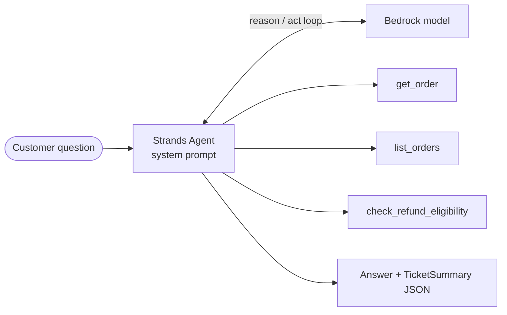

# Lab 21 · Your first Strands agent

> **Outcome:** `acme-support`, a Strands agent with three typed tools over a fake orders backend, structured hand-off output, and a fourth tool built by Kiro from a mini-spec.

## Scenario

You've used Kiro, an agent someone else built. Now you'll build agents **you ship**. **Strands Agents** is AWS's open-source, model-driven agent SDK (Python and TypeScript 1.0): you give it a model, a prompt and tools; the model plans the loop. This agent becomes the core of the end-to-end support build in Lab 34.



## How it works

| Concept | Code |
| --- | --- |
| Agent | `Agent(model=..., system_prompt=..., tools=[...])` |
| Tool | Any function decorated with `@tool`; **type hints + docstring become the schema** the model sees |
| Model providers | Bedrock (default), Anthropic, OpenAI, Gemini, Ollama, LiteLLM, Mistral, SageMaker, llama.cpp, custom |
| Streaming | Default callback prints tokens; `agent.stream_async(...)` yields events |
| Structured output | `agent(prompt, structured_output_model=PydanticModel).structured_output` |
| Metrics | `result.metrics.get_summary()` — tokens, latency, tool stats |

## Step 1 — Set up

```bash
cd labs/21-strands-first-agent
python3 -m venv .venv && source .venv/bin/activate
pip install -r requirements.txt
aws configure sso   # credentials with Bedrock InvokeModel; enable model access in the console
```

## Step 2 — Read the code

- [`orders_tools.py`](orders_tools.py) — three `@tool` functions over an in-memory backend
- [`agent.py`](agent.py) — `BedrockModel` (temperature 0.2), system prompt, tools, structured `TicketSummary`

## Step 3 — Run it

```bash
python agent.py "Where is order A-1001?"
python agent.py "Customer c-42 wants a refund for their delivered order. Can they get one?"
python agent.py "Refund A-1003 please"            # should refuse: not delivered
```

Watch the tool calls stream, then the token usage and the JSON hand-off.

## Step 4 — Let Kiro add a tool from a spec

In Kiro (with Lab 02 steering), ask:

```text
> Add a tool `request_return(order_id, reason)` to orders_tools.py.
  WHEN the order is eligible THE SYSTEM SHALL create a return id "R-<order>" and return a label URL.
  IF not eligible THEN return the eligibility reason unchanged.
  Write pytest tests for both paths and register the tool in agent.py.
```

## Step 5 — Swap the model

```python
from strands.models.anthropic import AnthropicModel   # pip install 'strands-agents[anthropic]'
from strands.models.ollama import OllamaModel         # local models
```

Tools and prompt don't change — that's the point of a model-driven SDK.

## Tool-design rules that matter

- **Docstrings are prompts.** Say when to use the tool and what it returns.
- **Return errors as data** (`{"error": ...}`) so the model can recover, rather than raising.
- **Small, composable tools** beat one `do_everything(action=...)`.
- **Never trust tool input** — validate like a public API (it effectively is one).

## Learn more

- [Strands quickstart (Python)](https://strandsagents.com/docs/user-guide/sdk/quickstart/python/) · [TypeScript SDK 1.0](https://strandsagents.com/blog/strands-agents-typescript-v1/)
- Next: [Lab 22 — Strands + MCP tools](../22-strands-mcp-tools/README.md)
