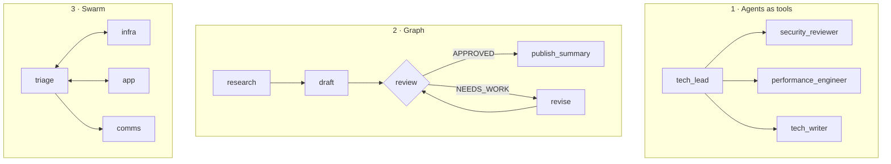

# Lab 23 · Multi-agent patterns — agents-as-tools, graph, swarm

> **Outcome:** Three runnable systems and a decision rule for picking a pattern — with the guardrails (timeouts, hand-off limits, loop bounds) that keep multi-agent systems from running away.

## Scenario

One agent with 40 tools and a 3-page prompt gets worse at everything. Splitting into specialists helps — *if* you pick the right coordination pattern.



## Choosing a pattern

| Pattern | Control | Use when | Watch out for |
| --- | --- | --- | --- |
| **Agents as tools** | Orchestrator decides | One user conversation; specialists are helpers | Orchestrator context growth — ask for short answers |
| **Graph** | You decide (edges + conditions) | Known steps, quality gates, parallel branches, audits | Cycles: bound with `set_max_node_executions` + `reset_on_revisit` |
| **Swarm** | Agents decide (hand-offs) | Path unknown up front; collaborative exploration | Ping-pong: `max_handoffs`, repetitive hand-off detection, timeouts |
| **Workflow** | Your code sequences | Simple pipelines | — |
| **A2A** | Network boundary | Agents owned by different teams/frameworks | Auth, versioning → Lab 24 |

Graphs and swarms compose: a graph node can be a swarm, and vice versa.

## Step 1 — Agents as tools

[`agents_as_tools.py`](agents_as_tools.py) — `specialist.as_tool()` wraps an agent as a tool; its `description` is what the orchestrator sees.

```bash
python agents_as_tools.py "Our checkout API p95 doubled after yesterday's deploy. What should we check?"
```

`as_tool(preserve_context=True)` keeps a specialist's memory across calls.

## Step 2 — Graph with a quality gate

[`graph_pipeline.py`](graph_pipeline.py) — conditional edges read `state.results["review"]`; the review→revise→review loop is bounded at 8 node executions.

```bash
python graph_pipeline.py "Write a 300-word internal guide: when to use SQS vs EventBridge"
```

The result exposes `status`, `execution_order`, per-node `results` and accumulated token usage — log them.

## Step 3 — Incident swarm

[`swarm_incident.py`](swarm_incident.py) — agents hand off with the built-in hand-off tool. Note the safety settings: `max_handoffs=12`, `execution_timeout=600`, `node_timeout=180`, and repetitive hand-off detection.

```bash
python swarm_incident.py "Orders API 5xx rate 12% since 02:10 UTC in eu-west-1"
```

Give `infra` the CloudWatch/CloudTrail MCP tools from Lab 19 to make it real.

## Step 4 — Spec it with Kiro

```text
> Create a design-first spec for a "PR risk assessor" multi-agent system:
  graph with parallel nodes (security, performance, test-coverage) feeding a judge node.
  Implement it with Strands GraphBuilder, with unit tests that mock the model.
```

## Production notes

- **Observability:** every node is traced (OpenTelemetry) — Lab 32 shows the traces in CloudWatch.
- **Cost:** multi-agent multiplies tokens. Log `accumulated_usage` per run and set budgets.
- **Determinism where it matters:** use a graph for anything with compliance steps.
- **Deploy** the whole system as one AgentCore Runtime agent (Lab 26) or split via A2A (Lab 24).

## Learn more

- [Choose a multi-agent pattern](https://strandsagents.com/docs/user-guide/sdk/multi-agent/multi-agent-patterns/)
- Next: [Lab 24 — A2A across teams](../24-strands-a2a/README.md)
