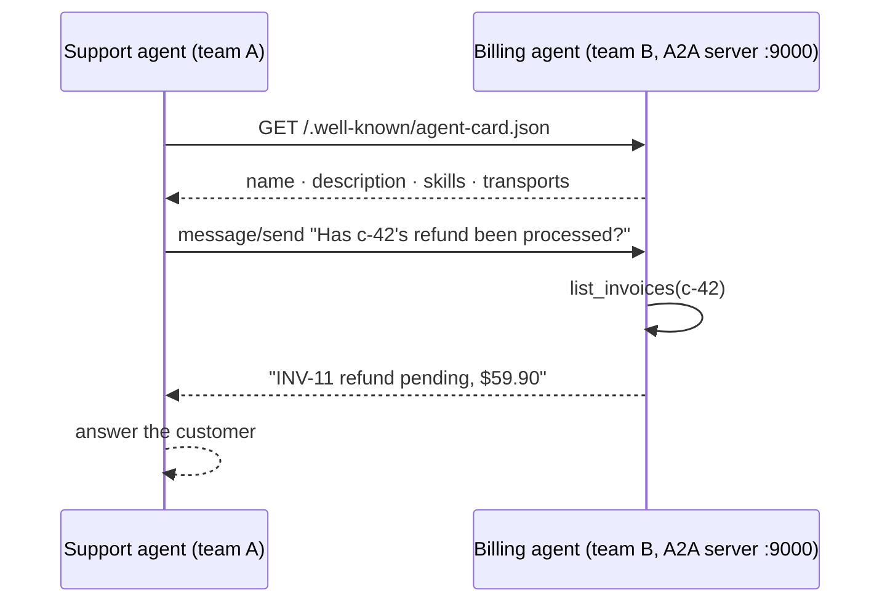

# Lab 24 · A2A — agents across teams and frameworks

> **Outcome:** A Billing agent served over A2A (discoverable Agent Card, one agent per context) and a Support agent that calls it as a tool — the agentic equivalent of a microservice boundary.

## Scenario

Billing owns refunds; Support owns the customer conversation. Neither team should embed the other's prompts and tools. **A2A** (Agent-to-Agent, an open protocol) lets each team publish an agent behind a stable contract — regardless of framework (Strands, LangGraph, ADK, …).



## Step 1 — Run the Billing server

```bash
cd labs/24-strands-a2a && pip install -r requirements.txt
python billing_agent_server.py
curl -s http://127.0.0.1:9000/.well-known/agent-card.json | jq
```

The card is generated from the agent's name, description and tools (as **skills**) — see [`billing_agent_server.py`](billing_agent_server.py). `agent_factory` builds a fresh agent per A2A context so conversations never bleed into each other.

## Step 2 — Call it from Support

```bash
python support_agent_client.py "Has customer c-42's refund been processed?"
```

[`support_agent_client.py`](support_agent_client.py) wraps `A2AAgent(endpoint=...)` in an `ask_billing` tool. To Support's model, Billing is a tool with a good docstring.

## Step 3 — Production hardening

| Concern | Approach |
| --- | --- |
| **Hosting** | Deploy each agent to **AgentCore Runtime**, which supports the A2A protocol natively (Lab 26) |
| **AuthN** | OAuth (Cognito/Entra/Okta) inbound auth on Runtime; `A2AAgent(client_config=...)` with an authenticated `httpx` client (SigV4, OAuth, bearer) |
| **Discovery** | Register agents in **AgentCore Registry** with their cards |
| **Contracts** | Version the card (`version="1.0.0"`); additive changes only within a major |
| **Timeouts** | `A2AAgent(timeout=...)`; Support degrades gracefully if Billing is down |
| **Trust** | Treat remote agent output as untrusted input; never forward secrets |

## Step 4 — Interop

Point the Support client at any A2A-compliant agent (LangGraph, Google ADK, CrewAI…) — only the endpoint changes.

## Learn more

- [A2A protocol](https://a2a-protocol.org/latest/) · [Strands A2A](https://strandsagents.com/docs/user-guide/sdk/multi-agent/agent-to-agent/)
- Next: [Lab 25 — Evals, hooks and guardrails](../25-strands-evals-and-guardrails/README.md)
