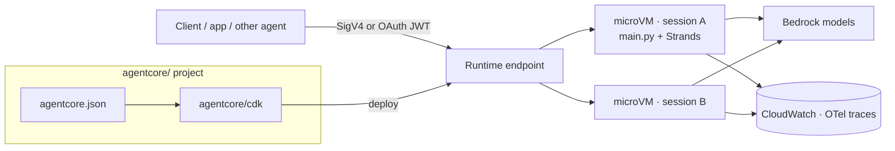

# Lab 26 · Deploy agents to AgentCore Runtime

> **Outcome:** The Acme support agent running on AgentCore Runtime with per-session isolation and streamed responses, deployed with the AgentCore CLI and invoked from the CLI and from Python.

## Scenario

Your agent works on a laptop. Production needs: isolation between users (one user's tool state must never leak into another's), long-running sessions, autoscaling to zero, streaming, auth, and observability — for **any** framework. That's **AgentCore Runtime**.



## How it works

| Concept | Detail |
| --- | --- |
| **Runtime** | Your code; any framework (Strands, LangGraph, CrewAI, ADK, OpenAI Agents…); Python or TypeScript; protocols **HTTP**, **MCP**, **A2A**, **AG-UI**; WebSocket bidirectional streaming |
| **Harness** | Alternative: a *managed* agent loop — model, prompt and tools declared in config, no code |
| **Contract** | `POST /invocations` + `GET /ping` on :8080 — `BedrockAgentCoreApp` implements it |
| **Sessions** | `runtimeSessionId` maps to an isolated microVM; state survives across invocations within a session |
| **Build** | CodeZip by default; add a `Dockerfile` to switch to a container build |
| **CLI** | `npm i -g @aws/agentcore` → `create · add · dev · build · deploy · status · invoke · logs · traces · eval` |

## Step 1 — Read the agent

[`app/support/main.py`](app/support/main.py): `@app.entrypoint` async generator that **validates the payload**, keys an agent per session, and streams `data` chunks. [`pyproject.toml`](app/support/pyproject.toml) sets `[tool.agentcore] entrypoint`.

Run the contract locally with no AWS calls except the model:

```bash
cd labs/26-agentcore-runtime/app/support
pip install -e . && python main.py
curl localhost:8080/ping
curl -N -X POST localhost:8080/invocations -H 'content-type: application/json' \
  -d '{"prompt":"Where is order A-1001?"}'
```

## Step 2 — Create a project and add the runtime

```bash
npm install -g @aws/agentcore          # Node 20+, uv, AWS credentials
agentcore create --name AcmeSupport --template agent-python-strands
cd AcmeSupport
# replace the scaffolded app code with this lab's main.py, orders_tools.py and pyproject.toml
agentcore dev                          # local loop; --mode browser opens Agent Inspector
```

Prefer bringing your own code into an existing project? `agentcore add runtime --name support --language python` creates `app/support/` with an `AGENTS.md` describing the contract — perfect context for Kiro.

## Step 3 — Deploy and invoke

```bash
agentcore deploy                       # CDK under agentcore/cdk, targets in agentcore/aws-targets.json
agentcore status
agentcore invoke --prompt "Customer c-42 wants a refund. Eligible?"
agentcore logs
agentcore traces
```

From Python (any service):

```python
import boto3, json, uuid
rt = boto3.client("bedrock-agentcore", region_name="us-east-1")
resp = rt.invoke_agent_runtime(
    agentRuntimeArn="<runtime-arn from agentcore status>",
    runtimeSessionId=str(uuid.uuid4()) + "-session",     # ≥ 33 chars; reuse it to continue a conversation
    payload=json.dumps({"prompt": "Where is order A-1001?"}).encode(),
)
for line in resp["response"].iter_lines():
    print(line.decode())
```

## Step 4 — Let Kiro do the packaging

The AgentCore CLI and the **AgentCore MCP server** (in the awslabs catalog) give Kiro what it needs:

```text
> Using the AgentCore docs, convert labs/23-strands-multi-agent/graph_pipeline.py into an
  AgentCore runtime in this project. Validate the payload, stream results, add a smoke test,
  then run agentcore dev and invoke it.
```

## Verify

- [ ] `agentcore status` shows the runtime deployed
- [ ] Two different `runtimeSessionId`s don't share conversation history; the same id does
- [ ] Traces appear in CloudWatch (GenAI observability)

## Clean up

`agentcore remove` the runtime and `agentcore deploy` again, or delete the project's stack in CloudFormation.

## Learn more

- [What is AgentCore](https://docs.aws.amazon.com/bedrock-agentcore/latest/devguide/what-is-bedrock-agentcore.html) · [AgentCore CLI (`@aws/agentcore`)](https://www.npmjs.com/package/@aws/agentcore) · [agentcore-samples](https://github.com/awslabs/agentcore-samples)
- Next: [Lab 27 — AgentCore Gateway](../27-agentcore-gateway/README.md)
