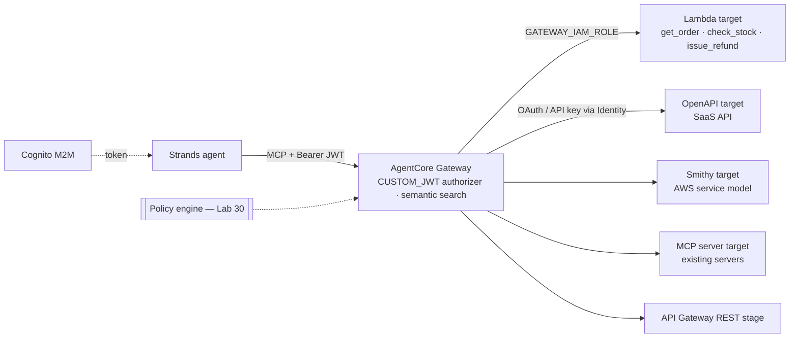

# Lab 27 · AgentCore Gateway — any API becomes an MCP tool

> **Outcome:** One MCP endpoint, protected by Cognito M2M JWTs, exposing tools implemented in Lambda — consumed by a Strands agent with a single `MCPClient`. Then extend it with OpenAPI and MCP-server targets.

## Scenario

Every agent re-implementing auth, retries and schemas for every API doesn't scale. **AgentCore Gateway** turns existing services into MCP tools in one place: inbound auth for agents, outbound credentials for APIs, a consolidated `tools/list`, semantic tool search, and a hook point for **Policy** (Lab 30).



## How it works

| Concept | Options |
| --- | --- |
| **Inbound auth** (`authorizerType`) | `CUSTOM_JWT` (Cognito, Okta, Entra ID, Auth0…), `AWS_IAM`, `AUTHENTICATE_ONLY`, `NONE` |
| **Targets (MCP)** | `lambda` (+ tool schema), `openApiSchema`, `smithyModel`, `mcpServer`, `apiGateway` (REST stage), built-in `connector`s |
| **Targets (HTTP / inference)** | Front an AgentCore Runtime or pass through HTTP; route model inference |
| **Outbound credentials** | `GATEWAY_IAM_ROLE`, `OAUTH`, `API_KEY` (stored in AgentCore Identity), `CALLER_IAM_CREDENTIALS`, `JWT_PASSTHROUGH` |
| **Extras** | Semantic tool search (`searchType: SEMANTIC`), Lambda interceptors on requests/responses, rate limits & rules, private endpoints, KMS, policy engine |

## Step 1 — Deploy the tools Lambda

[`tools_lambda/handler.py`](tools_lambda/handler.py) serves three tools (`get_order`, `check_stock`, `issue_refund` — the last is governed by Policy in Lab 30); Gateway passes the tool name in `context.client_context.custom["bedrockAgentCoreToolName"]` as `<target>___<tool>`.

```bash
cd labs/27-agentcore-gateway/tools_lambda && zip -q ../tools.zip handler.py && cd ..
aws iam create-role --role-name acme-tools-lambda --assume-role-policy-document \
  '{"Version":"2012-10-17","Statement":[{"Effect":"Allow","Principal":{"Service":"lambda.amazonaws.com"},"Action":"sts:AssumeRole"}]}'
aws iam attach-role-policy --role-name acme-tools-lambda \
  --policy-arn arn:aws:iam::aws:policy/service-role/AWSLambdaBasicExecutionRole
aws lambda create-function --function-name acme-tools --runtime python3.13 --architectures arm64 \
  --handler handler.lambda_handler --zip-file fileb://tools.zip \
  --role arn:aws:iam::<acct>:role/acme-tools-lambda
```

## Step 2 — Create the gateway

```bash
pip install -r requirements.txt
python create_gateway.py --lambda-arn arn:aws:lambda:us-east-1:<acct>:function:acme-tools --region us-east-1
```

[`create_gateway.py`](create_gateway.py) creates a Cognito pool + client-credentials app client, a least-privilege gateway role, the gateway (`CUSTOM_JWT`, semantic search) and the Lambda target with an inline tool schema. Output goes to `gateway.json` (git-ignored — it holds a client secret).

> Prefer the AgentCore CLI? `agentcore add gateway` in a project (Lab 26) declares the same resources in `agentcore.json`.

## Step 3 — Use it from an agent

```bash
python agent_via_gateway.py "Is order A-1002 delivered and is SKU-2 in stock?"
```

[`agent_via_gateway.py`](agent_via_gateway.py) fetches a token and connects **one** `MCPClient` — adding targets later needs no agent change.

Kiro can use the same gateway — add it to `.kiro/settings/mcp.json` with `url` and an `Authorization` header (Lab 09).

## Step 4 — Add an OpenAPI target

Store a SaaS API key in AgentCore Identity, then:

```python
ctl.create_api_key_credential_provider(name="weather-key", apiKey="<key>")
ctl.create_gateway_target(gatewayIdentifier=gw_id, name="weather",
  targetConfiguration={"mcp": {"openApiSchema": {"s3": {"uri": "s3://my-bucket/weather-openapi.json"}}}},
  credentialProviderConfigurations=[{"credentialProviderType": "API_KEY", "credentialProvider": {
      "apiKeyCredentialProvider": {"providerArn": "<arn>", "credentialLocation": "HEADER", "credentialParameterName": "x-api-key"}}}])
```

Ask Kiro to *write* the OpenAPI spec for an internal API from its code — then it becomes an agent tool.

## Step 5 — Front existing MCP servers

Use an `mcpServer` target (`endpoint` = the server's URL) to aggregate team MCP servers behind one authenticated endpoint with one `tools/list`.

## Clean up

```bash
python cleanup.py && aws lambda delete-function --function-name acme-tools
```

## Learn more

- [Gateway core concepts](https://docs.aws.amazon.com/bedrock-agentcore/latest/devguide/gateway-core-concepts.html) · [MCP server targets](https://docs.aws.amazon.com/bedrock-agentcore/latest/devguide/gateway-targets-mcp.html)
- [Unite MCP servers through AgentCore Gateway](https://aws.amazon.com/blogs/machine-learning/transform-your-mcp-architecture-unite-mcp-servers-through-agentcore-gateway/)
- Next: [Lab 28 — AgentCore Memory](../28-agentcore-memory/README.md)
