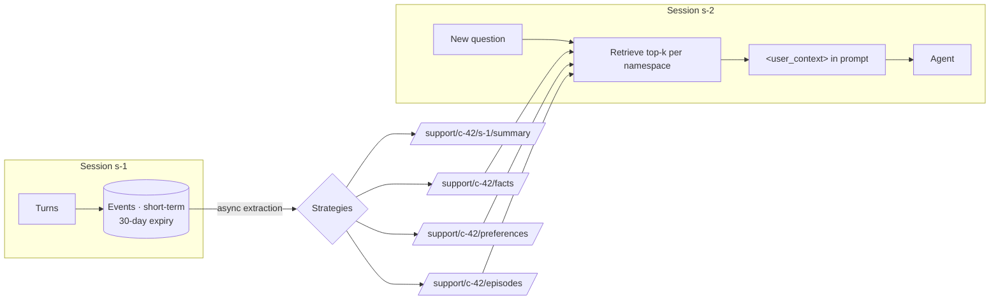

# Lab 28 · AgentCore Memory — agents that remember

> **Outcome:** A support agent that, in a **new session**, remembers the customer's name and contact preference and what happened last time — with memory scoped per customer and inspectable.

## Scenario

"I told you yesterday — email, not phone." Stateless agents force customers to repeat themselves. **AgentCore Memory** stores raw conversation events (short-term) and asynchronously extracts durable knowledge (long-term) into namespaces you control.



## How it works

| Strategy | Extracts | Use for |
| --- | --- | --- |
| **Semantic** | Facts ("Dana has a gold membership") | Grounding answers |
| **User preference** | Preferences ("email, never phone") | Personalization |
| **Summary** | Per-session summaries | Long conversations, hand-offs |
| **Episodic** | What happened, what worked, reflections | Learning from past interactions |
| **Custom** | Your extraction prompt/model | Domain-specific memory |

Namespaces are templates — `{actorId}`, `{sessionId}`, `{memoryStrategyId}` — so memory is **isolated per customer** by construction. The Strands integration (`AgentCoreMemorySessionManager`) writes every turn as an event and injects retrieved records as `<user_context>`.

## Step 1 — Create the memory

```bash
cd labs/28-agentcore-memory && pip install -r requirements.txt
python create_memory.py           # takes a few minutes; prints MEMORY_ID=...
export MEMORY_ID=...
```

See [`create_memory.py`](create_memory.py). (In an AgentCore CLI project: `agentcore add memory`.)

## Step 2 — Session 1: tell it things

```bash
python agent_with_memory.py c-42 s-1 "Hi, I'm Dana. Please always email me, never call. Where's A-1001?"
```

## Step 3 — Inspect extraction

Long-term extraction is asynchronous; wait ~1 minute.

```bash
python inspect_memory.py c-42 "contact preference"
```

## Step 4 — Session 2: it remembers

```bash
python agent_with_memory.py c-42 s-2 "Any update on my order? You know how I like to be contacted."
python agent_with_memory.py c-77 s-9 "How do I like to be contacted?"     # different actor → no leakage
```

## Step 5 — Wire into the Runtime

In Lab 26's `main.py`, build the session manager from the **Runtime session id** and an **actor id from the caller's identity** (JWT `sub`, never from the prompt):

```python
config = AgentCoreMemoryConfig(memory_id=MEMORY_ID, actor_id=caller_sub, session_id=context.session_id, retrieval_config=...)
```

## Privacy & governance

- Actor id must come from authenticated identity — otherwise users can read each other's memory.
- Set `event_expiry_days` and record expiry to match your retention policy; support deletion requests by actor.
- Don't store secrets or payment data in conversations; use a guardrail/PII filter before memory.
- Encrypt with a customer-managed KMS key (`encryptionKeyArn`) for regulated data.

## Clean up

```bash
python -c "from bedrock_agentcore.memory import MemoryClient; import os; MemoryClient(region_name='us-east-1').delete_memory_and_wait(os.environ['MEMORY_ID'])"
```

## Learn more

- [AgentCore Memory](https://docs.aws.amazon.com/bedrock-agentcore/latest/devguide/memory.html) · [agentcore-samples memory tutorials](https://github.com/awslabs/agentcore-samples)
- Next: [Lab 29 — AgentCore Identity](../29-agentcore-identity/README.md)
