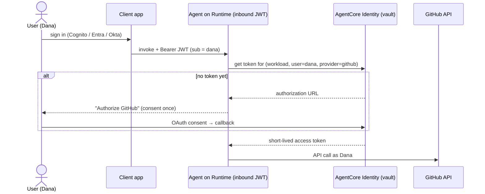

# Lab 29 · AgentCore Identity — inbound and outbound auth for agents

> **Outcome:** A GitHub triage agent that acts **as the signed-in user** via OAuth user federation, with tokens stored in the AgentCore Identity vault — plus the inbound JWT setup that tells the agent *who* is calling.

## Scenario

Agents sit between two trust boundaries. **Inbound:** who is allowed to call this agent, and as whom? **Outbound:** with what credentials does the agent call GitHub, Salesforce or your internal APIs — and whose permissions apply? Hard-coding API keys answers neither. **AgentCore Identity** gives every agent a **workload identity**, a **token vault**, and managed OAuth flows.



## How it works

| Direction | Mechanism |
| --- | --- |
| **Inbound** | Runtime / Gateway authorizer: IAM SigV4 or `CUSTOM_JWT` (any OIDC IdP — Cognito, Entra ID, Okta, Auth0); allowed audiences, clients, scopes |
| **Outbound — user** | `auth_flow="USER_FEDERATION"` (OAuth 3LO): agent acts as the user after one-time consent |
| **Outbound — agent** | `auth_flow="M2M"` (client credentials) or API keys |
| **Outbound — delegated** | `ON_BEHALF_OF_TOKEN_EXCHANGE`: exchange the caller's token for a downstream token |
| **Providers** | Built-in vendors (GitHub, Google, Microsoft, Slack, Salesforce, Atlassian, LinkedIn, Okta, …) or custom OAuth2 |
| **Code** | `@requires_access_token(provider_name=..., scopes=..., auth_flow=...)` and `@requires_api_key(...)` from `bedrock_agentcore.identity.auth` |

## Step 1 — Register GitHub as a credential provider

```bash
cd labs/29-agentcore-identity && pip install -r requirements.txt
GITHUB_CLIENT_ID=... GITHUB_CLIENT_SECRET=... python create_github_provider.py
```

Paste the printed `callbackUrl` into your GitHub OAuth App. ([`create_github_provider.py`](create_github_provider.py))

## Step 2 — Run the agent

```bash
python github_agent.py "List my 5 most recently updated repositories and any open PRs on them"
```

First run prints an authorization URL — consent once. [`github_agent.py`](github_agent.py) gets a short-lived token via the decorator; the agent code never sees the client secret or a refresh token. Run it again: no prompt, the vault reuses the token. (Outside Runtime the SDK uses a local workload identity for development; on Runtime the workload identity is provided.)

## Step 3 — Inbound auth on Runtime

Configure the runtime's authorizer as `CUSTOM_JWT` with your IdP's discovery URL and allowed clients (in an AgentCore CLI project, set it in `agentcore.json` or via `agentcore add identity`). Invoke with a bearer token:

```bash
printf '%s' "$JWT" | agentcore invoke --bearer-token - --prompt "What are my open PRs?"
```

Then in Lab 28's memory config, use the JWT `sub` as `actor_id` — identity and memory line up.

## Step 4 — Agent-to-API for Gateway targets

Gateway (Lab 27) uses the same vault for outbound OAuth/API-key credentials per target — the agent only holds a token for the gateway.

## Security checklist

- [ ] Least scopes (`read:user` before `repo`)
- [ ] Callback URL allow-listed; `custom_state` validated if you add your own UI
- [ ] Actor/user id always from the inbound token, never from the prompt
- [ ] Revoke: delete the credential provider or user tokens when users offboard
- [ ] CloudTrail on AgentCore Identity APIs for audit

## Learn more

- [AgentCore Identity](https://docs.aws.amazon.com/bedrock-agentcore/latest/devguide/identity.html)
- Next: [Lab 30 — AgentCore Policy with Cedar](../30-agentcore-policy/README.md)
