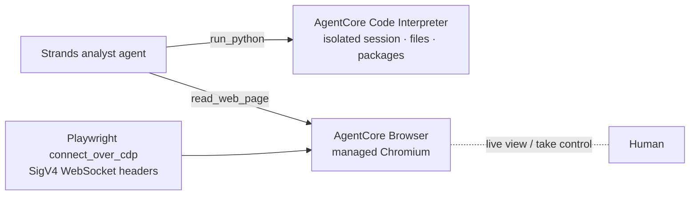

# Lab 31 · AgentCore Code Interpreter and Browser

> **Outcome:** An analyst agent with two tools — `run_python` (AgentCore Code Interpreter) and `read_web_page` (AgentCore Browser via Playwright over CDP) — both isolated from your machine and network.

## Scenario

Agents that compute in their heads hallucinate numbers; agents that run code on your laptop are a security incident waiting to happen. AgentCore provides **managed sandboxes**: a Code Interpreter (Python/JS/TS, files, packages, persistent state per session) and a Browser (managed Chromium, live view, session recording, take-over).



> Note: `strands-agents-tools` v0.9 removed its old `code_interpreter` and `browser` tools. Use the `bedrock-agentcore` SDK clients directly, as this lab does, to keep the isolation boundary.

## How it works

| Tool | API |
| --- | --- |
| Code Interpreter | `CodeInterpreter(region).start()` · `.execute_code(code, language)` · `.execute_command(cmd)` · `.upload_file / download_file` · `.install_packages` · `.stop()` (or `with code_session(region) as ci:`) |
| Browser | `with browser_session(region) as client:` → `ws_url, headers = client.generate_ws_headers()` → Playwright `connect_over_cdp(ws_url, headers=headers)`; `generate_live_view_url()`, `take_control()` / `release_control()` |
| Custom resources | Create your own interpreter/browser with network mode (sandbox vs public), execution role, recording to S3, proxies, extensions |

## Step 1 — Install

```bash
cd labs/31-agentcore-code-interpreter-browser
pip install -r requirements.txt && playwright install chromium   # client libs only; the browser runs in AWS
```

IAM: `bedrock-agentcore:StartCodeInterpreterSession`, `InvokeCodeInterpreter`, `StopCodeInterpreterSession`, `StartBrowserSession`, `ConnectBrowserAutomationStream`, `StopBrowserSession` (+ Bedrock model access).

## Step 2 — Analyse data in the sandbox

```bash
python analyst_agent.py
```

The default prompt makes the agent generate a dataset and analyse trends — all computation happens in the sandbox ([`analyst_agent.py`](analyst_agent.py)). Try uploading Lab 20's [`notification_events.csv`](../20-data-with-mcp/notification_events.csv) with `upload_file` and asking for daily sends per channel.

## Step 3 — Research on the web

```bash
python analyst_agent.py "Read https://aws.amazon.com/bedrock/agentcore/pricing/ and compute the cost of 1M 30-second Code Interpreter sessions at 1 vCPU / 2 GB"
```

Open the **live view** URL (`client.generate_live_view_url()`) to watch, or `take_control()` for steps needing a human (CAPTCHAs, logins).

## Step 4 — Harden

- Create a **custom Code Interpreter** in *sandbox* network mode for untrusted code (no internet).
- For the browser, use a custom browser with **session recording to S3** for audit, and proxies/allow-lists for egress.
- Put both behind AgentCore **Policy** if exposed via Gateway, and cap session timeouts.

## Learn more

- [AgentCore Code Interpreter](https://docs.aws.amazon.com/bedrock-agentcore/latest/devguide/code-interpreter-tool.html) · [AgentCore Browser](https://docs.aws.amazon.com/bedrock-agentcore/latest/devguide/browser-tool.html)
- Next: [Lab 32 — Observability and Evaluations](../32-agentcore-observability-evaluations/README.md)
