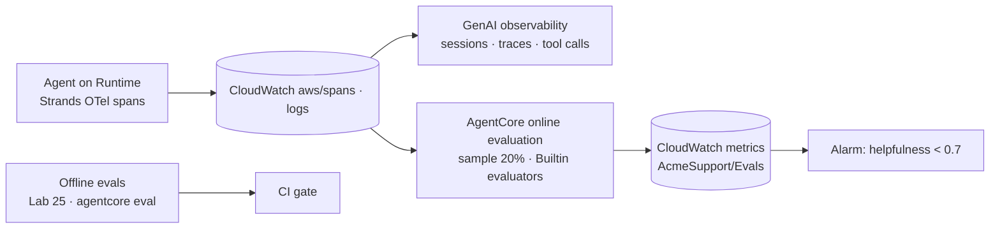

# Lab 32 · AgentCore Observability and Evaluations

> **Outcome:** End-to-end traces for the support agent in CloudWatch's GenAI observability views, Logs Insights queries for latency/cost/errors, and an online evaluation that samples 20 % of sessions and alarms when helpfulness drops.

## Scenario

"The agent got worse last Tuesday" is unprovable without data. You need **traces** (what happened, in what order, how long, how many tokens) and **evaluations** (was it any good) — continuously, on real traffic.



## How it works

| Capability | Detail |
| --- | --- |
| **Tracing** | Strands emits OpenTelemetry spans for invocations, model calls and tools; AgentCore Runtime wires them to CloudWatch automatically. Agents outside Runtime can use ADOT (`opentelemetry-instrument`) |
| **Where to look** | CloudWatch → GenAI observability (agents, sessions, traces); `aws/spans` log group for Logs Insights; `agentcore traces` / `agentcore logs` from the CLI |
| **Evaluations** | Built-in evaluators (e.g. `Builtin.Helpfulness`, `Builtin.GoalSuccessRate`, `Builtin.Harmfulness`, `Builtin.Relevance`, `Builtin.Accuracy`) plus custom LLM-judge and code-based evaluators |
| **Online** | `CreateOnlineEvaluationConfig`: sampling %, filters, session timeout, evaluators, output to CloudWatch logs + metrics |
| **On-demand / datasets** | `agentcore eval` — run experiments on datasets before deploys |
| **Optimization** | Uses evals + traces to recommend prompt/tool-description changes and A/B tests |

## Step 1 — Generate traffic

Deploy Lab 26's agent (or Lab 34's full build) and send a mix of good and bad prompts:

```bash
for p in "Where is A-1001?" "Refund A-1002" "Refund A-1003" "What's the weather?" "asdfgh"; do
  agentcore invoke --prompt "$p"; done
agentcore traces
```

## Step 2 — Explore traces

In CloudWatch → **GenAI observability**, open a session: see the model ↔ tool loop, latency per span, tokens. Then run the queries in [`dashboard_queries.md`](dashboard_queries.md) for p95 tool latency, tokens per session and tool errors.

## Step 3 — Turn on online evaluation

Create an execution role that AgentCore Evaluations can assume (CloudWatch Logs read, Bedrock invoke for judges), then:

```bash
python create_online_eval.py --service-name <your agent's service name> --role-arn <eval-role-arn>
```

([`create_online_eval.py`](create_online_eval.py)). Results appear as logs and as metrics in `AcmeSupport/Evals`.

## Step 4 — Alarm on quality

```bash
aws cloudwatch put-metric-alarm --alarm-name acme-support-helpfulness \
  --namespace AcmeSupport/Evals --metric-name <helpfulness metric name from the namespace> \
  --statistic Average --period 3600 --evaluation-periods 3 --threshold 0.7 \
  --comparison-operator LessThanThreshold --alarm-actions <sns-topic-arn>
```

Feed the alarm into the Lab 12 Crew heartbeat or Lab 19 investigator so a regression arrives with a diagnosis.

## Step 5 — Close the loop with Kiro

```text
> Pull the 10 lowest-scoring evaluated sessions from the last week, cluster the failure
  modes, add eval cases for each to labs/25.../run_evals.py, and propose prompt or tool
  description changes in a spec.
```

## Learn more

- [AgentCore Observability](https://docs.aws.amazon.com/bedrock-agentcore/latest/devguide/observability.html) · [AgentCore Evaluations](https://docs.aws.amazon.com/bedrock-agentcore/latest/devguide/evaluations.html)
- Next: [Lab 33 — E2E: serverless SaaS from spec to production](../33-e2e-serverless-saas/README.md)
