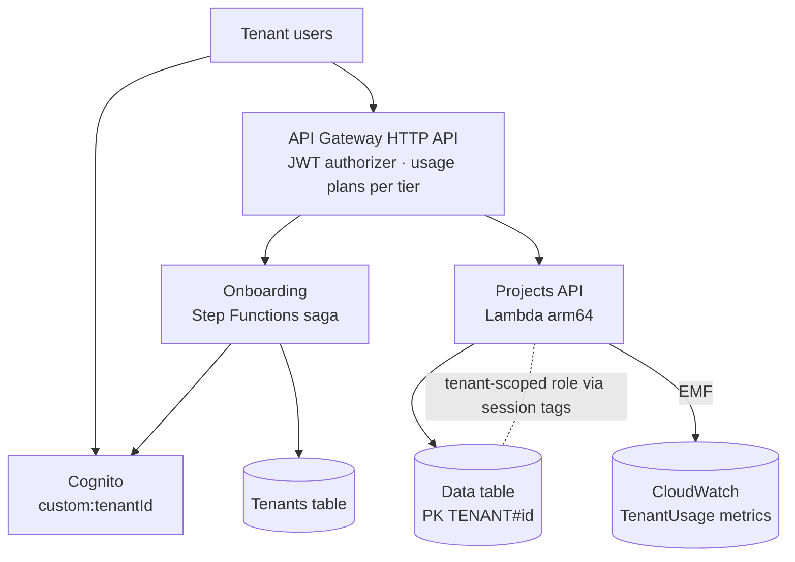

# Lab 33 · E2E: Multi-tenant serverless SaaS, spec to production

> **Outcome:** A working pooled-tenancy SaaS backend (onboarding saga, tenant-isolated CRUD API, tiered throttling, per-tenant metering) built almost entirely by Kiro under your direction — with the guardrails from earlier labs keeping it honest.

## Architecture



## What Kiro does vs. what you do

| Phase | Kiro features | You |
| --- | --- | --- |
| 0 · Ground | Steering ([`saas-architecture.md`](.kiro/steering/saas-architecture.md)), Lab 02 foundation files | Review tenancy rules |
| 1 · Specify | Specs per context: onboarding ([seed](.kiro/specs/tenant-onboarding/requirements.md)), projects API, metering | Approve requirements & design |
| 2 · Build infra | `iac-author` agent + AWS IaC MCP + cdk-nag (Labs 05, 16) | Review `cdk diff` |
| 3 · Build app | Spec task waves, subagents for tests (Lab 06), serverless-review skill (Lab 07) | Review PRs |
| 4 · Guard | Hooks: secret scan, block prod deploy, tests on stop (Lab 04) | — |
| 5 · Ship | Headless review in CI (Lab 10), cost estimate (Lab 18) | Deploy to dev, then prod |
| 6 · Operate | Incident investigator (Lab 19), cost sentinel bot (Lab 13) | On-call |

## Phase 0 — Workspace

```bash
mkdir acme-saas && cd acme-saas && git init
cp -r <repo>/labs/33-e2e-serverless-saas/.kiro .
cp -r <repo>/labs/04-agent-hooks/.kiro/hooks .kiro/ && cp -r <repo>/labs/04-agent-hooks/scripts .
cp -r <repo>/labs/05-custom-agents/.kiro/agents <repo>/labs/05-custom-agents/.kiro/prompts .kiro/
cp -r <repo>/labs/07-agent-skills/.kiro/skills .kiro/
mkdir -p .kiro/settings && cp <repo>/labs/09-mcp-servers-in-kiro/.kiro/settings/mcp.json .kiro/settings/
```

```text
> Generate product.md, tech.md and structure.md steering for a multi-tenant SaaS
  backend that follows saas-architecture.md. Monorepo: infra/ (CDK), services/<context>/.
```

## Phase 1 — Specs

```text
> Complete the tenant-onboarding spec: refine requirements.md, then design (Step Functions
  saga with compensation, Cognito admin user creation, idempotency) and tasks.
> Create a spec "projects-api": tenant-scoped CRUD for projects with pagination.
  Include a requirement that proves cross-tenant access is impossible.
> Create a spec "metering": EMF TenantUsage metrics and a daily per-tenant usage export to S3.
```

Gate: every requirement testable; isolation requirement has a negative test; design names DynamoDB keys and IAM conditions.

## Phase 2 — Infrastructure

```bash
kiro-cli --agent iac-author
```
```text
> Implement the infrastructure tasks of all three specs in infra/. One stack per context.
  Use dynamodb:LeadingKeys + session tags for tenant isolation. Apply cdk-nag. Synth until clean.
```

## Phase 3 — Application code

```text
> Run all remaining tasks in the onboarding spec, wave by wave.
> Run the projects-api tasks. Delegate test writing to the test-writer subagent.
> /serverless-review services/ and infra/
```

## Phase 4 — Prove isolation

```text
> Write an integration test suite that creates tenants A and B, and asserts every
  projects-api route returns 403/404 when A's token touches B's resources. Run it against dev.
```

## Phase 5 — Ship

1. Add Lab 10's PR-review workflow; open a PR per spec.
2. `/estimate-before-build` (Lab 08 power) — append the estimate at 50 tenants × 10k req/day.
3. Human deploys `infra/` to dev, then prod.

## Phase 6 — Operate

- Lab 19 `incident-investigator` against the dev stack with an injected fault.
- Lab 13 cost-sentinel bot on the account.

## Definition of done

- [ ] Specs complete, every task ticked, every requirement traced to a test
- [ ] cdk-nag clean; no unjustified suppressions
- [ ] Cross-tenant test suite green against dev
- [ ] Cost estimate in design.md; alarms on 5xx, throttles, DLQs
- [ ] CI review comments addressed

## Learn more

- [SaaS Lens — Well-Architected](https://docs.aws.amazon.com/wellarchitected/latest/saas-lens/saas-lens.html) · [Tenant isolation](https://docs.aws.amazon.com/whitepapers/latest/saas-architecture-fundamentals/tenant-isolation.html)
