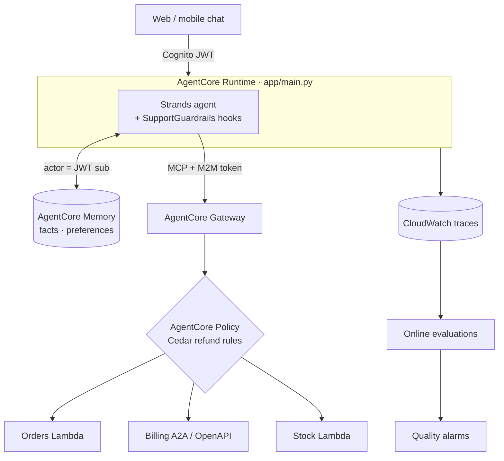

# Lab 34 · E2E: Production agentic customer support on AgentCore

> **Outcome:** A customer-support agent your security, compliance and support teams can all sign off on: authenticated callers, per-customer memory, tools behind a gateway, refund limits enforced by policy, every action traced and audited, quality scored continuously.

## Architecture



## Build plan (each phase reuses a lab)

| # | Phase | Lab | Done when |
| --- | --- | --- | --- |
| 1 | Spec the agent: intents, tools, refusal rules, eval cases | 03 | Requirements include safety criteria (IF … THEN refuse/escalate) |
| 2 | Tools as Lambdas behind Gateway (orders, stock, refunds) | 27 | `tools/list` shows all tools with good descriptions |
| 3 | Billing as an A2A agent or OpenAPI target | 24 / 27 | Support can answer invoice questions |
| 4 | Memory resource + strategies | 28 | Preferences recalled across sessions, isolated per actor |
| 5 | Inbound JWT + M2M credentials | 29 | Unauthenticated invoke rejected; actor id from token |
| 6 | Refund policy in LOG_ONLY → ENFORCE | 30 | Policy matrix passes |
| 7 | Compose and deploy [`app/main.py`](app/main.py) | 26 | `agentcore invoke` works with a bearer token |
| 8 | Offline evals gate + online evals + alarms | 25 / 32 | CI blocks regressions; alarm wired to on-call |

## Phase 1 — Spec with Kiro

```text
> Create a design-first spec "support-agent" for the architecture in this README.
  Requirements must cover: order status, refunds (with limits), invoices, preferences,
  prompt-injection resistance, escalation to humans, data retention, and latency (p95 < 6 s).
  Generate the eval cases (≥ 20) as part of the tasks.
```

## Phase 7 — Compose

[`app/main.py`](app/main.py) shows the composition:

- `caller_sub()` derives the **actor id from the validated inbound JWT** — the single most important line for privacy.
- One `MCPClient` to the gateway with a cached M2M token; `auto_reconnect=True`.
- `AgentCoreMemorySessionManager` keyed by `(actor, Runtime session)`.
- [`guardrails.py`](app/guardrails.py) from Lab 25 as defence in depth; **Policy** at the gateway is the authoritative control.
- `trace_attributes` add `session.id` / `enduser.id` to every span for observability and evals.

```bash
agentcore create --name AcmeSupportProd --template agent-python-strands
# copy app/ files into the project's runtime folder; set env vars (or Identity providers)
agentcore dev && agentcore deploy
printf '%s' "$JWT" | agentcore invoke --bearer-token - --prompt "Refund A-1002 please"
```

## Phase 8 — Quality gates

- CI: Lab 25's `run_evals.py` extended with the spec's eval cases; pass-rate threshold.
- Prod: Lab 32 online evaluation at 20 % sampling; alarms on helpfulness and goal success.

## Threat model checklist

- [ ] Prompt injection via order notes / emails → tools can't exceed policy; hooks flag; evals cover it
- [ ] Cross-customer data leakage → actor id from JWT; memory namespaces per actor; tools filter by caller
- [ ] Over-refunding → Cedar limits + role claims; LOG_ONLY trial recorded
- [ ] Secret exposure → Identity vault; no secrets in prompts, memory or logs
- [ ] Runaway cost → Runtime session limits, model choice per task, token metrics alarm

## Learn more

- [agentcore-samples end-to-end tutorials](https://github.com/awslabs/agentcore-samples)
