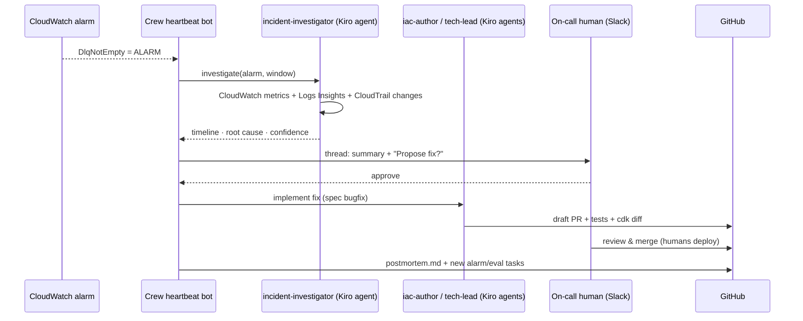

# Lab 35 · E2E: An AI SRE crew — detect, investigate, fix, learn

> **Outcome:** When an alarm fires, a Crew bot notices, an investigator agent builds the timeline and root cause, a fixer agent proposes a reviewed IaC/code change, a human approves in Slack, and the postmortem plus new eval/alarm coverage land automatically.

## Architecture

## Components

| Component | From lab | Role |
| --- | --- | --- |
| Heartbeat + Slack channel | 12 | Watches alarms every 5 min; silent unless red |
| Build-health / cost-sentinel bots | 13 | Adjacent signals (CI, spend spikes) |
| `incident-investigator` agent | 19 | Read-only, logs-capable role; writes postmortems |
| `iac-author`, `tech-lead`, `test-writer` | 05, 06, 16 | Bugfix spec → PR; never deploys |
| Hooks | 04 | Block destructive shell; secret scan; tests on stop |
| Strands incident swarm on Runtime | 23, 26 | Productized version for teams without Crew (e.g. triggered by EventBridge) |

## Phase 1 — Target system

Deploy Lab 16's notifications stack to a sandbox account (or use your own service in dev).

## Phase 2 — Crew wiring

1. Workspace = the service repo with `.kiro/agents/incident-investigator.json` (Lab 19) and Lab 05/06 agents.
2. Heartbeat (every 5 min):
   > Check CloudWatch alarms in eu-west-1 for stack NotificationsDevStack. If any is in ALARM and has no open incident thread, start the incident-investigator agent with the alarm name and the last 2 hours, post its summary to #incidents, and ask "Propose a fix?".
3. On approval in-thread:
   > Create a bugfix spec for the root cause, implement with tech-lead (tests first), open a draft PR with `cdk diff` in the description. Do not deploy.

## Phase 3 — Game day

Inject faults, one at a time, and score the crew:

| Fault | Expected root cause found |
| --- | --- |
| Remove the notifier's DynamoDB read permission | IAM change in CloudTrail at T-x |
| Set Lambda timeout to 1 s | Timeouts in logs, config change |
| Publish malformed events | Parse errors; propose schema validation |
| Throttle the function (reserved concurrency 0) | Throttles metric, config change |

Track: time-to-diagnosis, correctness, PR quality, false alarms.

## Phase 4 — Productize the swarm (optional)

Package Lab 23's `swarm_incident.py` with CloudWatch/CloudTrail MCP tools as an AgentCore Runtime agent; trigger it from an EventBridge rule on alarm state change via a small Lambda that calls `invoke_agent_runtime`; post results to Slack. Add Lab 32 evaluations on its outputs.

## Phase 5 — Learn

After each incident the crew opens tasks for: a missing alarm, a missing eval case, a runbook update in `docs/` (indexed as Crew knowledge), and a steering rule if a convention was violated.

## Guardrails

- Investigator role is read-only; fixer agents can't deploy (permissions + hooks).
- Every mutation path ends in a human-reviewed PR.
- Crew audit log retained; Slack approvals recorded.
- Consider the **AWS DevOps Agent** (frontier agent) for AWS-managed, always-on investigation alongside this crew.

## Learn more

- [Kiro Crew](https://github.com/kirodotdev/KiroCrew) · [CloudWatch MCP](https://awslabs.github.io/mcp/servers/cloudwatch-mcp-server/)
