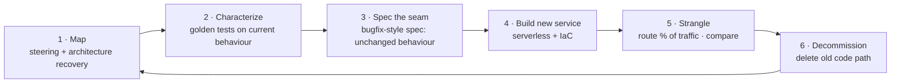

# Lab 36 · E2E: Legacy monolith to serverless, spec by spec

> **Outcome:** One capability (e.g. "order notifications") extracted from a monolith into a serverless service behind the same API — with characterization tests proving unchanged behaviour, a routing switch, and a repeatable playbook for the next capability.

## The playbook



## Phase 1 — Map the monolith

Pick any legacy app (Java/Spring, .NET, PHP, Rails…). In Kiro:

```text
> Generate steering docs for this repo. Then produce docs/architecture/recovered.md:
  modules, data stores, external calls, entry points, and a dependency graph (mermaid).
  Rank capabilities by extraction difficulty (coupling to shared tables, transactions).
```

Use subagents (Lab 06) to map modules in parallel; ask each for ≤ 20-line summaries.

## Phase 2 — Characterize behaviour

```text
> For the "notifications" capability, write characterization tests that pin current
  behaviour at the HTTP boundary (inputs → outputs, side effects in the DB/queue),
  including odd behaviour we may want to keep. Do not change production code.
```

These tests are your **unchanged behaviour** contract.

## Phase 3 — Spec the seam

Use a **bugfix-style spec** (Lab 03) because it has *current*, *expected* and *unchanged* behaviour sections:

```text
> Create a spec "extract-notifications": current behaviour (from the tests), expected
  behaviour (served by a new serverless service), unchanged behaviour (API contract,
  DB writes other modules depend on). Design: anti-corruption layer + events.
```

## Phase 4 — Build the new service

Reuse Labs 16–17: `iac-author` with AWS IaC MCP for infra, Serverless MCP for deploy/debug loop, serverless-review skill, hooks. The new service consumes events published by an adapter in the monolith (outbox pattern) rather than sharing tables.

## Phase 5 — Strangle

Route a percentage of traffic at the edge (API Gateway / ALB weighted routing or a feature flag), run both paths in **shadow mode** first and compare outputs:

```text
> Add a shadow-compare job: for 1% of requests, call both implementations and log diffs
  to CloudWatch. Write a Logs Insights query that reports mismatch rate by field.
```

Raise the percentage as mismatches hit zero.

## Phase 6 — Parallelize the grind

Repetitive, well-specified migration tasks (rename packages, replace a logging library, upgrade framework versions across 40 modules) are ideal for the **Kiro autonomous agent** (Lab 14): one issue per module with the template, label `kiro`, review PRs in batches.

## Definition of done (per capability)

- [ ] Characterization tests green against old and new paths
- [ ] Shadow mismatch rate 0 for 7 days at ≥ 10 % traffic
- [ ] 100 % traffic on new path; old code path deleted
- [ ] Runbook + ADR written; alarms and cost estimate in place

## Learn more

- [Strangler fig pattern](https://docs.aws.amazon.com/prescriptive-guidance/latest/cloud-design-patterns/strangler-fig.html) · [AWS Transform](https://aws.amazon.com/transform/) (agentic .NET / mainframe / VMware modernization, complementary to this playbook)
