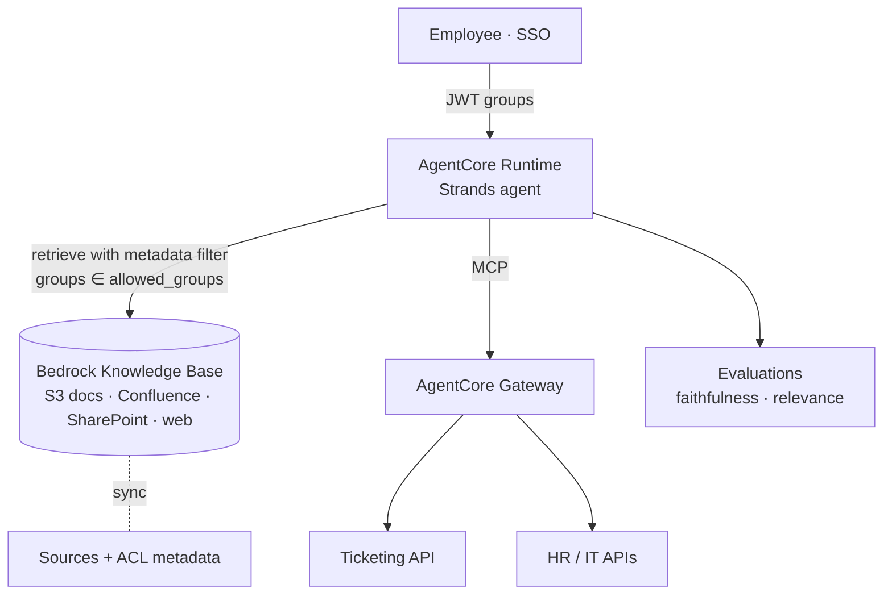

# Lab 37 · E2E: Enterprise knowledge assistant with permissions-aware RAG

> **Outcome:** An assistant that answers "how do we…" questions from internal sources with citations, respects document permissions per user, can take simple actions (open a ticket), and is measured for faithfulness.

## Architecture



## Phase 1 — Knowledge base

1. Put a document set in S3 with sidecar `*.metadata.json` files containing `allowed_groups` (e.g. `["all","engineering"]`).
2. Create a Bedrock Knowledge Base (console or Kiro + IaC MCP) with a vector store, chunking suited to your docs, and a data source per system.
3. Validate retrieval from Kiro using the **Bedrock KB Retrieval MCP server**:

```text
> Query the KB "acme-handbook" for "parental leave policy" — show top 5 chunks with sources and metadata.
```

## Phase 2 — The agent

```text
> Create a Strands agent in app/ with a tool search_handbook(query) that calls
  bedrock-agent-runtime retrieve() with a metadata filter allowed_groups listContains <group>
  for each of the caller's groups, returns chunks with source URIs, and a system prompt that
  REQUIRES citations and says "I don't know" when retrieval is empty. Package it for AgentCore Runtime.
```

Key design rules (put them in steering):

- Groups come from the **inbound JWT** (Lab 29), never from the prompt.
- The filter is applied in the tool, not left to the model.
- Answers without a citation are a test failure.

## Phase 3 — Actions

Expose `create_ticket` and `lookup_employee` through Gateway (Lab 27) with Policy (Lab 30) limiting who can do what.

## Phase 4 — Evaluate

- Offline (Lab 25): 50 question/answer pairs from SMEs; evaluators `FaithfulnessEvaluator`, `ResponseRelevanceEvaluator`, plus a deterministic "has citation" check; a **permissions test set** where users must *not* get answers from restricted docs.
- Online (Lab 32): sample production sessions for faithfulness and relevance; alarm on drops after each KB sync.

## Phase 5 — Operate

- KB sync schedule + a Crew bot (Lab 13) that reports sync failures and stale sources.
- Feedback button → low-rated answers become eval cases.

## Definition of done

- [ ] Restricted-doc test set: 0 leaks
- [ ] Faithfulness ≥ target on offline set; citations on 100 % of answers
- [ ] p95 latency within SLO; cost per question measured

## Learn more

- [Bedrock Knowledge Bases](https://docs.aws.amazon.com/bedrock/latest/userguide/knowledge-base.html) · [Metadata filtering](https://docs.aws.amazon.com/bedrock/latest/userguide/kb-test-config.html) · [Bedrock KB Retrieval MCP](https://awslabs.github.io/mcp/servers/bedrock-kb-retrieval-mcp-server/)
