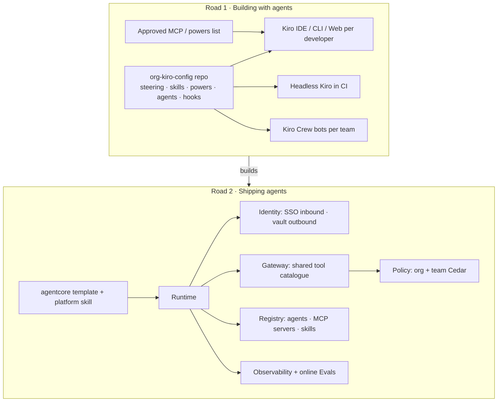

# Lab 38 · E2E: A governed agent platform for your organization

> **Outcome:** Two paved roads — one for **building with agents** (Kiro everywhere, consistently configured) and one for **shipping agents** (AgentCore with identity, policy, registry and evals by default) — plus the scorecard that proves they're working.

## Two paved roads

## Road 1 — Building with agents

### 1. An `org-kiro-config` repository

| Folder | Contents | Source lab |
| --- | --- | --- |
| `steering/` | Org-wide rules: security, licensing, data handling, API style | 02 |
| `skills/` | Code review, ADRs, threat modelling, serverless review, release notes | 07 |
| `powers/` | Approved powers (cost guard, internal platform APIs) | 08 |
| `agents/` | Reviewer, iac-author, release-manager, incident-investigator | 05, 19 |
| `hooks/` | Secret scan, destructive-command guard, PermissionRequest policies | 04 |
| `mcp/` | Approved MCP servers with pinned versions and read-only defaults | 09, 15 |

Distribute via a bootstrap script that syncs into `~/.kiro/` (global) and a template that seeds `.kiro/` in new repos. Kiro reads global + workspace scopes, workspace wins — teams can extend, not silently weaken (enforce critical rules with hooks, which run regardless).

### 2. Org sign-in and MCP identity

Use IAM Identity Center / your IdP for Kiro sign-in, and the MCP `identityProvider` + `oauth.mode: enterprise` settings so MCP servers authenticate with corporate SSO (Lab 09).

### 3. CI everywhere

Ship Lab 10's workflows as reusable workflows; every repo gets AI review and the nightly test doctor with the org `ci-reviewer` agent.

### 4. Crew for recurring work

Standard bot charters (Lab 13) offered as templates: intake, build-health, review, release-readiness, cost sentinel.

## Road 2 — Shipping agents

### 5. Template + platform skill

A skill `ship-an-agent` that tells Kiro exactly how to scaffold with `agentcore create`, where identity/memory/gateway config goes, mandatory eval cases, and the review checklist. Developers say *"ship this agent"* and get the paved road.

### 6. Shared gateway and policy layers

- A **shared gateway** per domain fronting approved internal APIs (Lab 27).
- **Policy engines** with org-wide forbids (e.g. no PII export tools for non-approved agents) plus team policies (Lab 30).
- **Registry** entries for every agent, MCP server and skill, with owners — discovery and governance in one place.

### 7. Identity and data

Inbound SSO on every runtime; outbound via Identity vault only; memory actor ids from tokens (Labs 28–29).

### 8. Quality and cost

Offline eval gate in CI (Lab 25), online evaluation per agent (Lab 32), budgets and per-agent cost dashboards (Lab 18).

## Scorecard

| Metric | Target |
| --- | --- |
| Repos with org Kiro config | > 90 % |
| PRs with AI review comment | > 95 % |
| Production agents with inbound auth + policy + online evals | 100 % |
| Agents registered with an owner | 100 % |
| Policy LOG_ONLY → ENFORCE lead time | < 2 weeks |
| Mean time to diagnosis (incident crew) | ↓ 50 % |
| Cost per agent session / per PR review | tracked & trending down |

## Capstone exercise

Pick one team. Roll out Road 1 to their repos, take one of their agent ideas down Road 2, and present the scorecard after two weeks.

## Learn more

- [Kiro for enterprise](https://kiro.dev/enterprise/) · [AgentCore docs](https://docs.aws.amazon.com/bedrock-agentcore/latest/devguide/what-is-bedrock-agentcore.html) · [Architecture patterns](../../docs/architecture-patterns.md)
