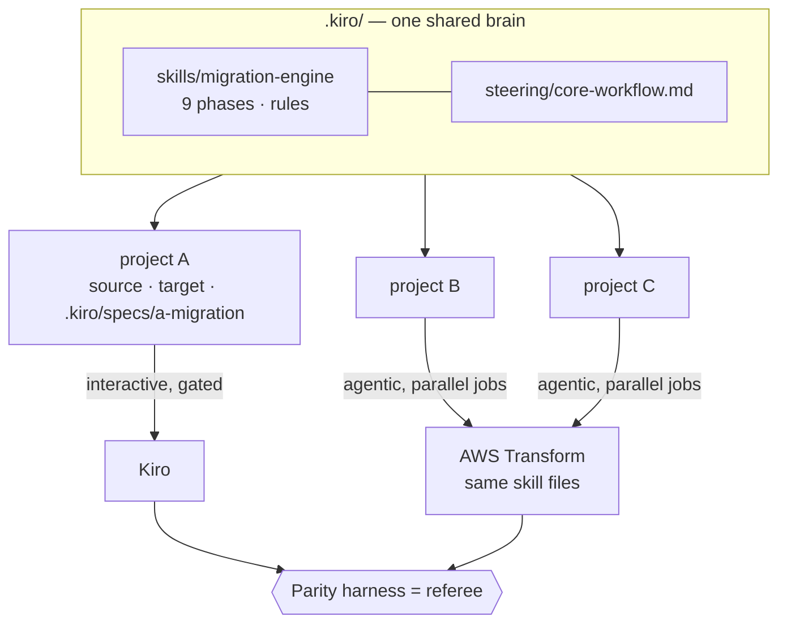

# Lab 39 · Field pattern: a skill-driven, parity-verified migration engine

> **Outcome:** A reusable "shared brain" (a skill plus steering) that runs any language or framework migration as nine gated phases, with a parity harness that proves the port behaves like the original. The harness ships with a self-test.

> **From the field:** [Build a repeatable PHP-to-Java migration engine with Kiro](https://aws.amazon.com/blogs/machine-learning/build-a-repeatable-php-to-java-migration-engine-with-kiro/) (AWS ML Blog, Oct 2026; sample: [aws-samples/sample-php-to-java-migration](https://github.com/aws-samples/sample-php-to-java-migration)). This lab generalizes that pattern beyond PHP→Java.

## Scenario

A ported app can compile cleanly and still behave differently. Business rules hide in ORM traits, `$hidden` lists and XML mappings. The blog's answer has four principles:

1. **The legacy application is the specification.**
2. **Discovery before translation.** A mechanical scanner builds a manifest, and ambiguity is flagged rather than guessed.
3. **Build the judge before the code.** The parity harness exists before the first line of target code, and it must catch injected breakage.
4. **Fix the loop, not the code.** Amend the rulebook and regenerate instead of hand-patching.



## How it works

| Piece | File |
| --- | --- |
| Methodology (phases, gates, rules) | [`.kiro/skills/migration-engine/SKILL.md`](.kiro/skills/migration-engine/SKILL.md) |
| Rulebook template with starter Laravel → Spring Boot rules | [`references/rulebook-template.md`](.kiro/skills/migration-engine/references/rulebook-template.md) |
| Framework detection and scanner guidance | [`references/frameworks.md`](.kiro/skills/migration-engine/references/frameworks.md) |
| Always-on principles | [`.kiro/steering/core-workflow.md`](.kiro/steering/core-workflow.md) |
| Referee | [`parity/parity_harness.py`](parity/parity_harness.py) and [`cases.example.json`](parity/cases.example.json) |

Phase 0 runs discovery. Phases 1–3 are where human judgment goes in: the harness, the rulebook and the stress test. Phases 4–8 are mostly self-driving loops refereed by the harness.

## Step 1 — Prove the referee

```bash
python3 labs/39-skill-driven-migration-engine/parity/parity_harness.py --self-test
```

The run passes on identical behaviour while ignoring volatile fields. It fails on a changed value, a leaked extra field and a status change. A harness that misses injected breakage isn't trusted.

## Step 2 — Open the shared brain in Kiro

Create a workspace with the `.kiro/` folder from this lab at the root and one folder per project (`project-a/source`, `project-a/target`). Then:

```text
> Migrate project-a (Laravel) to Spring Boot 3 on Java 21.
```

The skill activates from its description. Kiro then:

1. runs discovery and stops so you can resolve the manifest's `flags[]`;
2. creates `.kiro/specs/project-a-migration/`;
3. builds the harness, which must pass `--self-test` and replay against the running legacy app;
4. drafts `RULEBOOK.md` and `GAP_INVENTORY.md` for approval.

## Step 3 — Record cases from the legacy app

```text
> Generate parity cases for every public route in source/routes/*.php (happy path,
  validation error, not-found, hidden-field serialization). Save to parity/cases.json.
```

## Step 4 — Run the loop

```text
> Run phases 4–7. After each batch, run the harness. For any mismatch that repeats
  across files, propose a RULEBOOK rule, wait for approval, regenerate.
```

## Step 5 — Scale out

When the methodology is stable on one app, the blog points AWS Transform, which integrates natively with Kiro, at the **same skill files** to migrate many apps as parallel agentic jobs. A rulebook fix made in either tool improves the other.

## Adapting the pattern

None of this is specific to PHP or Java. Use it wherever the old system is the only complete specification:

- Python 2 → 3
- .NET Framework → .NET 8
- Struts → Spring
- AngularJS → React
- Stored procedures → services (pairs with [Lab 36](../36-e2e-legacy-modernization/README.md))

## Verify

- [ ] `--self-test` passes
- [ ] Every manifest flag was resolved by a human
- [ ] Final harness report: every case at parity or listed in `GAP_INVENTORY.md`

## Learn more

- [Kiro skills](https://kiro.dev/docs/skills/) · [Kiro steering](https://kiro.dev/docs/steering/) · [AWS Transform](https://aws.amazon.com/transform/)
