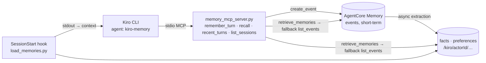

# Lab 40 · Field pattern: long-term memory for Kiro CLI with AgentCore Memory

> **Outcome:** Close Kiro CLI on Monday, open it on Thursday, and ask "what did we decide about the auth service?" Kiro recalls the decision. Preferences you mentioned once are loaded automatically.

> **From the field:** [Extending conversational memory in Kiro CLI using Amazon Bedrock AgentCore Memory](https://aws.amazon.com/blogs/machine-learning/extending-conversational-memory-in-kiro-cli-using-amazon-bedrock-agentcore-memory/) (AWS ML Blog, May 2026; sample: [aws-samples/sample-amazon-bedrock-agentcore-memory-mcp-server](https://github.com/aws-samples/sample-amazon-bedrock-agentcore-memory-mcp-server)). This lab builds a compact version of the same idea, written for the MCP 2.x Python SDK.

## Scenario

You work on a large codebase for weeks, but each new session starts from zero: the same context, the same preferences, the same "we already decided that." Kiro CLI V3 can learn some context locally. This pattern adds **durable, queryable, team-shareable** memory that you own, stored in AgentCore Memory.



## How it works

| Piece | Role |
| --- | --- |
| [`server/memory_mcp_server.py`](server/memory_mcp_server.py) | MCP server (`mcp` 2.x `MCPServer`). `recall` does a **two-stage retrieval**: semantic long-term records first, then a scan of raw events, so a conversation from five minutes ago is findable before extraction finishes |
| [`server/setup_memory.py`](server/setup_memory.py) | Creates the memory with semantic and preference strategies |
| [`.kiro/agents/kiro-memory.json`](.kiro/agents/kiro-memory.json) | Default agent. Its prompt says when to recall and when to remember, and it never stores secrets. Memory tools are pre-allowed |
| [`hooks/load_memories.py`](hooks/load_memories.py) | `SessionStart` hook that prints top preferences and facts into context. It fails open if memory is unreachable |
| Actor id | `$USER` for personal memory, or `KIRO_MEMORY_ACTOR=<project>` for a shared team memory (the blog's "project id" option) |

## Step 1 — Create the memory

```bash
cd labs/40-kiro-cli-persistent-memory/server
python3 -m venv .venv && source .venv/bin/activate && pip install -r requirements.txt
python setup_memory.py            # → export MEMORY_ID=...
```

## Step 2 — Install the server, hook and agent

```bash
mkdir -p ~/.kiro/mcp/kiro-memory ~/.kiro/agents
cp memory_mcp_server.py ../hooks/load_memories.py ~/.kiro/mcp/kiro-memory/
cp ../.kiro/agents/kiro-memory.json ~/.kiro/agents/
pip install --user -r requirements.txt          # so python3 can import mcp + bedrock-agentcore
kiro-cli settings chat.defaultAgent kiro-memory  # make it the default
export MEMORY_ID=...                             # add to your shell profile
```

## Step 3 — Try it

```bash
kiro-cli
```
```text
> /mcp                                    # agentcore-memory connected, 5 tools
> We're standardising on pnpm and Vitest; never suggest Jest. Remember that.
> /quit
```

Start a new session later:

```text
> Add tests for src/date.ts                 # should use Vitest without being told
> What have we decided about our test tooling?
```

## Step 4 — Team memory

Set `KIRO_MEMORY_ACTOR=payments-service` for everyone on the team. Decisions recalled by one developer's Kiro are now available to the whole team's Kiro. Pair this with [Lab 12](../12-kiro-crew-workspace/README.md): Crew agents run `kiro-cli`, so they inherit the same memory.

## Guardrails

- The agent prompt forbids storing secrets. Add the Lab 04 secret-scan hook as a `PreToolUse` matcher on `@agentcore-memory/remember_turn` to enforce it.
- Recalled memory can be stale. The prompt tells the agent to verify against the code.
- Set retention with `event_expiry_days`, and delete per actor on offboarding.

## Clean up

```bash
python -c "from bedrock_agentcore.memory import MemoryClient; import os; MemoryClient(region_name='us-east-1').delete_memory_and_wait(os.environ['MEMORY_ID'])"
rm -rf ~/.kiro/mcp/kiro-memory ~/.kiro/agents/kiro-memory.json
```

## Learn more

- [AgentCore Memory](https://docs.aws.amazon.com/bedrock-agentcore/latest/devguide/memory.html) · [Kiro CLI](https://kiro.dev/cli/) · [Lab 28 — Memory for your own agents](../28-agentcore-memory/README.md)
