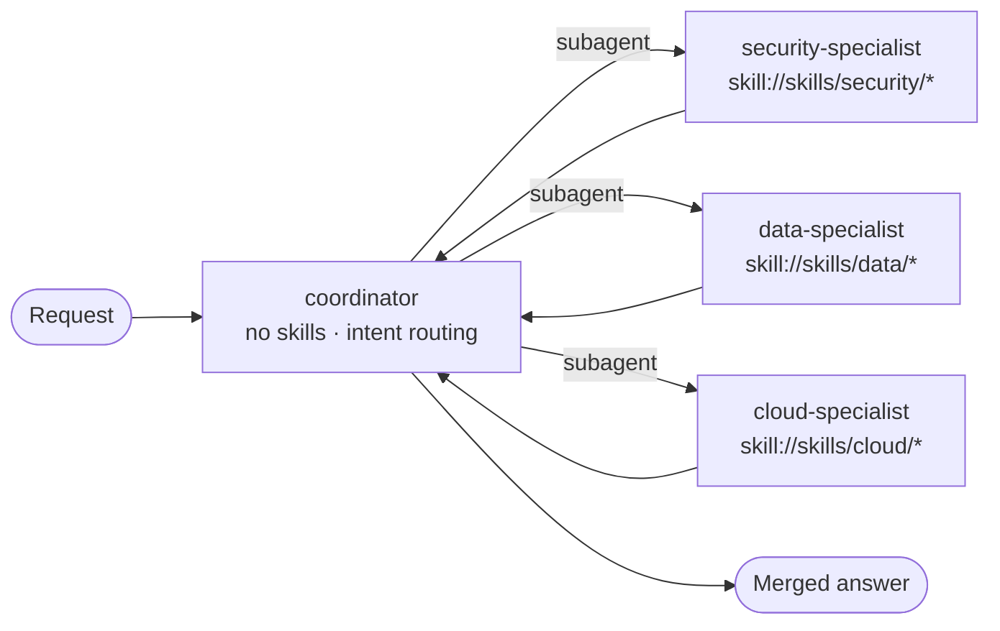

# Lab 41 · Field pattern: domain skills at scale — coordinator, specialists, A/B evals

> **Outcome:** A coordinator agent plus three domain specialists (security, data, cloud), each loading only its own skills. The same architecture runs in Kiro CLI (agent JSON) and in Strands (agents-as-tools with the `AgentSkills` plugin), and a blind A/B judge measures whether the skills improve answers.

> **From the field:** [Improving HCLS AI reasoning with open-source agent skills](https://aws.amazon.com/blogs/machine-learning/improving-hcls-ai-reasoning-with-open-source-agent-skills/) (AWS ML Blog, Sep 2026; repo linked from the post: [aws-samples/sample-hcls-agent-skills](https://github.com/aws-samples/sample-hcls-agent-skills)). The post covers 38 skills across 11 healthcare and life-sciences domains. With skills, agents won **70–86 %** of head-to-head comparisons against the same agents without them, and the biggest effect was on critical thinking. Loading all 38 skills costs about **80K tokens**. A skill-free coordinator in front of 8 specialists cuts that to about **15K per specialist**.

## Scenario

Models know facts but often misapply domain *procedures*. They cite the right framework and then skip a threshold or apply it in the wrong order. Skills encode the procedure, but many skills in one context compete for attention. The fix is **routing plus scoped loading**.



## How it works

| Layer | Kiro CLI | Strands |
| --- | --- | --- |
| Coordinator | [`coordinator.json`](.kiro/agents/coordinator.json): `subagent` tool, allowed only to call the three specialists | Agent with `specialist.as_tool()` × 3 |
| Specialist | [`security-specialist.json`](.kiro/agents/security-specialist.json): `"resources": ["skill://skills/security/*/SKILL.md"]` | `Agent(plugins=[AgentSkills(skills="./skills/security/")])` |
| Skills | [`threat-model`](skills/security/threat-model/SKILL.md), [`sql-review`](skills/data/sql-review/SKILL.md), [`serverless-review`](skills/cloud/serverless-review/SKILL.md) | same folders |

> **SDK note (verified against `strands-agents` 1.66):** skills load through the `AgentSkills` **plugin**: `from strands import Agent, AgentSkills` and then `Agent(plugins=[AgentSkills(...)])`. Some published snippets show `strands.skills` or `Agent(skills=...)`. Those paths don't exist in this version.

## Step 1 — Kiro CLI

```bash
cp -r labs/41-domain-skills-at-scale/{.kiro,skills} ~/kiro-quickstart/
cd ~/kiro-quickstart && kiro-cli --agent coordinator
```
```text
> We expose an SQS-triggered Lambda that writes orders to Aurora via a public webhook.
  What are the threats, and is this query OK: SELECT * FROM orders WHERE customer_id NOT IN (...)?
```

Watch the coordinator fan out to the security and data specialists in parallel. Each specialist names the skill it applied.

## Step 2 — Strands

```bash
cd labs/41-domain-skills-at-scale && pip install -r requirements.txt
python strands_specialists.py
```

([`strands_specialists.py`](strands_specialists.py)). To host it, deploy as an AgentCore Runtime agent ([Lab 26](../26-agentcore-runtime/README.md)). The post also covers configuring skills at the **AgentCore harness** environment level.

## Step 3 — Prove the skills help

```bash
python skills_ab_eval.py prompts.txt
```

[`skills_ab_eval.py`](skills_ab_eval.py) answers each prompt with and without skills. A judge then compares the two answers blind, in randomized order, and the script reports the skills win rate. Grow `prompts.txt` with real questions from your domain, and keep the prompts that skills *don't* win. Those show where a skill needs work.

## Step 4 — Write your domain's skills

Follow the post's split between two kinds of skill:

- **Reasoning skills** encode the method and the decision frameworks.
- **Pipeline skills** encode exact commands, validated parameters and templates.

Keep each `SKILL.md` auditable (a human can read every criterion) and versioned. When policy changes, edit the text file. Nothing needs retraining.

## Learn more

- [Agent Skills open standard](https://agentskills.io/) · [Kiro skills](https://kiro.dev/docs/skills/) · [Lab 07 — Agent skills basics](../07-agent-skills/README.md)
