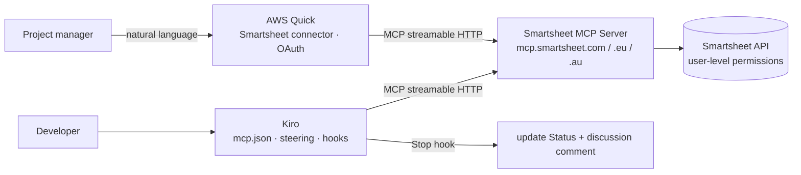

# Lab 42 · Field pattern: project plans in the dev loop with a work-management MCP

> **Outcome:** Kiro reads the sprint sheet, generates a spec from roadmap rows, and updates the row when your fix is committed. It leaves a discussion comment so the plan always explains itself.

> **From the field:** [Workflow context for AI agents with Smartsheet MCP on AWS](https://aws.amazon.com/blogs/machine-learning/workflow-context-for-ai-agents-with-smartsheet-mcp-on-aws/) (AWS ML Blog, Oct 2026). Smartsheet's GA remote MCP server exposes 40+ tools over streamable HTTP. The post shows two audiences: **AWS Quick** for project managers through a pre-built connector, and **Kiro** for developers through a config file and a token. The same pattern works for Jira, Linear, Asana or GitHub Projects MCP servers.

## Scenario

Developers context-switch to the project tool to find their next task, then forget to update it. Project managers chase status. Putting the plan into the agent's context closes the loop in both directions.



## How it works

| Piece | File |
| --- | --- |
| Remote MCP server with read tools auto-approved and destructive tools disabled | [`.kiro/settings/mcp.json`](.kiro/settings/mcp.json) |
| Conventions: sheet name, columns, branch naming, write limits | [`.kiro/steering/task-tracking.md`](.kiro/steering/task-tracking.md) |
| `SessionStart` briefing, plus a `Stop` agent hook that syncs status and comments | [`.kiro/hooks/task-sync.json`](.kiro/hooks/task-sync.json) |

From the post's governance notes:

- Agents see only what the authenticated user can see.
- Admins can switch AI features off org-wide and restrict write tools by user group.
- You allow-list traffic by FQDN.
- The server doesn't store prompts.

Use OAuth instead of a personal access token in production.

## Step 1 — Connect

```bash
export SMARTSHEET_API_TOKEN=...            # Personal Access Token (Business/Enterprise plan)
cp -r labs/42-work-management-mcp-in-the-dev-loop/.kiro ~/kiro-quickstart/
```

In Kiro, run `/mcp`. The `smartsheet` server should show as connected. You can also install it as a **power** (Lab 08) so the tools load only when you talk about tasks.

## Step 2 — Pull work into the IDE

```text
> Show my open backend tasks in the sprint sheet, highest priority first.
> Check the Backend API sheet for open bugs and generate a prioritized fix list.
```

## Step 3 — Roadmap rows → specs

```text
> Pull the Q3 Roadmap sheet and create a spec for each feature marked In Progress.
  Put the row's Task ID in the spec title and link the row.
```

## Step 4 — Status that updates itself

```bash
git switch -c TASK-123-fix-pagination
```
```text
> Fix the pagination bug in GET /todos, add a test, and commit referencing TASK-123.
```

When the agent stops, the `Stop` hook finds the commit, sets the row to Complete and adds a discussion comment. That comment is the audit trail.

## More workflows from the post

- **Risk sweep:** find rows marked Blocked or At Risk, annotate them, and summarize for the team.
- **Drift reconciliation:** compare the issue tracker with the plan and fix rows that disagree.
- **Portfolio briefing:** aggregate reports and dashboards into one status note.
- **Every write gets a comment:** a human-readable audit trail inside the plan.

## Learn more

- [Kiro MCP](https://kiro.dev/docs/mcp/) · [Kiro hooks](https://kiro.dev/docs/hooks/)
